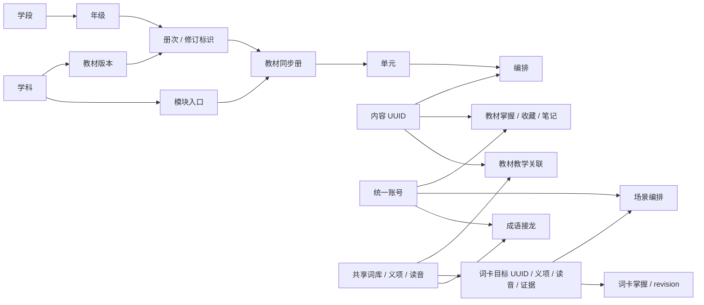

# 乐学堂 · 家庭学习系统

用于辅导孩子学习的 Django 单体项目。`primary-system/` 是主项目，其他目录保留为资料、原型或研究。

设计基线见 [系统设计与开发基线](docs/system-design.md)。当前明确区分两条管线：**教材按册次、单元和内容编排；学科功能拥有独立页面、数据模型和学习流程。** 旧专题学习册已退出，科学、地理、历史等后续按学科逐个开发，不放回通用专题阅读器。

`references/` 新资料的 [基础数据与中文教学规划](docs/foundation-data-plan.md) 已完成，另有 [文件与内容核验](docs/reference-audit-2026-11-02.md)。当前保留六包中的七类资料，南非教材及算术事实已按用户要求删除，提供中文界面、可靠短名称和字段对照及独立浏览入口；长篇英文释义仍保留原文并标明中文待补。字词资料已整合到[查字查词](http://127.0.0.1:8012/dictionary/)，见[统一展示实施](docs/dictionary-unification-implementation.md)；历史[全量资料库实施](docs/reference-library-implementation.md)与[独立验收](docs/reference-library-acceptance.md)。当前退役范围和维护流程见[退役报告](docs/reference-library-removal-implementation.md)。

## 当前功能

- 教材目录：语文、数学、英语三个模块，4 本教材同步册、394 条内容（包括单元指南与复习资料）；按年级、学科、教材筛选。
- 统一账号、个人年级偏好；教材内容的掌握、收藏、私人笔记及并发修改冲突提示。
- 教材阅读支持纯文本、类型化图示块、互动图示、点读、连读及打印；浏览器语音按朗读结束推进，实际发音依赖设备。
- 共享词库：字词、义项、读音、原始证据、人工修订、版本化导入、审核、启用与回退；统一查字查词页面。
- 成语接龙：游客／登录账号隔离、服务端计分、提示、陪练、终局；词池来自当前生效词库，后台可禁用词条。
- 场景单词：独立 `words` 应用，46 个生活场景、577 个词位；稳定词卡目标固定义项、读音和版本证据，可在多个场景复用。教学标注留在词位上，支持点读、连读和词卡掌握。
- 查字查词统一查询：已发布词义、CC-CEDICT汉英参考、CMU美式读音、汉字属性和笔顺在同一页展示；正式词条详情也显示同形补充资料，来源和版本分别保留。
- 资料探索：查字查词、古诗文、国家地区、元素及HYG星表五个入口，不自动生成学习记录。
- Nova 后台分组管理课程、词库、玩法、学习记录与账号；普通学习账号不具有管理权限。

以上内容规模是当前资料范围，不表示所有内容均已完成教学审校。场景词已支持多场景／多义项引用；跨学科学习总览及新的学科教学玩法尚待实现，见设计基线的后续顺序。

## 本地运行

Python 3.12+；依赖版本固定于 `requirements.txt`。运行不需要 Node，首次导出现有 `primary/` 资料需要 Node。

```sh
cd primary-system
python3.12 bootstrap.py
PRIMARY_DEBUG=1 .venv/bin/python manage.py runserver 127.0.0.1:8012
```

已有环境先用 SQLite backup API 保存新的恢复点，再执行 `.venv/bin/python manage.py migrate`。2026-11-02 的升级包括专题退出与场景学习目标迁移：词位原主键和标注保留，旧进度逐条映射为词卡掌握，不按拼写合并。详情见 [场景学习对象与迁移](docs/scenario-learning.md)；需要保留旧专题阅读的副本不可直接升级。

- [学习广场](http://127.0.0.1:8012/)
- [查字查词](http://127.0.0.1:8012/dictionary/)
- [资料探索](http://127.0.0.1:8012/references/)
- [场景单词](http://127.0.0.1:8012/words/)
- [成语接龙](http://127.0.0.1:8012/chain/)
- [管理后台](http://127.0.0.1:8012/admin/)

首次初始化会暂存教材英语与场景英语词库，不自动切换来源版本。启用词库、导入场景词位、填充接龙词池、创建账号及隔离数据库验证，详见 [本地开发与数据准备](docs/local-development.md)。初始化不会创建默认密码。

默认数据库为 `db.sqlite3`，用 `PRIMARY_SQLITE_PATH` 可指定独立文件。会话和 CSRF Cookie 使用 `primary_` 前缀；本地随机密钥在权限 0600 的 `.local-secret`。数据库、密钥、虚拟环境和快照不进 Git。

## 数据模型与扩展



教材内容使用稳定 UUID。复用同一内容时共享其学习状态；需要不同教材或年份各自记录时，应创建不同内容。学科专属数据、实验步骤、游戏回合等放在各自领域模型，不能堆进教材 `sections`。

`sections` 支持 v1 纯文本和 v2 `text/figure` 块，原始领域字段保留于只读 `source_payload`。目录跨学科／跨模块约束由模型及表单校验，直接 ORM 写入须调用 `full_clean()`；批量更新会绕过模型校验。

## 内容与词库维护

```sh
node scripts/export_primary.cjs
.venv/bin/python manage.py import_primary data/primary.json --dry-run
.venv/bin/python manage.py import_primary data/primary.json --publish
```

导出器只运行仓库固定的受信任静态数据模块；导入器仅接收教材模块，其他部分记录为跳过。导入在事务内执行，支持预演、重复运行和人工修改保护，不删除缺失记录、不覆盖受保护内容、不清空教材进度。`--publish` 只决定新增记录的发布状态。

词库按来源版本维护，教材通过稳定 UUID 与来源快照关联：词库原文、人工修订、教学简释分开保存；同形词不能只凭拼写合并；版本变化不能静默改绑教材词义。内部来源启用与词典页面展示审核是不同状态。

- [词库模型与分期设计](docs/lexicon-foundation.md)
- [词库导入、启用、回退与维护](docs/lexicon-operations.md)
- [首批词典来源与缺失范围](docs/public-dictionaries.md)

图示副本已在本项目内；它们目前与研究目录存在差异，不能无审查覆盖同步。`speech.js` 由本项目独立维护。

## 接口与记录

| 接口 | 用途 |
|---|---|
| `GET /api/v1/catalog/` | 目录与已发布教材册 |
| `GET /api/v1/items/` | 教材内容摘要，支持 `collection/grade/subject/edition/q` |
| `GET /api/v1/items/<uuid>/` | 已发布教材内容 |
| `GET /api/v1/lexicon/` | 可展示词条，支持词形／拼音查询及语言／类型筛选 |
| `GET /api/v1/lexicon/<uuid>/` | 独立义项、读音、来源与版本 |
| `GET /api/v1/items/<uuid>/lexicon/` | 教材的教学词义关联 |
| `GET/POST /api/v1/me/progress/<uuid>/` | 当前账号教材学习记录 |
| `/words/api/state/`、`/words/api/learn/` | schema v3：场景编排、显式中文呈现与目标词卡掌握 |
| `/chain/api/state/`、`play/`、`hint/`、`restart/` | 接龙状态与动作 |

教材进度 POST 使用完整 JSON：

```json
{"revision": 0, "status": "learning", "bookmarked": true, "note": "今天的新理解"}
```

状态为 `new/learning/mastered`，笔记最多 4,000 字。进度必须归属当前登录用户，写入要求 CSRF；过期 revision 返回 409，需要重新读取后由用户决定保存。个人页面禁止缓存。

场景单词写入使用目标 UUID，布局词位 ID 不作为学习身份：

```json
{"schema_version": 3, "target_id": "目标UUID", "revision": 0, "learned": true, "chinese_version_id": null, "presentation_revision": 0}
```

同目标跨场景共享词卡掌握，不扩张为同拼写所有义项或其他能力。过期 revision 和旧 word_id 请求返回 409，必须刷新；游客和账号不自动合并。变义、删词、来源停用或人工修订变化时保留目标与进度，暂停显示对应释义，不自动换义。详细约束、导入选择和备份见 [场景学习对象](docs/scenario-learning.md)。

中文翻译／教学解释独立版本化，目标及教材关联显式选版；同义升级保留学习身份，改义须新身份且不转移旧进度。来源或中文失效会暂停正文与依赖标注。当前首批39个固定绑定（26场景目标＋13教材关联）已复用来源中文并经AI核对采用，剩余844引用仍是未经本批核对的legacy呈现；不代表全库或所有memo质量通过。见[覆盖清点](docs/chinese-coverage-inventory.md)及[批次报告](docs/chinese-batch-01-implementation.md)。

教材有关联词义时，保存须携带GET返回的presentation及update_learning；仅改收藏／笔记不重写学习依据。旧mastered依据未知时保留原值并显示待确认，不计入当前已确认掌握。维护命令、版本链规则、迁移保护和实测见 [中文义项实施报告](docs/chinese-sense-implementation.md)。

## 验证与数据库配置

```sh
.venv/bin/python manage.py test --noinput
.venv/bin/python manage.py check
.venv/bin/python manage.py makemigrations --check --dry-run
node --test scripts/test_frontend.cjs
```

最新实测见 [VALIDATION.md](VALIDATION.md)，较早章节只代表当时状态。

PostgreSQL 使用 `requirements-postgres.txt`，设置 `PRIMARY_DB_ENGINE=postgres` 及 `PRIMARY_DB_NAME/USER/HOST/PORT/PASSWORD`；切换配置不会自动搬运 SQLite 数据。本机默认 SQLite；`bootstrap.py --database` 只支持 SQLite 初始化。

本次范围为本地开发。生产配置需启用 `PRIMARY_PRODUCTION=1`、关闭 DEBUG，并设置独立密钥、主机与 CSRF 域名，使用正式应用服务和 HTTPS 代理。开发服务器仅监听回环地址。
