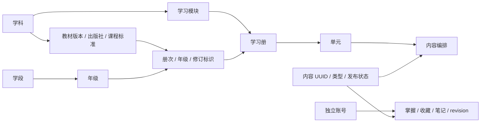

# 乐学堂 · 统一学习系统基座

把 `primary` 的多个离线学习页面纳入同一个账号、课程目录、数据库和后台。本轮按**每个人独立账号、独立学习记录**实现，不引入家长绑定或班级权限。

技术栈沿用 `idiom-chain`：Python 3.12+、Django 6.1.2、Nova Admin、Nova 滑块验证码、服务端模板。默认独立 SQLite，提供 PostgreSQL 配置与真实数据库回归测试。运行时不需要 Node；迁移现有 JavaScript 数据时需要 Node。

共享词库已有独立 `lexicon` 数据层、Nova 后台和版本化导入流程，868 张现有词卡已建立关联。新增统一查字查词页面，首批公开来源为 Unicode Unihan 18.0.0 的 9,810 个汉字和 Open English Wordnet 2025 的 861 个英文词条／3,700 个义项。已有 30,895 条成语快照仍仅暂存。来源筛选、范围和操作见 [首批公开词库与查词页](docs/public-dictionaries.md)，底层维护见 [词库维护手册](docs/lexicon-operations.md)。

## 现在可以使用

- 统一学习广场：按年级、学科、教材筛选；进入学习册、单元和内容详情。
- 12 个学习模块目录；11 个内容模块导入为 12 本学习册、1,219 条内容（含单元指南和复习资料，不等同于 1,219 个知识点）。英语上下册分别管理。
- 账号登录、退出、修改密码、显示名称与年级偏好；每条内容的掌握状态、收藏和私人笔记持久化到数据库。
- Nova 后台管理学段、年级、学科、教材版本、册次、模块、学习册、单元和内容编排。
- 内容草稿／发布／归档、学习册发布开关、模块入口开关。下架内容在前台、接口、个人列表中统一隐藏；已有进度保留。
- `内容编辑`权限组只管理课程内容；账号创建和权限调整由超级管理员操作。个人记录在后台仅对超级管理员只读展示。
- 幂等导入、预演回滚、来源留档、人工修改保护；进度写入有 CSRF 和 revision 冲突校验。
- 词库来源与固定版本、原始记录及字段证据、词条／义项／读音、教学关联和同形词核对；人工修订与来源原文分开保存。
- 词库导入预演、分批续跑、版本差异与原子启用／回退；独立的词库编辑与来源发布权限。词典接口只返回来源与内容均已审核的数据。
- 统一查字查词：汉字／拼音／英文词形查询，独立义项、部首笔画、简繁关联、来源例句、许可与版本展示；相关教学卡片单独呈现。

**本轮边界**：内容已进入数据库并提供通用文字阅读。原 `primary` 的 SVG 课文图示、点读、数学／科学互动演示、打印版式，尚未迁入新阅读器；成语接龙仅登记入口，账号对局、计分与陪练未接入。已有成语词典未公开发布。首批汉字为通用字集属性和英文简释，英文为教材词形范围内的英英词典，尚无完整中文词典译文、全部读音或音频；缺失数据明确提示。游客对局与浏览器本地进度未迁移，两个旧目录照常保留。

## 前台界面与屏幕适配

- 内容区随屏幕扩展，最大宽度 2,240px；宽屏首页展示 6 列课程入口、4 列学习册，平板和手机逐级减少列数。窄手机使用大图标配文字的横向课程卡片。
- 基础字号 18px，学习正文 20–21px，词典释义 21–22px；使用系统中文字体，增加行距、文字对比度和段落留白。
- 课程图标最大 88px，书架图标 60px；导航同时显示图标与文字，并标出当前栏目。不同学科采用柔和的独立配色。
- 主要按钮与输入框高度约 54–60px；保留键盘焦点、跳到正文和减少动态效果支持。阅读目录与记录面板在桌面显示为侧栏，小屏改为上下排列。

样式由 `static/platform.css` 与 `static/dictionary.css` 统一维护，不依赖在线字体或新增前端框架。屏幕与回归检查结果见 [VALIDATION.md](VALIDATION.md)。

## 本地使用

在仓库根目录执行：

```sh
cd primary-system
python3.12 bootstrap.py
.venv/bin/python manage.py createsuperuser
PRIMARY_DEBUG=1 .venv/bin/python manage.py runserver 127.0.0.1:8012
```

首次初始化会建立 `.venv`、安装依赖、迁移独立数据库、建立目录与词库权限组，再导入现有资料并建立词库关联。词库导入仅暂存，不自动启用或公开；已有成语大库需另行执行维护手册中的命令。默认不启动服务，不创建默认用户或默认密码。也可 `python3.12 bootstrap.py --serve` 一并启动；已有依赖可加 `--skip-install`，只需要空基座可加 `--skip-content`。

- 前台：<http://127.0.0.1:8012/>
- 后台：<http://127.0.0.1:8012/admin/>
- 查字查词：<http://127.0.0.1:8012/dictionary/>；首次在空库安装需按 [公开词库手册](docs/public-dictionaries.md) 下载、导入并审查，bootstrap 不自动下载或批准新来源。
- 普通账号：管理员在“账号与权限 → 学习账号”中添加，保持“职员状态”和“超级用户状态”关闭。
- 内容编辑：为账号开启“职员状态”，添加 `内容编辑`组，通过后台入口登录。管理账号不能从普通登录页绕过后台滑块验证；后台登录后可返回前台。
- Windows：用 `py -3.12 bootstrap.py`；Python 入口为 `.venv\Scripts\python.exe`，PowerShell 可用 `$env:PRIMARY_DEBUG='1'` 设置本地调试模式。

数据库默认在本目录 `db.sqlite3`，会话与 CSRF Cookie 使用独立的 `primary_` 前缀，不复用 `idiom-chain` 的数据库或游客身份。本地随机密钥保存于权限为 0600 的 `.local-secret`。数据库、密钥、虚拟环境和数据导出快照不进 Git。

## 扩展模型



新增年级、学科、教材、普通知识内容可直接在后台配置，不必修改前端代码。教材学习册按教材年级筛选；无教材的专题使用“专题适用年级”，留空表示全部年级。种子中的专题初始分配三至六年级，可后台调整。当前只有四年级同步教材内容，其他年级目录留待补充，不伪造教材内容。

教材版本与修订册次分别建模：同一年级可并存不同出版社、教材版本和修订年份。种子中的出版社及版本标签来自现有 `primary` 标注，尚未进行实物教材核验。

内容以稳定 UUID 定位，通过 `Placement` 可编入同一模块的多个单元／学习册。进度唯一键是 `(账号, 内容 UUID)`：复用同一内容时共享掌握状态；需要分别记录不同教材或年份学习时，应创建不同内容。账号当前年级只影响默认筛选，不影响历史记录的归属。

结构化分节采用 `sections=[{"title":"知识要点","text":"正文"}]` 和 `schema_version=1`，模板始终按纯文本转义；原始领域字段保留于只读 `source_payload`。后续词卡、成语、题目、实验等专门交互可新增领域模型并关联内容 UUID；通用内容表不承担对局或答题计分。

目录跨学科／跨模块引用在 Django 模型与后台表单校验，唯一键和进度状态由数据库约束。直接 ORM 脚本更改目录时必须调用 `full_clean()`；`bulk_update()` / `QuerySet.update()` 会绕过模型关联校验。

## 数据导入与维护

```sh
node scripts/export_primary.cjs
.venv/bin/python manage.py import_primary data/primary.json --dry-run
.venv/bin/python manage.py import_primary data/primary.json --publish
```

导出器只读取仓库中固定的 11 个受信任 `*-data.js` 模块，不能用来运行用户上传的 JS。导入以一个事务处理完整 JSON，失败全部回滚。SHA256 是来源文件的版本指纹，不是外部签名；原始记录、来源路径、摘要在后台可查。源文件没有独立 ID 的内容，以模块、单元、标题／词条作为来源键；改名可能产生新内容，需人工确认关联后归档旧项。

`--publish` 只决定新建记录的发布状态，不重新发布已有草稿或归档项。不加该参数时，新建学习册与内容默认为草稿。重复导入不删除缺失项、不重排人工编排、不清空进度、不覆盖已锁定内容。后台保存内容自动开启人工修改保护；明确取消保护后才允许下一次导入更新该项。

`primary` 是初次导入来源，之后可以直接在后台维护。导入仅沿“静态数据 → 数据库”单向进行，后台修改不会写回 JS。不要把重新导入当作同步删除功能。

## 接口

| 接口 | 用途 |
|---|---|
| `GET /api/v1/catalog/` | 学段年级、学科、教材版本、模块和已发布学习册 |
| `GET /api/v1/items/` | 分页读取内容摘要，支持 `collection`、`grade`、`subject`、`edition`、`q` |
| `GET /api/v1/items/<uuid>/` | 已发布内容详情 |
| `GET /api/v1/lexicon/` | 已准入、启用并审核的词条；支持 `q`、`language`、`kind` |
| `GET /api/v1/lexicon/<uuid>/` | 词条义项、已审读音、来源与版本；归并后旧 UUID 保留跳转 |
| `GET /api/v1/items/<uuid>/lexicon/` | 教学卡片关联的已审核词义；来源有实质变更时等待复核 |
| `GET /api/v1/me/progress/<uuid>/` | 当前账号进度；未保存时返回 revision 0，不创建记录 |
| `POST /api/v1/me/progress/<uuid>/` | 保存当前账号进度；要求会话与 CSRF |

列表每页 30 条，返回 `page/pages/total`，筛选值使用目录 `code`，`q` 搜索标题／概要／正文。未传 `grade` 时使用账号偏好，传 `grade=` 表示全部。内容读接口仅返回已发布资料；原始来源快照由后台管理。

进度 POST 的完整 JSON：

```json
{"revision": 0, "status": "learning", "bookmarked": true, "note": "今天的新理解"}
```

允许的状态为 `new / learning / mastered`，笔记最多 4,000 字。不能指定其他账号的 ID。版本过期返回 409，客户端应重新读取再由用户决定保存；不自动重试写入。PostgreSQL 锁定当前账号行以处理并发首次创建；SQLite 使用 IMMEDIATE 事务。个人页面和进度响应禁止缓存。

## PostgreSQL 与配置

按实际目标设置环境变量；项目不自动加载 `.env`：

```sh
.venv/bin/python -m pip install -r requirements-postgres.txt
export PRIMARY_DB_ENGINE=postgres
export PRIMARY_DB_NAME=primary_system
export PRIMARY_DB_USER=your_user
export PRIMARY_DB_HOST=127.0.0.1
export PRIMARY_DB_PORT=5432
# PRIMARY_DB_PASSWORD 从本机或部署环境安全注入
.venv/bin/python manage.py migrate
.venv/bin/python manage.py seed_platform
```

切换配置不会自动搬运 SQLite 的数据。本轮未做生产数据库迁移或发布。多用户并发部署应使用 PostgreSQL；生产启用 `PRIMARY_PRODUCTION=1`，设置 `PRIMARY_SECRET_KEY`（至少 50 字符）、`PRIMARY_ALLOWED_HOSTS`、`PRIMARY_CSRF_TRUSTED_ORIGINS`，并保持 `PRIMARY_DEBUG=0`。使用 WSGI/ASGI 服务与 HTTPS 反向代理、静态文件服务及登录限流；不得将本地 `runserver` 公开运行。生产开关未替你配置托管、代理、限流或备份。

其他变量：`PRIMARY_SQLITE_PATH` 可指定独立 SQLite 文件。`bootstrap.py` 固定为本机 SQLite 初始化；PostgreSQL 请使用上面的管理命令。

## 验证与后续

```sh
.venv/bin/python manage.py test --noinput
.venv/bin/python manage.py check
.venv/bin/python manage.py makemigrations --check --dry-run
```

在 `primary-system/` 目录运行；实际结果见 [VALIDATION.md](VALIDATION.md)。数据库迁移、账号隔离、内容发布边界、跨教材关联、导入保护与并发冲突都属于基座回归范围。

下一阶段补齐未匹配教材词形、可靠中文释义、多音字与教学适宜性审查，并继续复核教学义项关联。具体顺序见 [词库分期规划](docs/lexicon-foundation.md#9-分期实施与验收)。随后接入点读、图示和互动演示、统一账号的成语接龙、题库与学习计划。需要班级或家长协作时，再扩展独立授权关系，不能仅靠前端隐藏他人数据。

框架参考：[Django 自定义用户](https://docs.djangoproject.com/en/6.0/topics/auth/customizing/)、[数据库支持](https://docs.djangoproject.com/en/6.0/ref/databases/)。
