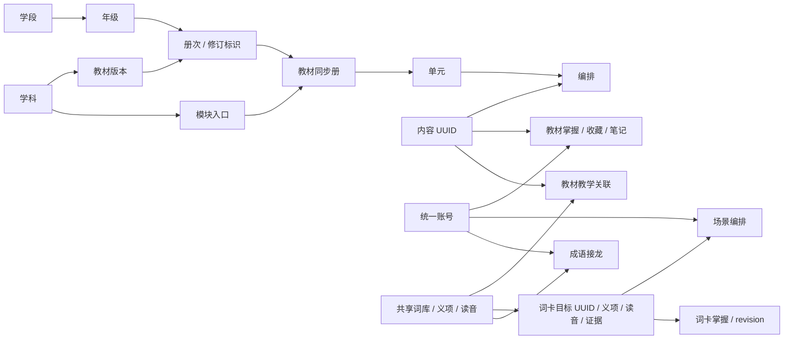

# 乐学堂 · 家庭学习系统

用于辅导孩子学习的 Django 单体项目。`primary-system/` 是主项目，其他目录保留为资料、原型或研究。

设计基线见 [系统设计与开发基线](docs/system-design.md)。当前明确区分两条管线：**教材按册次、单元和内容编排；学科功能拥有独立页面、数据模型和学习流程。** 旧专题学习册已退出，科学、地理、历史等后续按学科逐个开发，不放回通用专题阅读器。

`references/` 新资料的 [基础数据与中文教学规划](docs/foundation-data-plan.md) 已完成，另有 [文件与内容核验](docs/reference-audit-2026-11-02.md)。当前保留七包中的七类资料，南非教材及算术事实已按用户要求删除，提供中文界面、可靠短名称和字段对照及独立浏览入口；长篇英文释义仍保留原文并标明中文待补。字词资料已整合到[查字查词](http://127.0.0.1:8012/dictionary/)，见[统一展示实施](docs/dictionary-unification-implementation.md)；历史[全量资料库实施](docs/reference-library-implementation.md)与[独立验收](docs/reference-library-acceptance.md)。当前退役范围和维护流程见[退役报告](docs/reference-library-removal-implementation.md)。

## 当前功能

- 学习广场按专题搭配本地图标。地理、历史及容易混淆的语文、古诗词和数学卡片，用罗盘、人物名片、诗卷、尺子等图案区分。
- 乐学堂前台可滚动的页面在右侧中间显示三个本地 Tabler 图标，分别回到顶部、向上滚动一屏、向下滚动一屏，支持键盘和「学习设置」中的动效偏好。
- [升级记录](http://127.0.0.1:8012/updates/)通过统一页脚进入，按日期回看本系统的 Git 改进历史。支持关键词、提交编号和月份筛选，向下滚动会接着加载更早的日期，每个日期可折叠。游客可阅读，无 JavaScript 时仍可查找并通过链接打开更早的记录。记录随项目保存在 `catalog/data/upgrade_history.json`，页面运行不依赖 Git 或数据库，日期为提交日期而非线上发布时间。维护方式见[升级记录说明](docs/upgrade-history.md)。
- 前台统一页脚显示个人自用、公开资源来源及侵权联系说明，提供作者网站 `shimingyue.com` 的联系入口。
- 页头统一使用同一组圆角操作按钮，「学习设置」集中提供页面颜色、字体大小、动效与完成提示音。阅读外观有浅色、深色、暖色护眼三种，以及小／中／大三档字号（原字号的 90%／100%／120%）。选择立即生效，刷新、跨页和同源标签页自动沿用；游客也可使用，浏览器禁用存储时本页仍可切换。字号保留标题与正文层次，图片、画布及 SVG 绘图不做整页缩放或反色；打印沿用原来的浅色与字号。合并入口沿用原有阅读和动效存储键，偏好不写入账号或数据库，脚本不可用时保留原页面。
- 全站下拉框和展开／收起控件共用 `select-controls.css`、`disclosure-controls.css` 与本地 `icons/chevron-down.svg`，统一箭头尺寸、线条、展开方向及橙色键盘焦点。普通折叠项箭头在右侧，树形目录和时间轴小问答保留前置方向提示；点击区至少 44 像素，答案卡保留原有网格、教材目录保留原有宽屏／窄屏显示规则。筛选、键盘选择、动态选项与无脚本回退继续使用原生 `select` 和 `details`，专题样式不再单独绘制折叠箭头。
- 语文、数学教材的册次页与阅读页统一使用专题全宽布局，顶部导航、教材工作区与页脚共用平台的一层外侧留白，超宽屏不再受 2240 像素上限限制。阅读目录默认在右侧，可切换到左侧并在当前浏览器记住位置。
- 浮沉与框架观察：重力与浮力（`/science/lab/#lesson-su3-2`）用同样大小、不同轻重的物块比较上浮、悬浮和下沉，联动浸水比例及同一比例的受力箭头，漂浮稳定时浮力与重力相等。结构与稳定（`#lesson-su8-4`）并排比较框架，可向左／右推、加装／拆除右框斜杆，杆长始终不变。两处复用科学播放器，默认静止，支持暂停续播、步进、进度拖动和重播，减少动态时保留手动观察；脚本或数据失效时显示静态图。模型只用于理解关系，不预测真实运动速度或结构承重，课程规模保持不变。
- 磁铁与电磁铁：科学实验室的磁铁（`/science/lab/#lesson-su5-4`）可翻转右侧磁铁，观察异极吸引、同极排斥的受力与移动方向；电磁铁（`#lesson-su5-5`）可独立改变电流档位和线圈匝数，播放通电吸起、断电放下，也能直接对照两种状态。沿用现有播放器，支持暂停续播、步进、拖动进度和重置，减少动态时保留手动操作；强弱条只表示条件相同下的趋势，不是实测磁力。
- 昼夜与四季：地理小课堂（`/geography/study/#lesson-gu4-3`）点击「动画：地轴倾斜与四季」，可切换昼夜交替与四季昼长。昼夜模式跟随赤道地点经过正午、日落、午夜、日出；四季模式保持地轴朝向，比较北纬 40°、赤道、南纬 40°和地轴不倾斜的对照。默认静止，主动播放一圈后停止，可暂停、选位置、步进和拖动进度；统一动效偏好生效，脚本或数据缺失时保留原四季手动图。复用原知识点，未增加库或外部运行请求，地理仍为 8 章、37 个知识点。
- 生命世界动态观察：光合作用（`/science/lab/#lesson-su6-2`）按阳光供能、水的运输、二氧化碳进入、养料形成与运送、氧气释放五段查看，联动高亮来处和去处；食物链（`#lesson-su6-4`）沿用稻谷、蝗虫、青蛙、蛇、鹰，逐段展示食物与能量传向取食者。两处默认静止，可直接选段、前后步进、暂停续播、重置和播放一轮；复用分段播放器与统一动效设置，脚本或数据失效时保留静态图。科学课程仍为 8 个实验室、39 个知识点。
- 声音与简单机械：声音传播（`/science/lab/#lesson-su4-4`）可切换空气／真空，观察微粒在原位附近振动；音调与响度（`#lesson-su4-5`）可独立调整振动快慢和幅度，仅做可视化、不播放声音。简单机械（`#lesson-su3-5`）可调杠杆支点、切换定／动滑轮、改变斜面长度，对比理想用力与移动距离。支持播放一次、暂停、步进、拖动进度和重置，默认静止；减少动态效果保留手动操作。人体心跳与历史「丝路旅行」也接入统一动效控制，离屏、后台和离页时停止。全部复用现有知识点与入口，未增加第三方库。
- 前台下拉框使用统一样式，覆盖资料筛选、朗读设置、地图工具和顶部偏好：统一圆角、箭头、留白与聚焦提示，支持的浏览器还会显示带选中标记和轻柔过渡的展开菜单；其他浏览器保留原生菜单。长选项在收起时单行省略，展开后完整显示；控件仍使用原生单选框，动态选项、键盘操作、禁用与错误提示保持可用，多选列表不受影响。
- 动效与声音：页头「学习设置」中可选择跟随系统、轻柔或关闭动效，音效默认关闭，偏好保存在当前浏览器。汉字笔顺页复用现有笔画与中线，支持笔顺播放、逐笔查看、鼠标／触屏描红、暂停继续与重练；切到后台或写字板离屏时暂停。数学练习沿用挑战题库判分和错题本，只在整组完成查看结果时庆祝一次，客观判分与自评仍分开展示。Hanzi Writer 和撒花库随项目保存，撒花首次使用时才加载；依赖失效不影响静态笔顺和答题结果。见 [学习动效维护说明](docs/learning-effects.md)。
- 专题演示：地理主题路线支持当前地图内逐站导览、河流／山脉描线、8／15 秒停留与站点进度，跨地图时等待手动继续；太阳系支持两档公转速度、四分之一地球年步进、计时与所选行星圈数对比；迁徙地图增加下一年代提示和停留进度，暂停后保留剩余时间。三处演示均接入统一动效偏好，离开演示区域或切到后台暂停，减少动态效果时保留手动查看。全部复用原有地点、行星和年代数据，没有新增外部动效库。
- 历史疆域地图：从朝代页独立为专题，复用原有 16 个朝代、22 个阶段与同一份 territory 轮廓数据。标题、播放与朝代目录放在可切换左右的侧栏，地图适应宽屏和竖屏；保留自动播放、暂停续播、增减范围标色、叠图、缩放拖动及观察题。旧地图书签保留所选阶段并转到新入口，朝代更替与公元纪年仍在原页。
- 历史与字形观察：朝代版图可按现有 22 个阶段顺序播放，每张停留 6／10 秒，切换时保留视角，显示下一阶段提示；支持暂停后按剩余时间续播、从头播放，到最后一阶段自动停止，叠图、点选、缩放或展开观察题会暂停。默认用绿色、橙色斜线分别标出比上一阶段新增、减少的示意范围，配简短变化说明，暂停保留、可关闭；比较包含已画的并立政权，换国名不直接算增减。汉字演变馆的 100 张字卡支持四阶段逐段观察、点选字形、暂停与重播，同一时间只播放一张字卡，缺失字形仍保留说明，猜字模式继续遮住楷书。两处均支持减少动态效果下的手动步进和离屏暂停，未改变历史阶段、字形来源或掌握标记规则。
- 历史人物馆：首批 24 位人物，覆盖帝王将相、科学家、文学家与艺术家，每类 6 位；提供身份、时代与关键词筛选、人物名片、18 条有出处的关系和 24 个关键决策或创作选择案例。关系网可逐人展开，区分直接交往、后世影响和背景比较；案例按背景、讨论问题、实际做法、影响与局限展开。图片本地保存并注明后世画像、塑像或作品属性，名片与已有事件、时代和中外时间轴互相连接。筛选栏和人物目录默认在右，可切换左右并保存。维护见[人物馆资料说明](content_sources/history-timeline/people-SOURCES.md)。
- 丝绸之路：在本地自然底图上切换陆上／海上路线与 7 条代表性分支，点选 12 座城市，查看 6 类贸易品、4 组文化交流及年代节点。城市档案说明地理、贸易作用、材料边界与讨论问题；地图可前后选城、聚焦和全览，检索、路线与城市支持网址恢复。复用已有丝路精讲、录音、宝船模型与航海图，并连接人物馆、事件与中外时间轴。新增 4 张实物或遗址图像，核心内容本地保存。维护见[丝路资料说明](content_sources/history-timeline/silk-road-SOURCES.md)。
- 中国古代科技：四大发明、天文历法、数学、医学与本草、水利、建筑六类共 12 个档案，配 13 项本地图像材料、分步原理、证据边界、辨误与讨论题。可操作活字与雕版排印、割圆逼近、都江堰分流三个演示，状态可由网址恢复，并与人物馆、事件和时间轴双向关联。目录默认在右，可切换左右并保存。维护见[科技资料说明](content_sources/history-timeline/ancient-science-SOURCES.md)。
- 世界文明巡礼：古埃及、两河流域、古希腊、古罗马、玛雅、波斯、阿拉伯—伊斯兰世界、古印度共 8 站，按建筑、文字、制度与成就编排 32 个知识站，配 16 项本地图像材料、观察问题、讲解参考、材料边界和出处。支持关键词与主题浏览、两个文明围绕同一问题比较、主题深链接及事件反向入口；宽屏并列，竖屏按同一主题上下配对，目录可切换左右并保存。年代为选读范围，注明古今边界、政治制度与文字释读的不确定性。维护见[文明巡礼资料说明](content_sources/history-timeline/civilizations-SOURCES.md)。
- 科学动态观察：原有水的三态（`/science/lab/#lesson-su2-2`）增加微粒运动、暂停、单步和重置，补充常温蒸发说明；串并联电路（`/science/lab/#lesson-su5-2`）增加两个独立开关、灯泡通断反馈及约定电流方向演示。两处默认静止，复用统一动效控制，减少动态效果时可手动观察。图示均标明模型限制，说明与出处在 `content_sources/sci-demo-data.js`；课程仍为 8 个实验室、39 个知识点，无新增运行时依赖。
- 光路与水循环：科学实验室的光路（`/science/lab/#lesson-su4-2`）可调 0～75° 入射角，切换平面镜反射和空气入水折射，逐段观察并显示角度；同步修正垂直入射的课文说明。地理小课堂（`/geography/study/#lesson-gu5-1`）点击「动画：水循环过程」进入原有「水滴旅行」，按蒸发、凝结、降水、径流四步播放与回看，一轮结束自动停止。科学 `su7-3` 仍保留节水测量活动和地理关联链接。两处共用 `sci-process-data.js`、`sci-process.js` 与 `sci-process.css`，遵守统一动效偏好；脚本或数据失效时保留静态图或原有分步观察。
- 动植物地图：`/geography/life-maps/` 集中打开中国动物、中国植物、世界动物和世界植物四张地图，沿用物种照片、分布地点、筛选、观察记录和练习。四张地图与省份文化的旧图谱地址会跳转到独立专题，并保留物种、省份和筛选参数。地理图谱侧栏保留中国地图、世界地图、3D 地形、地球仪和地点索引，展开「专题与资料」可进入省域站、主题路线、实景图册和相关专题。
- 中国山河：`/geography/china-landscapes/` 把三级阶梯、山脉与高原、河流与流域、湖泊与河口串成一条学习线。复用「走上世界屋脊」「顺着长江去看海」两条路线和本地影像，可直接打开 3D 地形剖面、宜宾汇流和长江入海站。
- 航海与世界探索：`/geography/voyages/` 在同一张平面图上对照郑和下西洋与麦哲伦—埃尔卡诺环球航行。9 站与 10 站沿用地球仪的数据，支持从港口跳到对应的漫游站，关联原历史时间轴档案。
- 中国省份文化：`/geography/province-culture/` 覆盖 34 个省级行政区，复用原地图边界、简称和省会档案，补充常用别称、68 项特产、34 项民俗与传统技艺、68 处代表景观以及每省一个观察问题。点地图或省名按钮同步高亮与档案，可按名称、简称、城市、物产文化搜索，按行政区类型筛选；支持 `?adcode=810000` 深链接和浏览器前后退。省、自治区、直辖市与特别行政区分开标注省会、首府或行政区中心，资料附 62 项来源索引与流传范围说明。学习广场、地图首页、中国地图和省域站均可进入；不写学习记录。
- 天文总入口：`/astronomy/` 采用简洁专题目录，9 个主题下可展开 46 个探索问题，搜索直接定位问题；宇宙漫游、天文实验室、数据速查和常见误解作为独立入口。首页按需进入具体内容，保留知识点 ID 和本机掌握记录。旧 `/astronomy/study/` 自动跳转并保留参数与锚点；星表入口调整为 `/astronomy/stars/`，原天体详情地址及带筛选的星表书签继续可用。
- 月相与日月食：`/astronomy/#lesson-au2-2` 联动月球位置、可见亮面、近似天数与八种月相，支持连续播放、滑块、前后月相和重播；`#lesson-au2-4` 可切换日食／月食，按位置、排列、影子、离开四步观察。默认静止，统一偏好与离屏暂停生效，减少动态效果时仍可手动查看。天文知识点支持 `#lesson-<知识点 ID>` 直达，原有宇宙漫游入口不变；课程仍为 9 个基地、46 个知识点。
- 天文实验室：`/astronomy/?view=lab` 提供四项玩法。月相默认看此刻，也可选 1900—2100 年的日期，看当天北京时间 20 时的亮面；本地计算、每分钟刷新此刻，手动拖模型后明确切换为模型模式。八大行星与冥王星共 9 个天体对比直径、平均参考温度和公转周期，可排序并做 3 道小问答；冥王星标为矮行星，气体行星温度注明大气口径。北斗找北极星分四步，可播放、暂停和手动选步；14 个代表性探测里程碑按时间排列，可分看探月与探火星，注明目的地、任务成果和来源。九站课程、原掌握记录与日月食演示保持可用。

- 教材目录：英语模块（「教材同步」，2 本同步册，含单词与课文），英语模块页是教材同步册的专属书架；语文、数学已改文件编排（见下「语文教材册」「数学教材册」）。英语单元页提供「单词 / 课文」两个视图，课文气泡卡支持逐句点读；侧栏可选本单元全部课文或单篇课文连读。首页不再放书架与年级/学科/教材筛选（筛选仅保留在目录 API 层）。
- 统一账号、个人年级偏好；页面顶部独立信息条集中放置当前账号、学习偏好、退出和管理后台入口，游客可直接登录或注册，主导航专注学习入口。用户中心的学习偏好、密码修改与成功页、我的奖励及登录后的积分兑换采用正文与导航侧栏的左右布局；侧栏默认在右侧，顶部按钮可切换位置并在当前浏览器记忆，窄屏可展开导航。登录和注册沿用同一套大字号表单，欢迎区与主导航等宽，填写区域居中且最大宽度为 700 像素，密码可临时显示核对。偏好页区分随账号保存的资料与仅存当前浏览器的发音人，支持试听。奖励页集中展示积分、称号、七列打卡日历、勋章、兑换和积分明细，积分规则可展开查阅。教材内容支持掌握、收藏、私人笔记及并发修改冲突提示。
- 积分兑换：主导航与用户中心直达 `/rewards/shop/`，游客无需登录即可浏览，登录后兑换并查看本人积分和兑换记录；主导航「我的学习」仅登录后显示。内置 22 项、50～5000 积分的现实奖励，按愿望、玩具、零食、娱乐、自由时间五类分组，提供「全部」与分类筛选、数量和深链接；娱乐内容统一为「手机、平板娱乐、游戏」，按 15 分钟、30 分钟、1 小时三档兑换，电影归自由时间，登录与兑换后保留当前分类。源文件 `content_sources/rewards.json` 经校验后用 `manage.py import_rewards` 导入，重复执行跳过同名项并补齐空白分类；后台可调整分类，旧活动目录可选择下架，保留家长修改与历史记录。兑换后由家长安排与核销。见 [奖励目录维护](incentives/data/README.md)。
- 我的学习（`/me/`）：个人欢迎卡集中提供学习偏好与奖励入口，页内导航直达最近足迹、学习总览和教材记录。最近足迹优先展示 3 条，其余可展开；总览按教材学习、数学教材、场景单词、成语接龙、作文坊、成语挑战、飞花令、多音字、挑战题库、不规则复数和日常用语 11 个方向汇总，各领域只展示自己含义明确的数字与本周新增，不合成分比。教材记录支持学习状态与收藏筛选、结果计数和分类空状态，筛选与翻页后定位回记录区。首页只保留学习入口。
- 教材阅读支持纯文本、类型化图示块、互动图示、点读、连读及打印；英语单元页的单词与课文连读默认每次发音后留出 3 秒跟读时间，侧栏默认在右侧，可用顶部按钮切换到左侧，位置保存在当前浏览器。侧栏顶部集中提供「单词／课文」切换、开始／暂停／继续、停止连读和从头开始，显示当前内容、次数与进度；连读时突出当前词卡或句子，适度淡化其他内容，单词在侧栏放大展示，并分别标明听读、跟读和暂停状态；侧栏随窗口剩余高度伸缩，朗读设置位于播放控制下方，目录使用剩余空间独立滚动，不固定列表高度。暂停保留当前发音位置或剩余跟读时间；停止会清空本次连读、选中效果与进度，恢复正常浏览，从头开始会重播所选范围。单词卡和课文句子支持悬停与点击选中，手动选择退出连读，保留喇叭和句子点读，也可用键盘选择、按 Esc 退出选中。可展开顶部的「朗读设置」调整间隔（0～10 秒）和每项朗读次数（1～5 次，默认 1 次），保存在当前浏览器。浏览器语音按朗读结束推进，实际发音依赖设备。
- 语文教材册：独立 `chinesebook` 应用，**文件编排**（按册编排：`/chinesebook/` 为册次入口，册页 `/chinesebook/4a/`）——统编版四上 8 单元 27 篇课文：课文卡配作者小传、原文金句、真实百科、重点词语/多音字/近反义词与拓展视频（B站外链需联网），必背古诗文（含意境图、注释、创作背景、诗人小传）、日积月累、字词复习（多音字＋形近字）单独成视图；可点读、站内搜索、打印复习；「已复习」标记存本机浏览器，只读浏览不进学习总览。内容源头是 `content_sources/knowledge-data.js`，由 `scripts/build_chinesebook.cjs` 确定性同步。维护见 [语文教材册数据说明](chinesebook/data/README.md)。
- 古文精读馆：语文专题 `/classical/`，采用结构化文件编排。11 篇精选古文包含四上两篇及《滕王阁序》，另设《论语》二十篇、513 则全文与《道德经》八十一章、428 句精读。共 112 个阅读页面、1054 个精读段、367 道练习（248 道选择、119 道讲述自查）。支持逐句／逐则译解、点词释义、指代线索、停顿、单段／全文设备听读、关键词与全遮背诵、四种整篇打印及单段原文／讲解打印。全书可跨篇搜索原文、译文与词义并直达章句；《道德经》按道经、德经分卷导航，新增 243 道章后练习。《滕王阁序》按七段正文与附诗编排 71 个精读单元、190 处词义／典故提示、24 道练习，支持分段跳读、听读、背诵、练习和四种分段打印。原《论语六则》已合并到全书，旧链接兼容跳转。108 个页面按版本指纹关联本机原典，核心阅读无需数据库；复习与自测只存当前浏览器，朗读依赖设备语音。维护见 [古文精读馆](classical/README.md)。
- 数学教材册：独立 `mathbook` 应用，**文件编排**试点（按册编排：`/mathbook/` 为册次入口，册页 `/mathbook/4a/`，册次码对齐 catalog 教材码后缀）——北师大版四上 11 单元 43 个知识点按文件源的知识卡呈现：图示（含互动演示）开路，要点/例题/易错标签页、生活中的数学照片、记忆口诀，另有公式速查、易错诊所、教学视频（B站外链需联网）与站内搜索、打印复习。登录后，已读、自评掌握和上次单元随账号保存，从「我的学习」可以接着学。游客继续使用本机进度，登录后可确认导入，每个账号每册一次。四上知识卡直达例题自评，易错诊所可进入判断练习，练后可返回原处。内容源头是 `content_sources/math-data.js`，由 `scripts/build_mathbook.cjs` 确定性同步（共享图示库与照片一并同步），加载期校验坏数据拒绝上线。维护见 [数学教材册数据说明](mathbook/data/README.md)。
- 共享词库：字词、义项、读音、原始证据、人工修订、版本化导入、审核、启用与回退；统一查字查词页面。
- 成语接龙：游客／登录账号隔离、服务端计分、提示、陪练、终局；单人模式对小龙陪练，双人「家长对决」同屏轮流——每局选先手（孩子/家长），提示双方都能用、每次 −5 分从轮到的一方扣，谁接不上对方赢。词池来自当前生效词库，后台可禁用词条。
- 场景成语：6 类、44 个场景，358 个成语通过 397 个场景词位复用现有成语词典（例句部分取自 primary 成语本的整理数据）；支持全量词典搜索、出处与场景例句对照，以及成语／场景例句连读、暂停继续、停止和从头开始。跟读间隔和重复次数可调，当前成语、拼音和例句突出显示，支持悬停、点击成语或例句选中，点击例句旁的喇叭可点读；停止恢复正常浏览。侧栏默认在右侧，位置自动记忆，朗读设置位于自适应场景目录上方。场景固定词条、义项和来源证据，词义修订后暂停关联并提示复核；只读浏览，不生成学习记录。维护见 [场景清单说明](idioms/data/README.md)。
- 成语典故馆：挑有人物故事的 30 个成语按典籍分组做故事卡（负荆请罪、三顾茅庐、望梅止渴……），每卡含出处原句、孩子能懂的故事复述、含义与人物 chips；25 位人物档案提供「人物线索」（蔺相如 → 完璧归赵/负荆请罪），`?figure=` 展开线索视图。成语读音、释义、出处、例句实时取自词库 chinese-xinhua-idioms 生效记录，逐条 matches_pin 校验、漂移即降级待核对；只读浏览，不写学习记录。维护见 [典故馆数据说明](idioms/data/stories-README.md)。
- 看释义猜成语：释义补字小游戏——给出释义，把成语缺的字从候选键盘点选补上；难度就是亮出的提示字数（提示 3 字只剩一个空，无提示即挑战），提示位任意分布，`?seed=` 可复现同一题。题库两档：常用（场景课程成语逐条过钉词校验）与大全（全词库四字成语按释义质量过滤）；服务端提供填字提示并核对答案。每题首次检查记入学习记录，改正后可看解析。累计成绩与连对次数按账号或游客会话显示。
- 成语表情猜猜看：看 emoji 四选一猜成语（🐍➕🦶 = 画蛇添足）——296 个画面感强的成语配 AI 辅助生成、人工核对的 emoji 映射，一轮 8 题随机出题；判定、计分在服务端签名状态里（正确答案不留前端），答错即亮正确答案并给词典释义与跳转。页面临时练习，刷新重开，一局猜满由服务端记入学习足迹；映射维护见 [表情题库说明](idioms/data/emoji-README.md)。
- 成语配对：连线配对玩法——左栏找一个成语，右栏配它的近义或反义（画蛇添足 ↔ 多此一举，雪中送炭 ↔ 雪上加霜）。49 对配对（近义 11 / 反义 38）全部钉词校验，同局词头不相交；配对成功亮关系徽标与两侧释义，判定在服务端。页面临时练习，刷新重开，一局配满由服务端记入学习足迹；维护见 [配对题库说明](idioms/data/pairs-README.md)。
- 数学思维训练营：学习广场「数学」下的 `/mathcamp/`，逻辑推理、数独、幻方、找规律、巧算速算五条独立路线，共 15 个方法示例、15 关入门／进阶／挑战训练和 45 条分步提示。数独从 4×4、6×6 到 9×9，可看候选数；逻辑与数独校验唯一解，幻方按全部规则接受合法摆法，找规律明确模型边界。支持填写、冲突检查、完整讲解与复盘；完成标记按账号或游客保存在当前浏览器，不入库、不计分，继承主题、字号和侧栏换边。关闭脚本仍能读题、在纸上作答并逐条展开提示与答案。维护见[训练营内容与规则](mathcamp/data/README.md)。
- 数学之美：学习广场「数学」下的 `/mathbeauty/` 新增黄金分割、斐波那契数列、对称与分形、莫比乌斯环、拓扑入门五站，共 8 个可操作实验、15 道探索判断和 8 张本地默认图示。可调黄金分点，拼方格并比较相邻比值，改变种子转角，观察多边形对称与谢尔宾斯基分形，沿莫比乌斯环追踪法向，再比较橡皮片变形和欧拉数。每站有前置知识、渐进讲解、桌面活动、深入阅读与资料出处，不按年龄限制访问。交互只响应手动操作、不计分、不写学习记录；无脚本保留图示、正文和可展开的答案，继承平台主题、字号与侧栏换边。维护见[数学之美内容与模型](mathbeauty/data/README.md)。
- 图形运动实验室：学习广场「数学」及四上册页可进入 `/mathbook/geometry-lab/`。三个方格实验分别演示按格平移、绕点旋转和沿折痕翻折，可切换小箭头、三角帆和小旗子。9 道动手挑战支持逐步演示、暂停继续、原图对照和整圈旋转，独立完成记录保存在当前浏览器。访客可直接操作，实验手记沿用共用侧栏的位置记忆；图形、手记和挑战目标维护在 `content_sources/geometry-lab.json`。
- 多音字：`hanzi` 应用新专题——从 CC-CEDICT 全量词语按字位音节对齐推导出 1,010 个多音字（2,227 种读音），字卡网格按读音筛选，点字看每个读音的组词（整词声调拼音、目标字高亮、轻声标「轻」），练一练「给词选读音」前端判分，每题上报服务端按读音表复核后记一条练习记录（对错都记）。数据口径与重建见 [多音字数据说明](hanzi/polyphone_data/README.md)。
- 汉字演变馆：学习广场「语文」下 `/hanzi-evolution/`——10 个字族 100 个常用字的四段字形演变（甲骨文→金文→小篆→楷书），每字配看图提示、字理小故事和组词，与查字查词、笔顺资料、多音字三处按字互链（馆藏 100 字的笔顺详情页和多音字页也有「看字源」反链）。支持字族目录、搜索、猜字模式（藏住楷书猜古字）、点读和已认全标记；「馆前必读」讲甲骨文发现故事，「六书速查」解释造字法。古字形 SVG 抓取自汉字叔叔字源网（hanziyuan.net）随项目发布，站上缺失的字形以「未见于某文」诚实标注；选字清单与抓取脚本见 `scripts/fetch_hanzi_glyphs.py`，可得性报告在 `content_sources/hanzi-evo-availability.json`。
- 不规则复数：独立 `plurals` 应用——70 对英语不规则复数手工整理分六组（元音变化、-en 词尾、f 变 ves、单复同形、其他要记的、外来词），27 个小学必会词支持「单词变身屋」：先想复数，点击单数揭晓，配合数量变化、点读和提示记忆，一轮随机遍历、不重复计数，可重新开一轮。另有「给单数选复数」练习（干扰项含 childs、foots 这类规则误推形态），每题上报服务端按确定性选项集复核后记一条练习记录（对错都记）；翻看变身不产生答题记录，拓展词只浏览标「拓展」徽章。支持单复数与中文搜索、分组筛选；数据手工维护，口径见 [复数数据说明](plurals/plural_data/README.md)。
- 日常用语：独立 `phrases` 应用——教材词卡的 597 条常用短语与短句（en/zh 原文转换自 `content_sources/english-data.js` ENGLISH_PHRASES），一份两个视图：按句式 18 组（Let's… / Can… / There be / 日常套语……组头带中文口诀）与按话题 11 组（组头挂「去场景单词学词」互链）；141 个句子形态进「看中文选英文」练习池，干扰项取同句式/同话题易混句，每题上报服务端按确定性选项集复核后记一条练习记录（对错都记），搭配类只浏览。支持搜索与筛选；内容以教材语料为单一数据源，转换管线见 [日常用语数据说明](phrases/data/README.md)。
- 数学公式：`/mathformulas/` 按小学、初中、高中共 20 章、58 组编排 196 条公式和知识卡（小学 157、初中 23、高中 16 条），每条配「什么时候用」和一道带讲解的小例题。关键词可跨学段、跨章节搜索，支持多个关键词组合与零结果提示；常用、易错公式可收入本机收藏夹，跨章节集中查阅并直达出处。收藏按当前浏览器的学习账号或游客分别保存，清理浏览器数据会清空，不入库、不跨浏览器同步。无脚本仍能搜索和展开例题。见[公式数据维护说明](mathformulas/data/README.md)。
- 挑战题库共有 296 道可练题，包括数学教材自评与判断题、语文多音字、英语词义、语法巩固题和 100 道奥数题。可按学科筛选，每组 5、10 或 20 题。服务端逐题判分并保存作答，答错的题会进错题本，重练答对后移出。批次来源和导入方式见[题库数据说明](questionbank/data/README.md)。
- 从学习广场「数学」分类下的「奥数挑战」卡进入。100 道四年级四选一题分为 10 个题型，包含速算巧算、等差数列、鸡兔同笼、盈亏问题、还原问题、行程初步、图形计数、逻辑推理、植树问题和周期规律。首页可选题型和每组 5、10 或 20 题，也可混合抽题；题量不足时按实际题数练习。每题有两步提示，答题前按需逐步展开，提交后可打开完整解析。完成整组后，本机挑战榜按答对数优先、用时其次排名，并标记看过提示的题数；不同题型、实际题数和错题重练分别比较，当前浏览器按账号隔离保存前 10 名，游客单独保存。清理浏览器数据会清空榜单。奥数错题沿用挑战题库的错题本，重练时保留题型筛选。练习设置栏默认在右，可切换左右并记住选择。
- 场景单词：独立 `words` 应用，46 个生活场景、577 个词位；稳定词卡目标固定义项、读音和版本证据，可在多个场景复用。教学标注留在词位上，支持点读和词卡掌握。侧栏默认在右侧并可一键左右切换，朗读设置集中在顶部，目录使用窗口剩余高度独立滚动；当前场景或搜索结果都能连读；提供暂停／继续、停止、从头开始及跟读间隔、重复次数设置，与教材共用朗读偏好。当前单词会放大显示、词卡高亮，其他词卡适度淡化；支持悬停和点击选中，手动选择退出连读，停止恢复正常浏览；切换场景、搜索或更新掌握状态后清空旧播放进度与手动焦点。「我的学习」里的单词足迹会定位到对应词卡。
- 英语音标：独立 `phonetics` 应用，6 节发音基础、8 组易混音对比，44 个音素按五组编排；可看要领、听音素、点读例词。自测含 16 道听辨题与 12 道理论题，每轮最多 8 题，支持解析、知识卡回看和错题重练，结果仅保存在当前浏览器并按账号区分。例词连读支持跟读间隔、重复次数、暂停继续和从头跟读。首页与各组随窗口展开，保留音标与理论深链接。音素卡例词实时回查词库已核对读音（primary-words／primary-english），未解析到的标为拓展词；音素音频随项目发布。服务端只读。维护见 [音标数据说明](phonetics/data/README.md)。
- 英语语法：独立 `grammar` 应用，学习广场由语法模块提供唯一入口，不再重复注册专题卡。8 章 31 个语法点（词法基础、名词、冠词、代词、be 动词与 there be、时态初步、形容词与副词、句型变换），每点含讲解、必须掌握要点、对比表、句型公式、例题折叠、易错辨析与三选一巩固题（页内即时判分、进度存本机）。「练本章」从挑战题库的 `primary-grammar` 批次选取本章题目，作答由服务端判分并记录，可查看本章错题并重练。内容源头是 `content_sources/grammar/`，转换管线与修订流程见 [语法数据说明](grammar/data/README.md)。
- 作文坊：独立 `writing` 应用，**不进教材编排**（不用 ContentItem／单元／Placement）。7 个题材、47 个题目的写作锦囊（目标、结构锦囊、好词好句点读、范文点评、小练笔）加素材百宝箱与灵感抽签；「我的作文本」保存作文草稿——登录挂账号、游客挂浏览器会话；在同一浏览器退出登录后，可以继续写先前保存的游客草稿。未保存的正文按账号或游客会话暂存在当前浏览器，刷新可以接着改原稿，也可从「我的学习」直接打开对应草稿。草稿保存使用 revision 检测并发修改。题目数据转换自原型同源数据，维护见 [作文坊数据说明](writing/data/README.md)。
- 查字查词统一查询：已发布词义、CC-CEDICT汉英参考、CMU美式读音、汉字属性和笔顺在同一页展示；正式词条详情也显示同形补充资料，来源和版本分别保留。
- 资料探索：查字查词、古诗文、国家地区、元素及HYG星表五个入口，不自动生成学习记录。
- 学习广场的「历史」卡直接打开双轨时间轴，覆盖 9 个时代、126 件中外大事和 30 组同期对照。总轴可按全历史、前后 500／100 年缩放，输入年份或朝代定位，也可拖动选年；30 组同期对比可并列阅读，朝代色带随滚动高亮。事件详情用 43 条带理由的首选关联和按年代继续的阅读链串起前后故事，保留旧书签。从时代站和事件详情可打开相关精讲，完整精讲目录含 8 个主题、37 个知识点，配文物图片、音频、动画和自测。公元纪年与朝代顺序集中在朝代与版图页，另有 16 个朝代、22 个阶段的版图变化，在同一底图上圈出大致范围，可分色查看并立政权、叠加另一阶段、缩放和平移。
- 学习广场的「地理」卡直接打开地理图谱的中国地图，可切换世界地图、查地点、进省域站、走主题路线和看实景图册。「3D 中国地图」以真实数字高程呈现山脉、高原、盆地与平原，覆盖 34 个省级行政区，共约 44.8 万个顶点、84.4 万个三角形。默认地形设色并显示可点选的省名，省界使用深色线与浅色衬边，选中省份用橙色粗边强调；支持省份分色、区域配色、1—80 倍高度调节、点地形读取网格海拔，以及 6 条主要水系与 25 处地形的分类定位；旋转、缩放、俯视、键盘、原省份档案与深链接继续可用。默认显示长江、黄河、珠江、黑龙江、淮河与京杭大运河的走向，以及 14 处山脉、4 大高原、3 大平原和 4 大盆地的名称。水系贴合地形，支持显隐；新增 5 条自然河流的流向箭头与播放、暂停、单步观察，6 条水系共 12 个源区、入海区域或河段去向标记，京杭大运河标南北端。黑龙江和淮河说明图外后续去向，不把图内末端当海口。减少动效时保留单步，离屏或切到后台自动暂停。新增长江、黄河两条镜头沿河漫游路线，各 12 站，共 24 站，沿真实河道介绍主要城市与地形；支持停站阅读、暂停继续、两档速度、逐站或选站查看、进度与站点深链接，到入海口自动结束；名称自动避让，点目录可聚焦并查看原档案。6 条水系改用 HydroRIVERS 与 OpenStreetMap 真实河道中心线，保留源数据分段和河口，沿河使用更细高程资料和约 1 千米网格，按三角面切分河段以贴合河谷。河线不代表河宽或实际水位，资料精度与覆盖范围见[真实河道说明](content_sources/geo-map/RIVER-SOURCES.md)。省份高亮不改变地形高度，南海诸岛小图保留。高程和引擎均随项目本地提供；远离河道的底网间隔约 6—9 千米，小地形和峰顶已简化，高度倍率只用于观察。浏览器不支持 WebGL 时保留省份列表和档案。3D 中国地图新增省份拼图抬起、8 条猜省区线索与 4 个坐标寻宝任务，支持点地图、省名按钮或坐标输入作答，本机保存完成记录，查看答案不计入完成；新增 5 站山地飞行与 8 站大运河虚拟行船，复用原漫游控制器，保留河道分段并说明不代表全程通航；增加 6 处 Natural Earth 湖泊轮廓、可调高度的雪线观察示意（默认 5000 米），以及地图缓升效果；减少动态时即时呈现。配音复用系统中文朗读，可听剖面、当前站点或主动启用到站讲解，停止、换玩法、后台与离屏均停止朗读。3D 中国地图新增地形剖面仪：拖出 A→B 或依次点两个位置，在侧栏查看真实海拔剖面；可一键观察西向东示范线，认识三级阶梯，高度倍率不改变读数。3D 中国地图新增 5 处流域或汇水范围图层、16 条代表支流与水系支干，干流深蓝、支流浅蓝、湖泊湖蓝；6 处湖泊改为平整半透明水面并展示示意湖盆，关闭后恢复原地形，原始海拔、剖面与判题不变。长江三角洲、黄河三角洲和珠江口支持一键放大与返回河流全貌，并支持流域、湖泊和河口深链接。京杭大运河不虚构天然流域；黑龙江跨国范围及淮河部分汇水区另作说明，来源与简化范围见[水文图层说明](content_sources/geo-map/HYDROLOGY-SOURCES.md)。3D 中国地图采用轻量全图概览与按经纬度拆分的 96 个本地详细地形块，放大后优先读取视口区域，缓存通常最多 24 块；海拔读数、定位挑战和剖面先读取对应详细数据，失败时保留概览并可重试。地形采用颜色查表，河流贴地计算移到生成阶段，保留原始高程、全部省界与水文关系。3D 中国地图新增「地图小研究员」：三级阶梯定位挑战按地理区域判定并亮灯，过渡带不强判；长江水系拼图可拖回雅砻江、岷江、汉江和湘江，也可用按钮作答，独立拼好后干流高亮；5 道省界、河流与地形观察题提供地图定位、两步提示、解析和出处。查看参考不计完成，独立进度保存在当前浏览器。点地形后最多钉 6 根带原始海拔读数的半透明柱子，可逐根拔掉或清除。新增同视角 1×／50× 左右对照，旋转与缩放同步，两边海拔读数保持一致；单图也可一键切换倍率。新增「3D 世界地图」地球仪，复用 177 个国家和地区、七大洲、四大洋与 10 处世界地标档案，支持拖动旋转、滚轮与按钮缩放、键盘操作、点选国家、逐洲定位、经纬网、名称与地标显隐，并可俯瞰南北两极；使用完整南极轮廓，数据与引擎均本地提供。地点和大洲支持深链接，WebGL 不可用时保留列表与档案。新增六条重要经纬线讲解、地球五带配色、点击读取近似经纬度和地点搜索；三条逐站环球导览共 15 站，支持站点深链接；18 道探索题提供提示、解析、浏览器掌握与错题记录，支持全部再练和错题再练，复习不清除已掌握记录。增加两点球面测距，可点选、输入坐标或使用当前地点参考点，显示球面短弧与约数距离，附赤道四分之一圈、跨 180° 经线、南北极三组例子；新增 6 个经纬度寻宝任务，提供方向提示、答案观察、重新挑战和浏览器找到记录，查看答案不计入完成。测距与寻宝在 WebGL 不可用时仍可输入坐标使用。新增 9 站郑和下西洋与 10 站麦哲伦—埃尔卡诺球面航线，沿分段大圆弧停站、前进、暂停与逐站观察，各站连接原历史档案；路线仅作教学示意，郑和路线汇总多次远航。两点测距扩展最多 20 站行程，支持点城市或球面、输入坐标、逐段累计、移除和撤销。增加按日期比较的 8 城法定时区，北京早上 8 点可对照纽约冬夏时间；30 种世界动物和 30 种世界植物可在球面看照片、按环境筛选并沿用原观察记录；新增七洲无国界轮廓侦探，提示、查看答案与自己认出分开记录。增加「昼夜与四季」光照观察：切换春分、夏至、秋分、冬至前后的代表位置，调节 UTC 示意时刻，观察晨昏线与太阳直射点；点球面或输入坐标比较白昼时长，提供 4 组观察线索和同纬度四时昼长对照。一天演示支持播放、暂停继续、3 小时单步与播完停止，离屏、后台、减少动态或显示中断时暂停；无 WebGL 时保留输入和数值结果。新增的 6 道昼夜题可直接定位对应观察情境，沿用旧题掌握记录。地球仪新增大气边缘光、夜间城市灯光、柔和晨昏渐变、可见太阳、真实网格轻度起伏与极地冰盖；视觉开关可分别控制。新增「让地球自己转」，默认暂停、约两分钟一圈，昼夜观察时同步推进光照并保持太阳方向，和原一天演示互斥；手动操作、离屏、后台与减少动态时暂停。高程与灯光纹理均在本地提供，地形、冰盖与灯光的简化范围见[地球仪视觉素材说明](content_sources/geo-map/WORLD-VISUAL-SOURCES.md)。新增「地理侦探」8 条国家位置线索，支持球面点选和列表作答、两步提示、答案定位、重新挑战及关联档案，查看答案不计入完成；探索记录面板汇总 18 道探索题、6 个寻宝任务与 8 个侦探任务，可从未完成处继续。快捷视角和复位保留当前玩法。世界地图可选择七大洲逐洲高亮，并阅读位置、地形、气候等重点与观察问题。中国平面地图新增 34 个省级行政区中心参考标注，点击同步看省会、首府或直辖市名称与地形气候提示；长江、黄河支持从源区到海口的河流回放、沿途城市标注、暂停重播及进度拖动。3D 剖面仪增加沿线滑块、曲线拖动与最高／最低点定位，地图黄点和原始海拔同步。世界平面地图新增中国的 14 个陆上邻国与 6 个隔海相望国家探索，直接点国名或地图看一句特色，并保留原档案与洲别入口。「中国动物地图」展示 30 种代表动物，点位分布在 27 个省级行政区，可按 6 类栖息地筛选。「世界动物地图」展示七大洲和多片海域的 30 种代表动物，可按 7 类栖息地筛选。两张动物地图都可在地图下方直接点照片选动物，地图标记与档案同步更新，查看照片、习性和代表栖息地。动物地图新增名称、地点和环境关键词搜索，可与栖息地、已观察／未观察组合筛选；支持随机认识新朋友、上一种／下一种浏览及可取消的观察标记。观察记录按中国、世界分别保存在当前浏览器。动物小侦探提供看照片、读线索两种练习，每轮从当前筛选抽取最多 5 种动物，不重复，答后看解析与地图，并可重练本轮错题；练习不自动计入观察。新增中国、世界两张植物地图，各有 30 种植物与本地照片，中国点位覆盖 26 个省级行政区，按 7 类生长环境筛选，点地图下方照片同步查看分布、环境适应和观察线索，世界植物覆盖七大洲。两张植物地图也支持名称、学名、地点和环境搜索、生长环境与观察状态组合筛选、随机认识植物及上一种／下一种浏览；观察记录按地图独立保存，与动物记录分开。植物小侦探提供看照片、读线索两种最多五题练习，支持提示、查看地图和本轮错题重练，练习不自动标记已观察。从地图工具或代表地点可进入地理小课堂，小课堂含 8 个主题、37 个知识点，配照片、音频、动画和自测。河流的基础档案在地图上查看，精讲侧重流域、泥沙等概念。
- 中国 3D 地图的右侧「地形观察工具」提供每 500 米一档的等高线、东南西北光照预设与方向滑块、0—9000 米动态变白高度、0—100％地形不透明度；14 处山脉名称增加微图标。等高线随按需地形更新，雪线、透明度和光照都不改变海拔读数，并可用于 1×／50× 对照。算法、显示边界和测试见[地形视觉说明](content_sources/geo-map/TERRAIN-VISUAL-SOURCES.md)。
- 地球仪继续增加船只沿弧线回放、可保存的「我的环球旅行」和寻宝／侦探的 5 处计时挑战。新增 18 城人口规模、六大板块教学分区、约 2 亿年前古陆拼图、季风／台风示意、NASA 多年平均年降水、4 个星座的示意天球及星空背景；资料口径见[主题图层说明](content_sources/geo-map/WORLD-LAB-SOURCES.md)。倾斜控制需主动授权与安全来源，原操作继续可用。专题脚本合并为 3 个本地请求，生成物随项目保存，沿用既有发布命令；镜头与动画复用已绘制纹理。
- 新增「地球内部」总览与岩石矿物、地震火山、板块构造、地球年龄四站。可按半径比例或放大地壳观察四层结构，用本地标本照片认识矿物和三类岩石，选择多条岩石循环路径；地震波观察台比较 P／S 波到时，板块台对照张裂、俯冲、大陆碰撞和转换边界。两组示意均默认暂停，提供 8 秒有限播放、单步和进度拖动，后台、离屏与减少动态时暂停。铀—238 半衰期模型与「地球一天」时间线连接测年假设和深时间；图示比例、参数、来源与不确定性均在页面说明。专题目录默认右侧，可左右切换并沿用本机偏好；页面随宽屏展开，竖屏可收起目录。源与本地媒体维护在 `content_sources/earth/`，运行 `make study-topics-data` 更新。
- 「语文」新增标点符号实验室：12 种常见标点用法、12 组易错辨析和 24 道加标点练习。可切换语气观察同一句话，按作用搜索用法，逐空输入或点选标点，支持「不加」、组合标点、语境限定及多种合理答案。即时反馈、提示、参考解析与待巩固题重练共用同一内容源；查看答案与自己答对分开记录，进度在当前浏览器按账号保存，游客共用游客记录。依据 GB/T 15834—2011 编写，例句与题目自编，无需导入数据库。
- 「海洋世界」设总览和洋流、潮汐、海洋生物、海底地形四站。可在本地世界底图中追踪 5 股代表洋流，切换 4 种月相比较理想半日潮，按水深查看动物实例与热液区生态，拖动两条教学剖面辨认大陆架、洋中脊和海沟。5 张来源可查的图片随项目发布，模型与实拍均注明适用范围。专题目录默认在右侧并支持切换，竖屏可展开目录。内容维护于 `content_sources/ocean/`，通过 `make study-topics-data` 同步。
- 「地图技能」包含总览与比例尺、方向、图例、等高线、地形剖面图五站。同一张青石溪谷练习地图支持点选地标、换算距离、旋转判断方向和突出图例。等高线可切换 20／40／60 米等高距，探查山顶、鞍部、山脊和山谷。剖面支持拖线、依次点 A 和 B、反向比较、显示等高线交点和同步读数，并可打开 3D 中国地图的剖面工具。每页有即时读图题，图例和等高线站附两份本地 USGS 样例。内容由 `content_sources/map-skills/` 维护，运行 `make study-topics-data` 同步。
- 「气象与气候」包括总览、天气现象、气候类型和中国气候分区。可查看六组天气案例与四张本地实景，拖动气温观察到达露点的条件，用 11 站的 1991–2020 年逐月常年值比较雨季和温差，在中国地图上突出五个柯本大类、点阅格点并跳到五个典型气候代表站。专题区分气候类型、温度带和干湿区，注明格网、站点与照片的来源。内容维护于 `content_sources/climate/`，运行 `make study-topics-data` 同步。
- 「地理」下的天文探索有 9 站、46 个知识点，新增「宇宙漫游」的太阳系、银河系与深空 3 个主题，配 6 幅大图、3 段本地 NASA 动画、8 颗行星的公转／距离／大小实验桌及 6 个外部探索入口；另有五级宇宙地址导航、三条路线的光信号单程／往返计算和 6 道带解析及浏览器记录的观察挑战。图片注明实拍、观测合成或示意，保留星空实景与月相演示。「语文」下的文学常识有 8 个主题、41 个知识点，新增四大名著 31 位人物的可展开关系图，点人物看典型情节、回目与原著出处；另有 41 张作家名片，配年代、代表作和一句趣闻，可分类、搜索、点读并跳回课程。关系图和名片有独立深链接，原知识点和掌握记录继续保留。同组的汉字演变馆有 10 个字族、100 个常用字的四段字形演变和字理小故事。「科学」下的科学实验室有 8 个主题、39 个知识点，配互动图示、观察任务和小实验。四套课程支持搜索、点读、打印和本浏览器的掌握标记。已有资料从课内链接查阅，课程内容和图片随文件发布。
- 「科学」下的人体奥秘站有呼吸、消化、血液循环、骨骼肌肉、大脑与神经、眼耳与感官 6 课。每课先操作大图，再看两幅可放大的外部图像，共 12 幅，包括肠绒毛与神经细胞显微照片、血细胞电镜图、手骨 X 光片、脑部 MRI 和眼耳解剖图。每课有 3 条扩展知识、1 个小实验和 3 道即时反馈题，共 18 道自测。六课共 9 种过程演示、32 个观察阶段：呼吸联动膈肌、肺和气流并放大气体交换；食物沿六站连续前进，呈现蠕动、混合、营养与水的吸收和排出；循环可切换双侧泵血与八步血液路线，在肺和全身观察含氧变化。手臂连续屈伸、神经光点接力、眼耳鼻舌的光／振动／信号传递也可播放。所有演示默认静止，支持播放／暂停续播、前后步骤、进度拖动、三档速度和重置；离屏、后台、离页或减少动效时停止，手动观察仍可用。另保留反应小游戏与盲点实验。首页可直接点击人体图上的大脑、眼睛、肺、心脏、胃、小肠与骨骼肌，弹出位置和功能小档案，并跳转对应课程；数字标签和键盘也可操作。新增「我们的身体怎么长大」五阶段时间线，从婴儿、幼儿、学龄儿童、青春期到成人，说明个体成长节奏不同；无 JavaScript 时仍可阅读成长内容和器官档案。另有跑步、吃饭、接球 3 种身体协作场景，支持逐步点亮器官、播放／暂停及 7 道器官定位挑战；播放遵循统一动效偏好，离屏、后台或离页暂停。探索手册保存 18 道课程题与 7 道定位题的答对足迹。测脉搏配手腕图、30 秒计时、换算和静坐／活动／休息后三阶段对比图，可保存最近 20 组观察、逐条删除、导出 CSV。答题足迹和脉搏记录仅保存在当前浏览器，同一浏览器的使用者共用；存储不可用时退回本页暂存。图像随项目保存，原出处需联网。侧栏位置由浏览器记忆。见 [课程文件源](content_sources/README.md)。
- 「科学」下的人类起源从莱托利脚印出发，依次看人类家谱、远古生活、智人迁徙和中国遗址。迁徙年代地图有约 30 万年前至今天的 17 个节点、8 个地区证据卡和 7 类古人类生活记录，地图直接用 7 种颜色标出 17 个代表点位。自动播放按年代切换路线与点位，约略消失的人群退场，灭绝时间未定者保留空心问号并另列清单；点击点位后直接定位到地图下方的当地记录与出处，并可返回刚才的点位。支持暂停、继续、从非洲重新开始及每站 3／6／10 秒调速；专题导航恢复侧栏，默认右侧，可左右切换和折叠，折叠状态保存在当前浏览器；正文内部采用单列，年代说明放在地图下方；年代、地区与点位均可用深链接打开。家谱图可缩放、拖动和适应窗口，点人群展开下方详情并保留返回位置；配有与迁徙图同名同色的七组人群对照、近 40 万年放大时间条和头骨实物对照；石器与火补齐切痕骨骼、受热燧石照片及观察问题。图片观察室支持 2／3／4 倍局部放大镜、方向键移动和观察问题，官方三维藏品与原文配中文引导并标注「需联网」。中国地图标出四个地区的五组发现，点编号在地图下方看介绍，再进入完整实物线索；加入白石崖下颌骨与哈尔滨头骨实物图，和家谱、年代地图双向关联；哈尔滨头骨按年代下限单独说明。各站配图示、证据卡和一道即时反馈的判断题，正文与素材采用项目内文件编排。见 [专题数据说明](humanorigins/data/README.md)。
- 「科学」下的未解之谜研究所按「外星生命与文明」「太空与信号」「地球与生命」「古迹与文字」编排 36 份案卷。每篇在线索前展开 2 个具体未解问题，共 72 个，并说明还缺的证据，目录直接展示未解焦点。「外星生命与文明」含外星文明与费米之问、UFO 证据、系外行星生命三份新案，以及火星、土卫二和「哇！」信号；另有第九行星、鲸歌、海龟感磁、古文字等主题；本批补充土星六边形、暗能量、地磁倒转、乳海、金字塔大空隙和费斯托斯圆盘。每篇配图、线索、判断题、调查结论、家长延伸和资料出处，访客可直接阅读和作答。20 份案卷有短片、动图、录音或互动读图，包括本地 GoFast 红外实拍节选与数字点读、TRAPPIST-1 e 光谱点读、鲸歌录音和海龟实验短片；新增土星增强色观测动图与 6 组点选读图，涵盖云带、宇宙膨胀、磁性条带、乳海卫星图、金字塔内部模型和圆盘符号。深海可沿立体剖面探索 5 个深度带，查看 10 张动物照片。目录支持关键词、领域、素材类型与本机阅读状态组合筛选，可从筛选结果随机抽案；两份案卷可并排对照已知、未知与调查方向。详情可加入稍后读、手动标记读完，并按「线索／猜想／下一步」写三栏调查笔记，自动保存在当前浏览器，可导出文本。筛选与对照支持网址恢复，禁用脚本仍能阅读原有案卷与判断反馈。核心素材随项目保存，资料原文需联网。见[案卷维护说明](mysteries/data/README.md)。
- 「科学」下的科学流言粉碎机有 24 项查证任务，按身边的材料、天气与地球、太空里的误会、动物与植物和视频里的说法五类查找，支持关键词搜索。每项配两张证据卡、四类判断和一道三选一迁移题，逐项解释选项；另有找反例、补条件、公平比较、追问证据四张方法卡。其中 14 项配本地媒体，共 12 张照片或图解、2 段 NASA 原始影像，另有 12 个动手或观察活动。「我的查证台」可继续学习、随机选任务，按未查证、待巩固和收藏筛选；详情支持证据阅读计数、收藏、查证手记及已完成结论恢复。[五题判断训练](http://127.0.0.1:8012/science/rumors/training/) 每轮最多随机五题、不重复，可只练待巩固任务，支持暂歇、同一标签页刷新续答、本轮报告和错题重练。判断或迁移题答错后加入待巩固，迁移题练对后移出；训练不会代替原任务的查证进度。访客可直接作答，旧版进度继续保留，进度、收藏和手记只保存在当前浏览器，筛选后仍显示全部任务总进度。正文、图示和媒体随项目保存，资料原文需联网。见 [课程文件源](content_sources/README.md)。
- 飞花令：桌面优先的单字令五句练习，从已入库唐诗、宋词、诗经、楚辞和千家诗检索。预置 29 个令字（花月春山水风雪云雨江日天秋酒夜柳桥马竹红白青海河梅灯舟松荷），也支持自定义任意单个汉字开令（语料不足五句如实拒绝）。输入分句后展示所在完整句，提示学习与独立作答分开统计，可跳转原诗。本页临时状态，刷新重新开始；完成一局由服务端记入学习足迹（每局一条）。来源范围、版本采用与派生索引维护见 [诗句库说明](poetry/data/README.md)。
- 诗词地图：一座城一首诗——背过的诗按地点摆上中国地图（离线 SVG 底图，39 个地点）。点地点或搜城市看当地诗：代表诗、其余诗、点读与跳转原诗；诗篇运行时定位 simplified 层语料，定位不到如实降级。只读浏览，不写学习记录；地点编排与地图来源见 [诗词地图说明](poetry/map_data/README.md)。
- 「地理」下的二十四节气馆按春夏秋冬排 24 张卡，收录 72 候、地方习俗和农谚，可按季节与关键词筛选。应景诗句在打开页面时从简体语料库读取，可点读、查原文。24 个观察任务配家乡四季日记，可多次记录、修改、删除和下载文字记录。12 道节气小挑战每轮抽 5 题，配讲解、卡片回看和错题重练。每卡新增「看天气、读文学、寻诗景」三步联读，共 72 个问题与读诗任务，连接地理天气单元 5 课、文学常识 4 课及对应季节诗单。课程页、诗单与诗文详情保留所选节气，可回原卡继续观察；诗单的搜索、朝代筛选与翻页也保留联读路线。诗词四季首页和各季诗单都可直达这一季的六张节气卡。
- 节气馆自动高亮当前节气，显示北京时间交节区间与下个节气倒计时，支持一键回到当前卡片或记家乡观察。24 张卡各配三候与地方习俗四幅简笔画，共 96 幅，可逐幅播放、连看、暂停；古人想象的旧说按原文说明，减少动态时保留手动点选。观察册升级为家乡四季日记：同节气可多次、跨年记录家乡、天气、实测气温、植物、动物和手记，按年份、季节、家乡查看，修改、删除和下载全部日记。原每节气一页的笔记直接兼容，打开不自动改写原存储；当前节气按本地天文引擎计算，外部来源链接才需联网。
- 诗词四季：按春夏秋冬、按情感与题材两条路径浏览诗词——四季（春 715 / 夏 135 / 秋 456 / 冬 477 句）走新增的关键词分类规则，思乡、送别、边塞、咏物等情感题材复用原题材分类；四季大卡 + 情感分组入口页，诗单沿用题材详情页。关键词自动归档不等于逐句审校；只读浏览，不写学习记录。
- 古文经典：hanzhaodeng/chinese-ancient-text 62 册简体古籍（三字经、声律启蒙、论语、史记、资治通鉴等）入库古诗文浏览——九个 collection（蒙学读物/儒家经典/史书典籍/诸子百家/兵法谋略/笔记杂谈/科技博物/医学典籍/佛典经文）、5258 篇正文约 1225 万字，与既有诗词语料同页检索但独立来源版本（`ancient-classics` 数据集），正文简体原生不做繁简切换。飞花令、题材分类与诗词地图不收古文经典；只读浏览，不写学习记录。来源与管线见 [古文经典实施](docs/ancient-classics-implementation.md)。
- 词以类聚包含三种关系：WordNet 词义树按意思分组，有动物、食物、交通工具等 10 条枝干、263 个节点、285 个场景词，用节点和连线展示由大类到单词的关系，词卡可跳到场景页学习。拼写家族按共同词尾和读音分组，含 `-at`、`-an`、`-ake` 等 16 组、80 个例词，默认翻卡猜词义，可点读、全部翻回重练，也可切回词尾目录。词根词缀树含前缀、后缀、词根与组合成分三类，共 24 个家族、96 条家族例词（94 个不同单词），支持按家族展开、彩色拆词、构词式、拼写变化说明、双语例句与句子点读；同一个词可从不同构词成分进入，并关联同家族词和其他构词成分。三种关系分别展示，均可筛词、查词典、使用深链接和记住展开状态，不写学习记录。数据与维护方式见[词树说明](words/tree_data/README.md)。
- Nova 后台分组管理课程、词库、玩法、学习记录、题库与账号；普通学习账号不具有管理权限。首页提供按权限显示的学习统计、内容储备和待办提醒，支持近 7／30／90 天切换、手动刷新及每分钟自动刷新，列表不显示「打印当前页」。

后台首页使用 Nova 的原生模板扩展和导航计数 provider，业务聚合维护在 `config/admin_dashboard.py`，保留现有模型注册、权限、滑块验证与管理表单。六类图表为每日学习打卡、题库作答趋势、内容发布状态、启用题目学科分布、教材掌握状态和奖励兑换进展；指标与明细入口按对应 `ModelAdmin` 的查看权限和查询集生成，教材进度仍仅超级管理员可见。打卡人数按账号去重；题库含游客作答，正确率只计算选择题与判断题；时段按北京时间自然日计算。发布内容、题目储备和教材掌握为当前快照，待核销兑换为全部积压，不受时段限制。

图表复用 Nova 随附的本地 Chart.js，保留可展开的数据表，无脚本时可用 GET 切换时段并阅读数据表。异步接口 `/admin/_dashboard/data/` 仅限后台账号、按模型权限重新聚合且不缓存，刷新失败保留上次结果。主题升级固定为 Nova 0.6.1 的最新上游源码修订 `041cd80772a8ecc9621743463134462809de13e2`（正式版本号未变），通过 `/admin/_nova/` 接入外观偏好；原生外观或关闭 Nova 时恢复标准后台首页。依赖已锁在 `requirements.txt`，无需新增数据库迁移。验证命令：`.venv/bin/python manage.py test config.test_admin_dashboard accounts.tests.AccountTests lexicon.tests.test_admin`。

以上内容规模是当前资料范围，不表示所有内容均已完成教学审校。场景词已支持多场景／多义项引用；新的学科教学玩法尚待实现，见设计基线的后续顺序。

## Docker 线上部署

已有 Nginx／宝塔负责域名和 HTTPS 时，在本目录执行 `make deploy DOMAIN=自己的域名`：自动生成密钥、构建镜像、准备完整学习内容并等待健康检查；再用 `make admin` 创建管理员。代理转发到 `127.0.0.1:8012`，配置片段见 [Docker 部署与日常维护](docs/docker-deployment.md)，宝塔整站示例见 [nginx-baota.conf.example](deploy/nginx-baota.conf.example)。只改反向代理规则时，检查并重载宿主机 Nginx 即可，无需再次部署应用。

后续 `make update` 快进拉取 Git 并在备份后升级；已同步代码用 `make update PULL=0`。生产使用独立的 **PostgreSQL 16 Docker 容器**，仅在容器内网连接；数据库、私有资料和备份分别保存在持久卷。`make status`、`make logs`、`make db-shell`、`make db-logs`、`make restart`、`make backup`、`make restore BACKUP=文件名` 提供日常维护，数据库小版本升级使用 `make db-update`。更新不重置账号或学习记录，新站点初始化使用发布基础包；本机仍默认 SQLite，个人数据不会自动上云。

本地可用 `make test-deploy` 测试部署保护逻辑，`make test-docker` 在独立容器和临时卷中验证实际部署、更新、备份恢复和数据持久性。全部运维说明、反向代理规则与故障恢复步骤见 [部署文档](docs/docker-deployment.md)。

日常只改页面、样式、文件型专题或无迁移的代码，使用 `make update-app`（已拉取代码加 `PULL=0`），省略全量备份、迁移、资料扫描与索引重建。已构建镜像用 `make apply`；应用配置改动用 `make reload-config`，普通 `make restart` 保留原环境。快捷更新遇到待执行迁移会在替换应用前拒绝；改用完整更新，或构建后 `make db-migrate`。积分兑换用 `make rewards-preview`、`make rewards-import`；另有 `questions-import`、`permissions-sync` 和 `index-rebuild` 单项维护，具体执行范围见部署文档的场景表。

## 本地运行

Python 3.12+；依赖版本固定于 `requirements.txt`。初始化与运行均从项目内读取内容与素材，Node 仅用于生成和测试。完整基础内容及固定来源载荷随仓库保存，内容恢复不联网；首次安装 Python 依赖可能需要网络。

```sh
cd primary-system
python3.12 bootstrap.py
PRIMARY_DEBUG=1 .venv/bin/python manage.py runserver 127.0.0.1:8012
```

也可以用 `make`：`make install` 初始化、`make run` 启动、`make test` 跑 Django 测试、`make test-frontend` 跑前端回归；直接运行 `make` 或 `make help` 查看按部署更新、服务排查、数据库与备份、线上内容维护、本地开发、测试检查、资料生成分组的全部命令。帮助使用青色分组标题、绿色命令和黄色示例参数；终端自动显示颜色，管道或文件输出自动使用纯文本。`make help COLOR=always` 强制彩色，`make help COLOR=never` 或 `NO_COLOR=1 make help` 关闭颜色；`NO_COLOR` 非空时优先关闭。

已有数据库默认只校验，不重置内容、用户或学习记录。旧初始化只导入部分教材／暂存词库时，先停止目标服务，再运行 `python3.12 bootstrap.py --refresh-data`：脚本在迁移前建立 SQLite backup 恢复点；需替换且含个人记录或人工修订时拒绝，并给出独立 `--database` 路径。迁移待应用且有个人记录时，在迁移前直接拒绝。详见 [本地开发与数据准备](docs/local-development.md)。

- [学习广场](http://127.0.0.1:8012/)
- [数学教材](http://127.0.0.1:8012/mathbook/)
- [图形运动实验室](http://127.0.0.1:8012/mathbook/geometry-lab/)
- [数学之美](http://127.0.0.1:8012/mathbeauty/)
- [数学思维训练营](http://127.0.0.1:8012/mathcamp/)
- [单位与测量](http://127.0.0.1:8012/measurement/) · 长度、面积、体积与容量、质量及时间共 25 种单位可换算，配 10 道例题、5 个生活估算情境和动手测量。估算会对照样本参照给出偏差，换算及估值比较可在关闭脚本时使用。[内容维护说明](measurement/data/README.md)
- [语文教材](http://127.0.0.1:8012/chinesebook/)
- [标点符号实验室](http://127.0.0.1:8012/punctuation/) · 常见用法、易错辨析与加标点练习
- [修辞手法馆](http://127.0.0.1:8012/rhetoric/) · 语文专题，讲解比喻、拟人、排比、夸张、对偶、反复、设问和反问。16 条例句标出关键字句并讲表达效果，另有 16 组可按手法筛选的辨析题，配逐项反馈、参考理由和讲解回链。
- [近反义词迷宫](http://127.0.0.1:8012/word-maze/) · 近义词、反义词、多义词辨析三条路线，共 18 关。读句子为词语开门，答错可再选，每关有提示和解析。进度在浏览器按账号保存，游客共用游客进度，自己答对与看答案后练会分开统计。
- [古文精读馆](http://127.0.0.1:8012/classical/) · [现有四上两篇](http://127.0.0.1:8012/classical/?curriculum=4a) · [论语二十篇](http://127.0.0.1:8012/classical/books/lunyu/) · [道德经八十一章](http://127.0.0.1:8012/classical/books/daodejing/) · [滕王阁序](http://127.0.0.1:8012/classical/tengwanggexu/)
- [查字查词](http://127.0.0.1:8012/dictionary/)
- [资料探索](http://127.0.0.1:8012/references/)
- [历史双轨时间轴](http://127.0.0.1:8012/history/timeline/timeline.html) · [历史人物馆](http://127.0.0.1:8012/history/timeline/people.html) · [世界文明巡礼](http://127.0.0.1:8012/history/timeline/civilizations.html) · [中国古代科技](http://127.0.0.1:8012/history/timeline/ancient-science.html) · [丝绸之路](http://127.0.0.1:8012/history/timeline/silk-road.html) · [历史疆域地图](http://127.0.0.1:8012/history/timeline/territory.html#territory-maps) · [朝代更替](http://127.0.0.1:8012/history/timeline/dynasties.html#dyn-title) · [历史精讲](http://127.0.0.1:8012/history/)
- [地理图谱](http://127.0.0.1:8012/geography/atlas/china.html) · [3D 中国地图](http://127.0.0.1:8012/geography/atlas/china-3d.html) · [3D 世界地图](http://127.0.0.1:8012/geography/atlas/world-3d.html) · [动植物地图](http://127.0.0.1:8012/geography/life-maps/) · [地理小课堂](http://127.0.0.1:8012/geography/study/)
- [中国山河](http://127.0.0.1:8012/geography/china-landscapes/) · [航海与世界探索](http://127.0.0.1:8012/geography/voyages/)
- [地图技能](http://127.0.0.1:8012/geography/map-skills/) · [中国省份文化](http://127.0.0.1:8012/geography/province-culture/) · [地球内部](http://127.0.0.1:8012/geography/earth/) · [海洋世界](http://127.0.0.1:8012/geography/ocean/) · [气象与气候](http://127.0.0.1:8012/geography/climate/)
- [天文探索](http://127.0.0.1:8012/astronomy/) · [文学常识](http://127.0.0.1:8012/literature/) · [科学实验室](http://127.0.0.1:8012/science/lab/) · [汉字演变馆](http://127.0.0.1:8012/hanzi-evolution/)
- [人体奥秘站](http://127.0.0.1:8012/science/body/) · [未解之谜研究所](http://127.0.0.1:8012/mysteries/) · [科学流言粉碎机](http://127.0.0.1:8012/science/rumors/)
- [人类起源](http://127.0.0.1:8012/human-origins/)
- [伟大工程](http://127.0.0.1:8012/interdisciplinary/great-works/) · 学习广场「跨学科」下设长城、大运河、都江堰、赵州桥、故宫和港珠澳大桥六份工程档案。每份可按三个编号读本地原理示意图、做现场推理、回到相关历史或科学课程查证。总览可选任意两项并排比较地理条件、设计与取舍，也可分享比较链接。无需导入数据或启用 JavaScript。
- [时间的故事](http://127.0.0.1:8012/interdisciplinary/time-story/) · 学习广场「跨学科」分类的五站路线：历法、节气、时区、计时工具发展史、纪年换算。可判断公历闰年、换算固定 UTC 偏移（含跨日）、对照唐贞观年号与公元年份并查世纪；节气卡、月相、地球仪与朝代纪年链接到原专题。正文、自测与出处见[课程文件源](content_sources/time-story.json)，无需导入数据库。
- [场景单词](http://127.0.0.1:8012/words/)
- [词以类聚 · WordNet 词义树](http://127.0.0.1:8012/words/tree/) · [拼写家族](http://127.0.0.1:8012/words/tree/?root=spelling) · [词根词缀树](http://127.0.0.1:8012/words/tree/?root=morphology)
- [二十四节气馆](http://127.0.0.1:8012/geography/solar-terms/) · [诗词四季](http://127.0.0.1:8012/poetry/seasons/)
- [成语接龙](http://127.0.0.1:8012/chain/)
- [场景成语](http://127.0.0.1:8012/idioms/)
- [成语典故馆](http://127.0.0.1:8012/idioms/stories/)
- [看释义猜成语](http://127.0.0.1:8012/idioms/quiz/)
- [多音字](http://127.0.0.1:8012/hanzi/polyphones/) · 先看 8 个常用字的组词和例句，再跟读、选读音。1,010 字可按汉字、组词和拼音查找。
- [病句医院](http://127.0.0.1:8012/chinesebook/sentence-hospital/) · 四年级修改病句，6 类病因共 18 张病例，按「挂号 → 诊断 → 处方」接诊。
- [错别字诊所](http://127.0.0.1:8012/chinesebook/typo-clinic/) · 四上教材字词的 20 道形近字改错和 16 道多音字辨读。两个诊室都可分类练习或混合接诊，值班成绩只在当轮显示。病例维护见[课程文件源](content_sources/README.md)。
- [不规则复数](http://127.0.0.1:8012/plurals/)
- [日常用语](http://127.0.0.1:8012/phrases/)
- [挑战题库](http://127.0.0.1:8012/questionbank/)
- [数学公式](http://127.0.0.1:8012/mathformulas/)
- [奥数挑战](http://127.0.0.1:8012/questionbank/olympiad/)
- [英语音标](http://127.0.0.1:8012/phonetics/)
- [英语语法](http://127.0.0.1:8012/grammar/)
- [作文坊](http://127.0.0.1:8012/writing/)
- [对联工坊](http://127.0.0.1:8012/couplets/) · 学习广场「语文」专题。4 条入门线索、4 类共 12 副例联、12 道即时反馈题和 6 关拼下联。例联支持分类搜索、句尾拼音、系统朗读和带入创作，配 3 组词语素材。创作支持字数检查、横批换向、打印和本浏览器作品收藏；草稿在当前标签页刷新后恢复，作品和练习记录按账号区分，游客共用游客记录。见[课程文件源](content_sources/README.md)。
- [飞花令](http://127.0.0.1:8012/poetry/feihualing/)
- [诗词地图](http://127.0.0.1:8012/poetry/map/)
- [管理后台](http://127.0.0.1:8012/admin/)

首次初始化从 `data/baseline/` 恢复当前教材编排、固定内容／词义 UUID、已选中文版本、词库生效与公开状态、接龙词池及九个资料数据集，从本目录 `data/reference-archives/` 下的七个 ZIP 恢复 354 个资料文件。初始化还会导入 5 个题库批次（296 道可练题），恢复全部 577 个在用场景词卡和 310 个教材词卡的中文采用记录，并预建飞花令索引。系统初始化不创建默认账号。

默认数据库为 `db.sqlite3`，用 `PRIMARY_SQLITE_PATH` 可指定独立文件。会话和 CSRF Cookie 使用 `primary_` 前缀；本地随机密钥在权限 0600 的 `.local-secret`。日常数据库、密钥、虚拟环境、备份和解压缓存不进 Git；可复现的基础数据包及三个固定词典来源文件进 Git。

## 数据模型与扩展



教材内容使用稳定 UUID。复用同一内容时共享其学习状态；需要不同教材或年份各自记录时，应创建不同内容。学科专属数据、实验步骤、游戏回合等放在各自领域模型，不能堆进教材 `sections`。

`sections` 支持 v1 纯文本和 v2 `text/figure` 块，原始领域字段保留于只读 `source_payload`。目录跨学科／跨模块约束由模型及表单校验，直接 ORM 写入须调用 `full_clean()`；批量更新会绕过模型校验。

## 内容与词库维护

教材与专题继续采用文件编排。编辑 [课程文件源](content_sources/README.md) 中的内容与素材，在本目录用 `make test-content-sources` 校验、`make content-data` 重生成。项目内的生成物随源文件一起维护。

日常通过当前后台及维护命令更新；需要把核对后的当前内容带到另一台电脑时，重新导出基础包，见 [基础包维护](docs/local-development.md#基础包维护)。下列 Node 命令是可选的教材快照导出入口，覆盖语文、数学和英语教材源。语文、数学的教学页面直接读取生成文件，详见 [语文教材册数据说明](chinesebook/data/README.md) 和 [数学教材册数据说明](mathbook/data/README.md)。

```sh
node scripts/export_primary.cjs
.venv/bin/python manage.py import_primary data/primary.json --dry-run
.venv/bin/python manage.py import_primary data/primary.json --publish
```

导出器只运行仓库固定的受信任静态数据模块；导入器仅接收教材模块，其他部分记录为跳过。导入在事务内执行，支持预演、重复运行和人工修改保护，不删除缺失记录、不覆盖受保护内容、不清空教材进度。`--publish` 只决定新增记录的发布状态。

词库按来源版本维护，教材通过稳定 UUID 与来源快照关联：词库原文、人工修订、教学简释分开保存；同形词不能只凭拼写合并；版本变化不能静默改绑教材词义。内部来源启用与词典页面展示审核是不同状态。

- [词库模型与分期设计](docs/lexicon-foundation.md)
- [词库导入、启用、回退与维护](docs/lexicon-operations.md)
- [首批词典来源与缺失范围](docs/public-dictionaries.md)

图示副本已在本项目内，由 `scripts/build_mathbook.cjs` 与 `scripts/build_chinesebook.cjs` 从 `content_sources/` 确定性生成（共用图示库 `static/figures/figures.js|css` 与数学图示 `static/mathbook/math-figures.js`），内容源头更新后重跑脚本即可；`speech.js` 由本项目独立维护。

## 接口与记录

| 接口 | 用途 |
|---|---|
| `GET /api/v1/catalog/` | 目录与已发布教材册 |
| `GET /api/v1/items/` | 教材内容摘要，支持 `collection/grade/subject/edition/q` |
| `GET /api/v1/items/<uuid>/` | 已发布教材内容 |
| `GET /api/v1/lexicon/` | 可展示词条，支持词形／拼音查询及语言／类型筛选 |
| `GET /api/v1/lexicon/<uuid>/` | 独立义项、读音、来源与版本 |
| `GET /api/v1/items/<uuid>/lexicon/` | 教材的教学词义关联 |
| `GET/POST /api/v1/me/progress/<uuid>/` | 当前账号教材学习记录 |
| `/words/api/state/`、`/words/api/learn/` | schema v3：场景编排、显式中文呈现与目标词卡掌握 |
| `/chain/api/state/`、`play/`、`hint/`、`restart/` | 接龙状态与动作 |
| `POST /idioms/quiz/api/report/` | 看释义猜成语凭签名题目取提示或检查填字，重试不重复记分 |
| `POST /hanzi/polyphones/api/report/` | 多音字练习逐题上报（服务端按读音表复核并重算对错） |
| `POST /poetry/feihualing/api/action/` | 飞花令开局、作答、提示与揭晓；CSRF 保护，短期签名局内状态，完成一局写入完成记录 |

教材进度 POST 使用完整 JSON：

```json
{"revision": 0, "status": "learning", "bookmarked": true, "note": "今天的新理解"}
```

状态为 `new/learning/mastered`，笔记最多 4,000 字。进度必须归属当前登录用户，写入要求 CSRF；过期 revision 返回 409，需要重新读取后由用户决定保存。个人页面禁止缓存。

场景单词写入使用目标 UUID，布局词位 ID 不作为学习身份：

```json
{"schema_version": 3, "target_id": "目标UUID", "revision": 0, "learned": true, "chinese_version_id": null, "presentation_revision": 0}
```

同目标跨场景共享词卡掌握，不扩张为同拼写所有义项或其他能力。过期 revision 和旧 word_id 请求返回 409，必须刷新；游客和账号不自动合并。变义、删词、来源停用或人工修订变化时保留目标与进度，暂停显示对应释义，不自动换义。详细约束、导入选择和备份见 [场景学习对象](docs/scenario-learning.md)。

中文翻译／教学解释独立版本化，目标及教材关联显式选版；同义升级保留学习身份，改义须新身份且不转移旧进度。来源或中文失效会暂停正文与依赖标注。当前 577 个在用场景词卡与 310 个教材词卡已采用经 AI 核对的固定来源中文。核对范围为已采用释义和来源绑定。见[覆盖清点](docs/chinese-coverage-inventory.md)及[批次报告](docs/chinese-batch-01-implementation.md)。

教材有关联词义时，保存须携带GET返回的presentation及update_learning；仅改收藏／笔记不重写学习依据。旧mastered依据未知时保留原值并显示待确认，不计入当前已确认掌握。维护命令、版本链规则、迁移保护和实测见 [中文义项实施报告](docs/chinese-sense-implementation.md)。

## 验证与数据库配置

```sh
.venv/bin/python -m unittest config.test_base_data
.venv/bin/python manage.py test --noinput
.venv/bin/python manage.py check
.venv/bin/python manage.py makemigrations --check --dry-run
make test-frontend
```

最新实测见 [VALIDATION.md](VALIDATION.md)，较早章节只代表当时状态。

PostgreSQL 使用 `requirements-postgres.txt`，设置 `PRIMARY_DB_ENGINE=postgres` 及 `PRIMARY_DB_NAME/USER/HOST/PORT/PASSWORD`；切换配置不会自动搬运 SQLite 数据。本机默认 SQLite；`bootstrap.py --database` 只支持 SQLite 初始化。

生产使用本项目的 Docker Compose 配置：PostgreSQL、Gunicorn、独立密钥、显式主机和 CSRF 域名，并通过已有 HTTPS 代理接入，详见 [部署文档](docs/docker-deployment.md)。本地开发服务器默认仅监听回环地址。

## 阅读侧栏

教材、专题目录和工具侧栏默认在右侧，顶部按钮可以移到左侧，选择自动保存在当前浏览器。侧栏按窗口剩余高度伸缩，搜索、筛选等常用工具在上方，长目录在剩余区域独立滚动；宽屏可收起为窄条，正文随之展开，各类侧栏的折叠选择自动记忆；窄窗口默认收起，可点击展开。教材与场景跟读页折叠时保留朗读进度。页面切换和词卡更新保留原有查询、深链接、作答和记录逻辑。适用页面与接入方法见 [侧栏布局说明](docs/sidebar-layout.md)。
