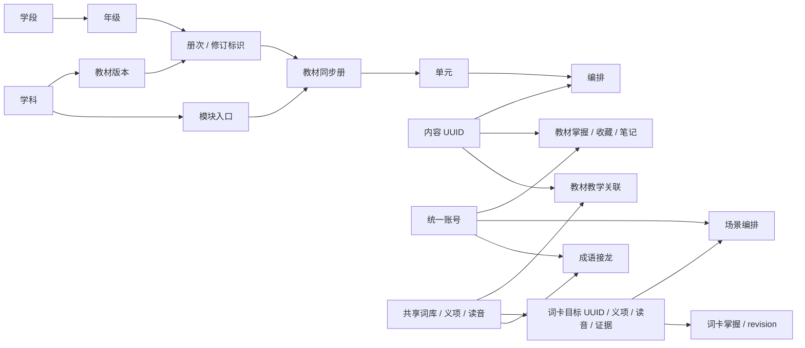

# 乐学堂 · 家庭学习系统

用于辅导孩子学习的 Django 单体项目。`primary-system/` 是主项目，其他目录保留为资料、原型或研究。

设计基线见 [系统设计与开发基线](docs/system-design.md)。当前明确区分两条管线：**教材按册次、单元和内容编排；学科功能拥有独立页面、数据模型和学习流程。** 旧专题学习册已退出，科学、地理、历史等后续按学科逐个开发，不放回通用专题阅读器。

`references/` 新资料的 [基础数据与中文教学规划](docs/foundation-data-plan.md) 已完成，另有 [文件与内容核验](docs/reference-audit-2026-11-02.md)。当前保留七包中的七类资料，南非教材及算术事实已按用户要求删除，提供中文界面、可靠短名称和字段对照及独立浏览入口；长篇英文释义仍保留原文并标明中文待补。字词资料已整合到[查字查词](http://127.0.0.1:8012/dictionary/)，见[统一展示实施](docs/dictionary-unification-implementation.md)；历史[全量资料库实施](docs/reference-library-implementation.md)与[独立验收](docs/reference-library-acceptance.md)。当前退役范围和维护流程见[退役报告](docs/reference-library-removal-implementation.md)。

## 当前功能

- 教材目录：英语模块（「教材同步」，2 本同步册，含单词与课文），英语模块页是教材同步册的专属书架；语文、数学已改文件编排（见下「语文教材册」「数学教材册」）。英语单元页提供「单词 / 课文」两个视图，课文气泡卡支持逐句点读；侧栏可选本单元全部课文或单篇课文连读。首页不再放书架与年级/学科/教材筛选（筛选仅保留在目录 API 层）。
- 统一账号、个人年级偏好；页面顶部独立信息条集中放置当前账号、学习偏好、退出和管理后台入口，游客可直接登录或注册，主导航专注学习入口。用户中心的学习偏好、密码修改与成功页、我的奖励共用导航与卡片样式，登录和注册沿用同一套大字号表单，密码可临时显示核对。偏好页区分随账号保存的资料与仅存当前浏览器的发音人，支持试听。奖励页集中展示积分、称号、七列打卡日历、勋章、兑换和积分明细，积分规则可展开查阅。教材内容支持掌握、收藏、私人笔记及并发修改冲突提示。
- 积分兑换：主导航与用户中心直达 `/rewards/shop/`，游客无需登录即可浏览，登录后兑换并查看本人积分和兑换记录；主导航「我的学习」仅登录后显示。内置 22 项、50～5000 积分的现实奖励，按愿望、玩具、零食、娱乐、自由时间五类分组，提供「全部」与分类筛选、数量和深链接；娱乐内容统一为「手机、平板娱乐、游戏」，按 15 分钟、30 分钟、1 小时三档兑换，电影归自由时间，登录与兑换后保留当前分类。源文件 `content_sources/rewards.json` 经校验后用 `manage.py import_rewards` 导入，重复执行跳过同名项并补齐空白分类；后台可调整分类，旧活动目录可选择下架，保留家长修改与历史记录。兑换后由家长安排与核销。见 [奖励目录维护](incentives/data/README.md)。
- 我的学习（`/me/`）：个人欢迎卡集中提供学习偏好与奖励入口，页内导航直达最近足迹、学习总览和教材记录。最近足迹优先展示 3 条，其余可展开；总览按教材学习、数学教材、场景单词、成语接龙、作文坊、成语挑战、飞花令、多音字、挑战题库、不规则复数和日常用语 11 个方向汇总，各领域只展示自己含义明确的数字与本周新增，不合成分比。教材记录支持学习状态与收藏筛选、结果计数和分类空状态，筛选与翻页后定位回记录区。首页只保留学习入口。
- 教材阅读支持纯文本、类型化图示块、互动图示、点读、连读及打印；英语单元页的单词与课文连读默认每次发音后留出 3 秒跟读时间，侧栏默认在右侧，可用顶部按钮切换到左侧，位置保存在当前浏览器。侧栏顶部集中提供「单词／课文」切换、开始／暂停／继续、停止连读和从头开始，显示当前内容、次数与进度；连读时突出当前词卡或句子，适度淡化其他内容，单词在侧栏放大展示，并分别标明听读、跟读和暂停状态；侧栏随窗口剩余高度伸缩，朗读设置位于播放控制下方，目录使用剩余空间独立滚动，不固定列表高度。暂停保留当前发音位置或剩余跟读时间；停止会清空本次连读、选中效果与进度，恢复正常浏览，从头开始会重播所选范围。单词卡和课文句子支持悬停与点击选中，手动选择退出连读，保留喇叭和句子点读，也可用键盘选择、按 Esc 退出选中。可展开顶部的「朗读设置」调整间隔（0～10 秒）和每项朗读次数（1～5 次，默认 1 次），保存在当前浏览器。浏览器语音按朗读结束推进，实际发音依赖设备。
- 语文教材册：独立 `chinesebook` 应用，**文件编排**（按册编排：`/chinesebook/` 为册次入口，册页 `/chinesebook/4a/`）——统编版四上 8 单元 27 篇课文：课文卡配作者小传、原文金句、真实百科、重点词语/多音字/近反义词与拓展视频（B站外链需联网），必背古诗文（含意境图、注释、创作背景、诗人小传）、日积月累、字词复习（多音字＋形近字）单独成视图；可点读、站内搜索、打印复习；「已复习」标记存本机浏览器，只读浏览不进学习总览。内容源头是 `content_sources/knowledge-data.js`，由 `scripts/build_chinesebook.cjs` 确定性同步。维护见 [语文教材册数据说明](chinesebook/data/README.md)。
- 古文精读馆：语文专题 `/classical/`，采用结构化文件编排。11 篇精选古文包含四上两篇及《滕王阁序》，另设《论语》二十篇、513 则全文与《道德经》八十一章、428 句精读。共 112 个阅读页面、1054 个精读段、367 道练习（248 道选择、119 道讲述自查）。支持逐句／逐则译解、点词释义、指代线索、停顿、单段／全文设备听读、关键词与全遮背诵、四种整篇打印及单段原文／讲解打印。全书可跨篇搜索原文、译文与词义并直达章句；《道德经》按道经、德经分卷导航，新增 243 道章后练习。《滕王阁序》按七段正文与附诗编排 71 个精读单元、190 处词义／典故提示、24 道练习，支持分段跳读、听读、背诵、练习和四种分段打印。原《论语六则》已合并到全书，旧链接兼容跳转。108 个页面按版本指纹关联本机原典，核心阅读无需数据库；复习与自测只存当前浏览器，朗读依赖设备语音。维护见 [古文精读馆](classical/README.md)。
- 数学教材册：独立 `mathbook` 应用，**文件编排**试点（按册编排：`/mathbook/` 为册次入口，册页 `/mathbook/4a/`，册次码对齐 catalog 教材码后缀）——北师大版四上 11 单元 43 个知识点按文件源的知识卡呈现：图示（含互动演示）开路，要点/例题/易错标签页、生活中的数学照片、记忆口诀，另有公式速查、易错诊所、教学视频（B站外链需联网）与站内搜索、打印复习。登录后，已读、自评掌握和上次单元随账号保存，从「我的学习」可以接着学。游客继续使用本机进度，登录后可确认导入，每个账号每册一次。四上知识卡直达例题自评，易错诊所可进入判断练习，练后可返回原处。内容源头是 `content_sources/math-data.js`，由 `scripts/build_mathbook.cjs` 确定性同步（共享图示库与照片一并同步），加载期校验坏数据拒绝上线。维护见 [数学教材册数据说明](mathbook/data/README.md)。
- 共享词库：字词、义项、读音、原始证据、人工修订、版本化导入、审核、启用与回退；统一查字查词页面。
- 成语接龙：游客／登录账号隔离、服务端计分、提示、陪练、终局；单人模式对小龙陪练，双人「家长对决」同屏轮流——每局选先手（孩子/家长），提示双方都能用、每次 −5 分从轮到的一方扣，谁接不上对方赢。词池来自当前生效词库，后台可禁用词条。
- 场景成语：6 类、44 个场景，358 个成语通过 397 个场景词位复用现有成语词典（例句部分取自 primary 成语本的整理数据）；支持全量词典搜索、出处与场景例句对照，以及成语／场景例句连读、暂停继续、停止和从头开始。跟读间隔和重复次数可调，当前成语、拼音和例句突出显示，支持悬停、点击成语或例句选中，点击例句旁的喇叭可点读；停止恢复正常浏览。侧栏默认在右侧，位置自动记忆，朗读设置位于自适应场景目录上方。场景固定词条、义项和来源证据，词义修订后暂停关联并提示复核；只读浏览，不生成学习记录。维护见 [场景清单说明](idioms/data/README.md)。
- 成语典故馆：挑有人物故事的 30 个成语按典籍分组做故事卡（负荆请罪、三顾茅庐、望梅止渴……），每卡含出处原句、孩子能懂的故事复述、含义与人物 chips；25 位人物档案提供「人物线索」（蔺相如 → 完璧归赵/负荆请罪），`?figure=` 展开线索视图。成语读音、释义、出处、例句实时取自词库 chinese-xinhua-idioms 生效记录，逐条 matches_pin 校验、漂移即降级待核对；只读浏览，不写学习记录。维护见 [典故馆数据说明](idioms/data/stories-README.md)。
- 看释义猜成语：释义补字小游戏——给出释义，把成语缺的字从候选键盘点选补上；难度就是亮出的提示字数（提示 3 字只剩一个空，无提示即挑战），提示位任意分布，`?seed=` 可复现同一题。题库两档：常用（场景课程成语逐条过钉词校验）与大全（全词库四字成语按释义质量过滤）；服务端提供填字提示并核对答案。每题首次检查记入学习记录，改正后可看解析。累计成绩与连对次数按账号或游客会话显示。
- 成语表情猜猜看：看 emoji 四选一猜成语（🐍➕🦶 = 画蛇添足）——296 个画面感强的成语配 AI 辅助生成、人工核对的 emoji 映射，一轮 8 题随机出题；判定、计分在服务端签名状态里（正确答案不留前端），答错即亮正确答案并给词典释义与跳转。页面临时练习，刷新重开，一局猜满由服务端记入学习足迹；映射维护见 [表情题库说明](idioms/data/emoji-README.md)。
- 成语配对：连线配对玩法——左栏找一个成语，右栏配它的近义或反义（画蛇添足 ↔ 多此一举，雪中送炭 ↔ 雪上加霜）。49 对配对（近义 11 / 反义 38）全部钉词校验，同局词头不相交；配对成功亮关系徽标与两侧释义，判定在服务端。页面临时练习，刷新重开，一局配满由服务端记入学习足迹；维护见 [配对题库说明](idioms/data/pairs-README.md)。
- 图形运动实验室：学习广场「数学」及四上册页可进入 `/mathbook/geometry-lab/`。三个方格实验分别演示按格平移、绕点旋转和沿折痕翻折，每个实验配一个即时反馈挑战。访客可直接操作，手记和挑战目标维护在 `content_sources/geometry-lab.json`。
- 多音字：`hanzi` 应用新专题——从 CC-CEDICT 全量词语按字位音节对齐推导出 1,010 个多音字（2,227 种读音），字卡网格按读音筛选，点字看每个读音的组词（整词声调拼音、目标字高亮、轻声标「轻」），练一练「给词选读音」前端判分，每题上报服务端按读音表复核后记一条练习记录（对错都记）。数据口径与重建见 [多音字数据说明](hanzi/polyphone_data/README.md)。
- 汉字演变馆：学习广场「语文」下 `/hanzi-evolution/`——10 个字族 100 个常用字的四段字形演变（甲骨文→金文→小篆→楷书），每字配看图提示、字理小故事和组词，与查字查词、笔顺资料、多音字三处按字互链（馆藏 100 字的笔顺详情页和多音字页也有「看字源」反链）。支持字族目录、搜索、猜字模式（藏住楷书猜古字）、点读和已认全标记；「馆前必读」讲甲骨文发现故事，「六书速查」解释造字法。古字形 SVG 抓取自汉字叔叔字源网（hanziyuan.net）随项目发布，站上缺失的字形以「未见于某文」诚实标注；选字清单与抓取脚本见 `scripts/fetch_hanzi_glyphs.py`，可得性报告在 `content_sources/hanzi-evo-availability.json`。
- 不规则复数：独立 `plurals` 应用——70 对英语不规则复数手工整理分六组（元音变化、-en 词尾、f 变 ves、单复同形、其他要记的、外来词），27 个小学必会词进「给单数选复数」练习池（干扰项含 childs、foots 这类规则误推形态），每题上报服务端按确定性选项集复核后记一条练习记录（对错都记）；拓展词只浏览标「拓展」徽章。支持搜索与分组筛选；数据手工维护，口径见 [复数数据说明](plurals/plural_data/README.md)。
- 日常用语：独立 `phrases` 应用——教材词卡的 597 条常用短语与短句（en/zh 原文转换自 `content_sources/english-data.js` ENGLISH_PHRASES），一份两个视图：按句式 18 组（Let's… / Can… / There be / 日常套语……组头带中文口诀）与按话题 11 组（组头挂「去场景单词学词」互链）；141 个句子形态进「看中文选英文」练习池，干扰项取同句式/同话题易混句，每题上报服务端按确定性选项集复核后记一条练习记录（对错都记），搭配类只浏览。支持搜索与筛选；内容以教材语料为单一数据源，转换管线见 [日常用语数据说明](phrases/data/README.md)。
- 挑战题库共有 296 道可练题，包括数学教材自评与判断题、语文多音字、英语词义、语法巩固题和 100 道奥数题。可按学科筛选，每组 5、10 或 20 题。服务端逐题判分并保存作答，答错的题会进错题本，重练答对后移出。批次来源和导入方式见[题库数据说明](questionbank/data/README.md)。
- 从学习广场「数学」分类下的「奥数挑战」卡进入。100 道四年级四选一题分为 10 个主题，每组 10 道，包含速算巧算、等差数列、鸡兔同笼、盈亏问题、还原问题、行程初步、图形计数、逻辑推理、植树问题和周期规律。可按主题练一组，也可混合抽题，每题附有解题思路。奥数错题沿用挑战题库的错题本，重练时按奥数轨抽题。
- 场景单词：独立 `words` 应用，46 个生活场景、577 个词位；稳定词卡目标固定义项、读音和版本证据，可在多个场景复用。教学标注留在词位上，支持点读和词卡掌握。侧栏默认在右侧并可一键左右切换，朗读设置集中在顶部，目录使用窗口剩余高度独立滚动；当前场景或搜索结果都能连读；提供暂停／继续、停止、从头开始及跟读间隔、重复次数设置，与教材共用朗读偏好。当前单词会放大显示、词卡高亮，其他词卡适度淡化；支持悬停和点击选中，手动选择退出连读，停止恢复正常浏览；切换场景、搜索或更新掌握状态后清空旧播放进度与手动焦点。「我的学习」里的单词足迹会定位到对应词卡。
- 英语音标：独立 `phonetics` 应用，首页的「发音基础」有 6 节短课，从读懂音标到辨音和找重音。44 个音素按五组编排，每组提供发音要领、常见拼读、例词点读与连读。音素卡例词运行时回查词库已核对读音（primary-words／primary-english），解析不到显示「拓展词」；音素原声为预生成资产（espeak-ng 合成，运行时不依赖）；只读浏览，不生成学习记录。维护见 [音标数据说明](phonetics/data/README.md)。
- 英语语法：独立 `grammar` 应用，8 章 31 个语法点（词法基础、名词、冠词、代词、be 动词与 there be、时态初步、形容词与副词、句型变换），每点含讲解、必须掌握要点、对比表、句型公式、例题折叠、易错辨析与三选一巩固题（页内即时判分、进度存本机）。「练本章」从挑战题库的 `primary-grammar` 批次选取本章题目，作答由服务端判分并记录，可查看本章错题并重练。内容源头是 `content_sources/grammar/`，转换管线与修订流程见 [语法数据说明](grammar/data/README.md)。
- 作文坊：独立 `writing` 应用，**不进教材编排**（不用 ContentItem／单元／Placement）。7 个题材、47 个题目的写作锦囊（目标、结构锦囊、好词好句点读、范文点评、小练笔）加素材百宝箱与灵感抽签；「我的作文本」保存作文草稿——登录挂账号、游客挂浏览器会话；在同一浏览器退出登录后，可以继续写先前保存的游客草稿。未保存的正文按账号或游客会话暂存在当前浏览器，刷新可以接着改原稿，也可从「我的学习」直接打开对应草稿。草稿保存使用 revision 检测并发修改。题目数据转换自原型同源数据，维护见 [作文坊数据说明](writing/data/README.md)。
- 查字查词统一查询：已发布词义、CC-CEDICT汉英参考、CMU美式读音、汉字属性和笔顺在同一页展示；正式词条详情也显示同形补充资料，来源和版本分别保留。
- 资料探索：查字查词、古诗文、国家地区、元素及HYG星表五个入口，不自动生成学习记录。
- 学习广场的「历史」卡直接打开双轨时间轴，覆盖 9 个时代、126 件中外大事和 30 组同期对照。从时代站和事件详情可打开相关精讲，完整精讲目录含 8 个主题、37 个知识点，配文物图片、音频、动画和自测。公元纪年与朝代顺序集中在朝代与版图页，另有 16 个朝代、22 个阶段的版图变化，在同一底图上圈出大致范围，可分色查看并立政权、叠加另一阶段、缩放和平移。
- 学习广场的「地理」卡直接打开地理图谱的中国地图，可切换世界地图、查地点、进省域站、走主题路线和看实景图册。世界地图可选择七大洲逐洲高亮，并阅读位置、地形、气候等重点与观察问题。「中国动物地图」展示 30 种代表动物，点位分布在 27 个省级行政区，可按 6 类栖息地筛选。「世界动物地图」展示七大洲和多片海域的 30 种代表动物，可按 7 类栖息地筛选。两张动物地图都可在地图下方直接点照片选动物，地图标记与档案同步更新，查看照片、习性和代表栖息地。新增中国、世界两张植物地图，各有 24 种植物与本地照片，按 7 类生长环境筛选，点地图下方照片同步查看分布、环境适应和观察线索，世界植物覆盖七大洲。从地图工具或代表地点可进入地理小课堂，小课堂含 8 个主题、37 个知识点，配照片、音频、动画和自测。河流的基础档案在地图上查看，精讲侧重流域、泥沙等概念。
- 「地理」下的天文探索有 9 站、46 个知识点，新增「宇宙漫游」的太阳系、银河系与深空 3 个主题，配 6 幅大图、3 段本地 NASA 动画、8 颗行星的公转／距离／大小实验桌及 6 个外部探索入口；图片注明实拍、观测合成或示意，保留星空实景与月相演示。「语文」下的文学常识有 8 个主题、41 个知识点，从体裁到名著练习阅读；同组的汉字演变馆有 10 个字族、100 个常用字的四段字形演变和字理小故事。「科学」下的科学实验室有 8 个主题、39 个知识点，配互动图示、观察任务和小实验。四套课程支持搜索、点读、打印和本浏览器的掌握标记。已有资料从课内链接查阅，课程内容和图片随文件发布。
- 「科学」下的人体奥秘站有呼吸、消化、血液循环、骨骼肌肉、大脑与神经、眼耳与感官 6 课。每课先操作大图，再看两幅可放大的外部图像，共 12 幅，包括肠绒毛与神经细胞显微照片、血细胞电镜图、手骨 X 光片、脑部 MRI 和眼耳解剖图。每课有 3 条扩展知识、1 个小实验和 3 道即时反馈题，共 18 道自测。互动包括呼吸与膈肌、五站食物旅行、心脏泵血、手臂屈伸、神经消息接力、感官切换、反应小游戏与盲点实验。测脉搏配手腕图、30 秒计时和换算。图像随项目保存，原出处需联网。计时、作答和测量记录在当前页面使用，侧栏位置由浏览器记忆。见 [课程文件源](content_sources/README.md)。
- 「科学」下的人类起源从莱托利脚印出发，依次看人类家谱、远古生活、智人迁徙和中国遗址。迁徙年代地图有约 30 万年前至今天的 17 个节点、8 个地区证据卡和 7 类古人类生活记录，地图直接用 7 种颜色标出 17 个代表点位。自动播放按年代切换路线与点位，约略消失的人群退场，灭绝时间未定者保留空心问号并另列清单；点击点位后直接定位到地图下方的当地记录与出处，并可返回刚才的点位。支持暂停、继续、从非洲重新开始及每站 3／6／10 秒调速；专题导航恢复侧栏，默认右侧，可左右切换和折叠，折叠状态保存在当前浏览器；正文内部采用单列，年代说明放在地图下方；年代、地区与点位均可用深链接打开。家谱增加与迁徙图同名同色的七组人群对照、近 40 万年放大时间条和头骨实物对照；石器与火补齐切痕骨骼、受热燧石照片及观察问题。图片可放大，官方三维藏品与原文配中文引导并标注「需联网」。中国遗址扩充为四个地区的五组发现，加入白石崖下颌骨与哈尔滨头骨实物图，和家谱、年代地图双向关联；哈尔滨头骨按年代下限单独说明。各站配图示、证据卡和一道即时反馈的判断题，正文与素材采用项目内文件编排。见 [专题数据说明](humanorigins/data/README.md)。
- 「科学」下的未解之谜研究所按「太空与信号」「地球与生命」「古迹与文字」编排 27 份案卷。每篇在线索前展开 2 个具体未解问题，共 54 个，并说明还缺的证据，目录直接展示未解焦点。新案卷包括第九行星、金星云层、早期黑洞、鲸歌、海龟感磁、地球水的来源、罗马十二面体、线形文字 A 和印度河印章。每篇配图、线索、判断题、调查结论、家长延伸和资料出处，访客可直接阅读和作答。12 份案卷有短片、动图、录音或互动读图，新增本地鲸歌原始录音、海龟实验短片，以及轨道图和声谱图点读。深海可沿立体剖面探索 5 个深度带，查看 10 张动物照片。核心素材随项目保存，资料原文需联网。见[案卷维护说明](mysteries/data/README.md)。
- 「科学」下的科学流言粉碎机有 24 项查证任务，按身边的材料、天气与地球、太空里的误会、动物与植物和视频里的说法五类查找，支持关键词搜索。每项配两张证据卡、四类判断、即时反馈和迁移小问题。其中 14 项配本地媒体，共 12 张照片或图解、2 段 NASA 原始影像，另有 12 个动手或观察活动。访客可直接作答，进度保存在当前浏览器，筛选后仍显示全部任务的总进度。正文、图示和媒体随项目保存，资料原文需联网。见 [课程文件源](content_sources/README.md)。
- 飞花令：桌面优先的单字令五句练习，从已入库唐诗、宋词、诗经、楚辞和千家诗检索。预置 29 个令字（花月春山水风雪云雨江日天秋酒夜柳桥马竹红白青海河梅灯舟松荷），也支持自定义任意单个汉字开令（语料不足五句如实拒绝）。输入分句后展示所在完整句，提示学习与独立作答分开统计，可跳转原诗。本页临时状态，刷新重新开始；完成一局由服务端记入学习足迹（每局一条）。来源范围、版本采用与派生索引维护见 [诗句库说明](poetry/data/README.md)。
- 诗词地图：一座城一首诗——背过的诗按地点摆上中国地图（离线 SVG 底图，39 个地点）。点地点或搜城市看当地诗：代表诗、其余诗、点读与跳转原诗；诗篇运行时定位 simplified 层语料，定位不到如实降级。只读浏览，不写学习记录；地点编排与地图来源见 [诗词地图说明](poetry/map_data/README.md)。
- 「地理」下的二十四节气馆按春夏秋冬排 24 张卡，收录 72 候、地方习俗和农谚。应景诗句在打开页面时从简体语料库读取，可点进原文。节气馆与地理小课堂的天气和四季、文学常识的节气课、诗词四季和各季诗单双向联读。
- 诗词四季：按春夏秋冬、按情感与题材两条路径浏览诗词——四季（春 715 / 夏 135 / 秋 456 / 冬 477 句）走新增的关键词分类规则，思乡、送别、边塞、咏物等情感题材复用原题材分类；四季大卡 + 情感分组入口页，诗单沿用题材详情页。关键词自动归档不等于逐句审校；只读浏览，不写学习记录。
- 古文经典：hanzhaodeng/chinese-ancient-text 62 册简体古籍（三字经、声律启蒙、论语、史记、资治通鉴等）入库古诗文浏览——九个 collection（蒙学读物/儒家经典/史书典籍/诸子百家/兵法谋略/笔记杂谈/科技博物/医学典籍/佛典经文）、5258 篇正文约 1225 万字，与既有诗词语料同页检索但独立来源版本（`ancient-classics` 数据集），正文简体原生不做繁简切换。飞花令、题材分类与诗词地图不收古文经典；只读浏览，不写学习记录。来源与管线见 [古文经典实施](docs/ancient-classics-implementation.md)。
- 词以类聚：WordNet 词义树按意思分组，有动物、食物、交通工具等 10 条枝干、263 个节点、285 个场景词。并列的拼写家族按共同词尾和读音分组，含 `-at`、`-an`、`-ake` 等 16 组、80 个例词。两枝都可展开、筛词、点读和查词典。拼写家族词墙高亮共同词尾，每个例词旁可直接看音标和点读。WordNet 词卡可跳到场景页学习。词树供只读浏览，维护方式见[词树说明](words/tree_data/README.md)。
- Nova 后台分组管理课程、词库、玩法、学习记录、题库与账号；普通学习账号不具有管理权限。首页提供按权限显示的学习统计、内容储备和待办提醒，支持近 7／30／90 天切换、手动刷新及每分钟自动刷新，列表不显示「打印当前页」。

后台首页使用 Nova 的原生模板扩展和导航计数 provider，业务聚合维护在 `config/admin_dashboard.py`，保留现有模型注册、权限、滑块验证与管理表单。六类图表为每日学习打卡、题库作答趋势、内容发布状态、启用题目学科分布、教材掌握状态和奖励兑换进展；指标与明细入口按对应 `ModelAdmin` 的查看权限和查询集生成，教材进度仍仅超级管理员可见。打卡人数按账号去重；题库含游客作答，正确率只计算选择题与判断题；时段按北京时间自然日计算。发布内容、题目储备和教材掌握为当前快照，待核销兑换为全部积压，不受时段限制。

图表复用 Nova 随附的本地 Chart.js，保留可展开的数据表，无脚本时可用 GET 切换时段并阅读数据表。异步接口 `/admin/_dashboard/data/` 仅限后台账号、按模型权限重新聚合且不缓存，刷新失败保留上次结果。主题升级固定为 Nova 0.6.1 的最新上游源码修订 `041cd80772a8ecc9621743463134462809de13e2`（正式版本号未变），通过 `/admin/_nova/` 接入外观偏好；原生外观或关闭 Nova 时恢复标准后台首页。依赖已锁在 `requirements.txt`，无需新增数据库迁移。验证命令：`.venv/bin/python manage.py test config.test_admin_dashboard accounts.tests.AccountTests lexicon.tests.test_admin`。

以上内容规模是当前资料范围，不表示所有内容均已完成教学审校。场景词已支持多场景／多义项引用；新的学科教学玩法尚待实现，见设计基线的后续顺序。

## Docker 线上部署

已有 Nginx／宝塔负责域名和 HTTPS 时，在本目录执行 `make deploy DOMAIN=自己的域名`：自动生成密钥、构建镜像、准备完整学习内容并等待健康检查；再用 `make admin` 创建管理员。代理转发到 `127.0.0.1:8012`，配置片段见 [Docker 部署与日常维护](docs/docker-deployment.md)，宝塔整站示例见 [nginx-baota.conf.example](deploy/nginx-baota.conf.example)。只改反向代理规则时，检查并重载宿主机 Nginx 即可，无需再次部署应用。

后续 `make update` 快进拉取 Git 并在备份后升级；已同步代码用 `make update PULL=0`。生产使用独立的 **PostgreSQL 16 Docker 容器**，仅在容器内网连接；数据库、私有资料和备份分别保存在持久卷。`make status`、`make logs`、`make db-shell`、`make db-logs`、`make restart`、`make backup`、`make restore BACKUP=文件名` 提供日常维护，数据库小版本升级使用 `make db-update`。更新不重置账号或学习记录，新站点初始化使用发布基础包；本机仍默认 SQLite，个人数据不会自动上云。

本地可用 `make test-deploy` 测试部署保护逻辑，`make test-docker` 在独立容器和临时卷中验证实际部署、更新、备份恢复和数据持久性。全部运维说明、反向代理规则与故障恢复步骤见 [部署文档](docs/docker-deployment.md)。

日常只改页面、样式、文件型专题或无迁移的代码，使用 `make update-app`（已拉取代码加 `PULL=0`），省略全量备份、迁移、资料扫描与索引重建。已构建镜像用 `make apply`；应用配置改动用 `make reload-config`，普通 `make restart` 保留原环境。快捷更新遇到待执行迁移会在替换应用前拒绝；改用完整更新，或构建后 `make db-migrate`。积分兑换用 `make rewards-preview`、`make rewards-import`；另有 `questions-import`、`permissions-sync` 和 `index-rebuild` 单项维护，具体执行范围见部署文档的场景表。

## 本地运行

Python 3.12+；依赖版本固定于 `requirements.txt`。初始化与运行均从项目内读取内容与素材，Node 仅用于生成和测试。完整基础内容及固定来源载荷随仓库保存，内容恢复不联网；首次安装 Python 依赖可能需要网络。

```sh
cd primary-system
python3.12 bootstrap.py
PRIMARY_DEBUG=1 .venv/bin/python manage.py runserver 127.0.0.1:8012
```

也可以用 `make`：`make install` 初始化、`make run` 启动、`make test` 跑 Django 测试、`make test-frontend` 跑前端回归；直接运行 `make` 查看全部命令（迁移、seed、数据修复、作文坊与音标数据再生成等）。

已有数据库默认只校验，不重置内容、用户或学习记录。旧初始化只导入部分教材／暂存词库时，先停止目标服务，再运行 `python3.12 bootstrap.py --refresh-data`：脚本在迁移前建立 SQLite backup 恢复点；需替换且含个人记录或人工修订时拒绝，并给出独立 `--database` 路径。迁移待应用且有个人记录时，在迁移前直接拒绝。详见 [本地开发与数据准备](docs/local-development.md)。

- [学习广场](http://127.0.0.1:8012/)
- [数学教材](http://127.0.0.1:8012/mathbook/)
- [图形运动实验室](http://127.0.0.1:8012/mathbook/geometry-lab/)
- [语文教材](http://127.0.0.1:8012/chinesebook/)
- [古文精读馆](http://127.0.0.1:8012/classical/) · [现有四上两篇](http://127.0.0.1:8012/classical/?curriculum=4a) · [论语二十篇](http://127.0.0.1:8012/classical/books/lunyu/) · [道德经八十一章](http://127.0.0.1:8012/classical/books/daodejing/) · [滕王阁序](http://127.0.0.1:8012/classical/tengwanggexu/)
- [查字查词](http://127.0.0.1:8012/dictionary/)
- [资料探索](http://127.0.0.1:8012/references/)
- [历史双轨时间轴](http://127.0.0.1:8012/history/timeline/timeline.html) · [朝代与版图](http://127.0.0.1:8012/history/timeline/dynasties.html#territory-maps) · [历史精讲](http://127.0.0.1:8012/history/)
- [地理图谱](http://127.0.0.1:8012/geography/atlas/china.html) · [中国动物地图](http://127.0.0.1:8012/geography/atlas/animals.html) · [世界动物地图](http://127.0.0.1:8012/geography/atlas/world-animals.html) · [中国植物地图](http://127.0.0.1:8012/geography/atlas/plants.html) · [世界植物地图](http://127.0.0.1:8012/geography/atlas/world-plants.html) · [地理小课堂](http://127.0.0.1:8012/geography/study/)
- [天文探索](http://127.0.0.1:8012/astronomy/study/) · [文学常识](http://127.0.0.1:8012/literature/) · [科学实验室](http://127.0.0.1:8012/science/lab/) · [汉字演变馆](http://127.0.0.1:8012/hanzi-evolution/)
- [人体奥秘站](http://127.0.0.1:8012/science/body/) · [未解之谜研究所](http://127.0.0.1:8012/mysteries/) · [科学流言粉碎机](http://127.0.0.1:8012/science/rumors/)
- [人类起源](http://127.0.0.1:8012/human-origins/)
- [场景单词](http://127.0.0.1:8012/words/)
- [词以类聚 · WordNet 词义树](http://127.0.0.1:8012/words/tree/) · [拼写家族](http://127.0.0.1:8012/words/tree/?root=spelling)
- [二十四节气馆](http://127.0.0.1:8012/geography/solar-terms/) · [诗词四季](http://127.0.0.1:8012/poetry/seasons/)
- [成语接龙](http://127.0.0.1:8012/chain/)
- [场景成语](http://127.0.0.1:8012/idioms/)
- [成语典故馆](http://127.0.0.1:8012/idioms/stories/)
- [看释义猜成语](http://127.0.0.1:8012/idioms/quiz/)
- [多音字](http://127.0.0.1:8012/hanzi/polyphones/) · 先看 8 个常用字的组词和例句，再跟读、选读音。1,010 字可按汉字、组词和拼音查找。
- [病句医院](http://127.0.0.1:8012/chinesebook/sentence-hospital/) · 四年级修改病句，6 类病因共 18 张病例，按「挂号 → 诊断 → 处方」接诊。
- [错别字诊所](http://127.0.0.1:8012/chinesebook/typo-clinic/) · 四上教材字词的 20 道形近字改错和 16 道多音字辨读。两个诊室都可分类练习或混合接诊，值班成绩只在当轮显示。病例维护见[课程文件源](content_sources/README.md)。
- [不规则复数](http://127.0.0.1:8012/plurals/)
- [日常用语](http://127.0.0.1:8012/phrases/)
- [挑战题库](http://127.0.0.1:8012/questionbank/)
- [奥数挑战](http://127.0.0.1:8012/questionbank/olympiad/)
- [英语音标](http://127.0.0.1:8012/phonetics/)
- [英语语法](http://127.0.0.1:8012/grammar/)
- [作文坊](http://127.0.0.1:8012/writing/)
- [对联工坊](http://127.0.0.1:8012/couplets/) · 学习广场「语文」专题。4 条入门线索、6 副分词例联、6 道即时反馈题；可填写上下联和横批，切换阅读方向，预览贴在门上的样子。见[课程文件源](content_sources/README.md)。
- [飞花令](http://127.0.0.1:8012/poetry/feihualing/)
- [诗词地图](http://127.0.0.1:8012/poetry/map/)
- [管理后台](http://127.0.0.1:8012/admin/)

首次初始化从 `data/baseline/` 恢复当前教材编排、固定内容／词义 UUID、已选中文版本、词库生效与公开状态、接龙词池及九个资料数据集，从本目录 `data/reference-archives/` 下的七个 ZIP 恢复 354 个资料文件。初始化还会导入 5 个题库批次（296 道可练题），恢复全部 577 个在用场景词卡和 310 个教材词卡的中文采用记录，并预建飞花令索引。系统初始化不创建默认账号。

默认数据库为 `db.sqlite3`，用 `PRIMARY_SQLITE_PATH` 可指定独立文件。会话和 CSRF Cookie 使用 `primary_` 前缀；本地随机密钥在权限 0600 的 `.local-secret`。日常数据库、密钥、虚拟环境、备份和解压缓存不进 Git；可复现的基础数据包及三个固定词典来源文件进 Git。

## 数据模型与扩展



教材内容使用稳定 UUID。复用同一内容时共享其学习状态；需要不同教材或年份各自记录时，应创建不同内容。学科专属数据、实验步骤、游戏回合等放在各自领域模型，不能堆进教材 `sections`。

`sections` 支持 v1 纯文本和 v2 `text/figure` 块，原始领域字段保留于只读 `source_payload`。目录跨学科／跨模块约束由模型及表单校验，直接 ORM 写入须调用 `full_clean()`；批量更新会绕过模型校验。

## 内容与词库维护

教材与专题继续采用文件编排。编辑 [课程文件源](content_sources/README.md) 中的内容与素材，在本目录用 `make test-content-sources` 校验、`make content-data` 重生成。项目内的生成物随源文件一起维护。

日常通过当前后台及维护命令更新；需要把核对后的当前内容带到另一台电脑时，重新导出基础包，见 [基础包维护](docs/local-development.md#基础包维护)。下列 Node 命令是可选的教材快照导出入口，覆盖语文、数学和英语教材源。语文、数学的教学页面直接读取生成文件，详见 [语文教材册数据说明](chinesebook/data/README.md) 和 [数学教材册数据说明](mathbook/data/README.md)。

```sh
node scripts/export_primary.cjs
.venv/bin/python manage.py import_primary data/primary.json --dry-run
.venv/bin/python manage.py import_primary data/primary.json --publish
```

导出器只运行仓库固定的受信任静态数据模块；导入器仅接收教材模块，其他部分记录为跳过。导入在事务内执行，支持预演、重复运行和人工修改保护，不删除缺失记录、不覆盖受保护内容、不清空教材进度。`--publish` 只决定新增记录的发布状态。

词库按来源版本维护，教材通过稳定 UUID 与来源快照关联：词库原文、人工修订、教学简释分开保存；同形词不能只凭拼写合并；版本变化不能静默改绑教材词义。内部来源启用与词典页面展示审核是不同状态。

- [词库模型与分期设计](docs/lexicon-foundation.md)
- [词库导入、启用、回退与维护](docs/lexicon-operations.md)
- [首批词典来源与缺失范围](docs/public-dictionaries.md)

图示副本已在本项目内，由 `scripts/build_mathbook.cjs` 与 `scripts/build_chinesebook.cjs` 从 `content_sources/` 确定性生成（共用图示库 `static/figures/figures.js|css` 与数学图示 `static/mathbook/math-figures.js`），内容源头更新后重跑脚本即可；`speech.js` 由本项目独立维护。

## 接口与记录

| 接口 | 用途 |
|---|---|
| `GET /api/v1/catalog/` | 目录与已发布教材册 |
| `GET /api/v1/items/` | 教材内容摘要，支持 `collection/grade/subject/edition/q` |
| `GET /api/v1/items/<uuid>/` | 已发布教材内容 |
| `GET /api/v1/lexicon/` | 可展示词条，支持词形／拼音查询及语言／类型筛选 |
| `GET /api/v1/lexicon/<uuid>/` | 独立义项、读音、来源与版本 |
| `GET /api/v1/items/<uuid>/lexicon/` | 教材的教学词义关联 |
| `GET/POST /api/v1/me/progress/<uuid>/` | 当前账号教材学习记录 |
| `/words/api/state/`、`/words/api/learn/` | schema v3：场景编排、显式中文呈现与目标词卡掌握 |
| `/chain/api/state/`、`play/`、`hint/`、`restart/` | 接龙状态与动作 |
| `POST /idioms/quiz/api/report/` | 看释义猜成语凭签名题目取提示或检查填字，重试不重复记分 |
| `POST /hanzi/polyphones/api/report/` | 多音字练习逐题上报（服务端按读音表复核并重算对错） |
| `POST /poetry/feihualing/api/action/` | 飞花令开局、作答、提示与揭晓；CSRF 保护，短期签名局内状态，完成一局写入完成记录 |

教材进度 POST 使用完整 JSON：

```json
{"revision": 0, "status": "learning", "bookmarked": true, "note": "今天的新理解"}
```

状态为 `new/learning/mastered`，笔记最多 4,000 字。进度必须归属当前登录用户，写入要求 CSRF；过期 revision 返回 409，需要重新读取后由用户决定保存。个人页面禁止缓存。

场景单词写入使用目标 UUID，布局词位 ID 不作为学习身份：

```json
{"schema_version": 3, "target_id": "目标UUID", "revision": 0, "learned": true, "chinese_version_id": null, "presentation_revision": 0}
```

同目标跨场景共享词卡掌握，不扩张为同拼写所有义项或其他能力。过期 revision 和旧 word_id 请求返回 409，必须刷新；游客和账号不自动合并。变义、删词、来源停用或人工修订变化时保留目标与进度，暂停显示对应释义，不自动换义。详细约束、导入选择和备份见 [场景学习对象](docs/scenario-learning.md)。

中文翻译／教学解释独立版本化，目标及教材关联显式选版；同义升级保留学习身份，改义须新身份且不转移旧进度。来源或中文失效会暂停正文与依赖标注。当前 577 个在用场景词卡与 310 个教材词卡已采用经 AI 核对的固定来源中文。核对范围为已采用释义和来源绑定。见[覆盖清点](docs/chinese-coverage-inventory.md)及[批次报告](docs/chinese-batch-01-implementation.md)。

教材有关联词义时，保存须携带GET返回的presentation及update_learning；仅改收藏／笔记不重写学习依据。旧mastered依据未知时保留原值并显示待确认，不计入当前已确认掌握。维护命令、版本链规则、迁移保护和实测见 [中文义项实施报告](docs/chinese-sense-implementation.md)。

## 验证与数据库配置

```sh
.venv/bin/python -m unittest config.test_base_data
.venv/bin/python manage.py test --noinput
.venv/bin/python manage.py check
.venv/bin/python manage.py makemigrations --check --dry-run
make test-frontend
```

最新实测见 [VALIDATION.md](VALIDATION.md)，较早章节只代表当时状态。

PostgreSQL 使用 `requirements-postgres.txt`，设置 `PRIMARY_DB_ENGINE=postgres` 及 `PRIMARY_DB_NAME/USER/HOST/PORT/PASSWORD`；切换配置不会自动搬运 SQLite 数据。本机默认 SQLite；`bootstrap.py --database` 只支持 SQLite 初始化。

生产使用本项目的 Docker Compose 配置：PostgreSQL、Gunicorn、独立密钥、显式主机和 CSRF 域名，并通过已有 HTTPS 代理接入，详见 [部署文档](docs/docker-deployment.md)。本地开发服务器默认仅监听回环地址。

## 阅读侧栏

教材、专题目录和工具侧栏默认在右侧，顶部按钮可以移到左侧，选择自动保存在当前浏览器。侧栏按窗口剩余高度伸缩，搜索、筛选等常用工具在上方，长目录在剩余区域独立滚动；宽屏可收起为窄条，正文随之展开，各类侧栏的折叠选择自动记忆；窄窗口默认收起，可点击展开。教材与场景跟读页折叠时保留朗读进度。页面切换和词卡更新保留原有查询、深链接、作答和记录逻辑。适用页面与接入方法见 [侧栏布局说明](docs/sidebar-layout.md)。
