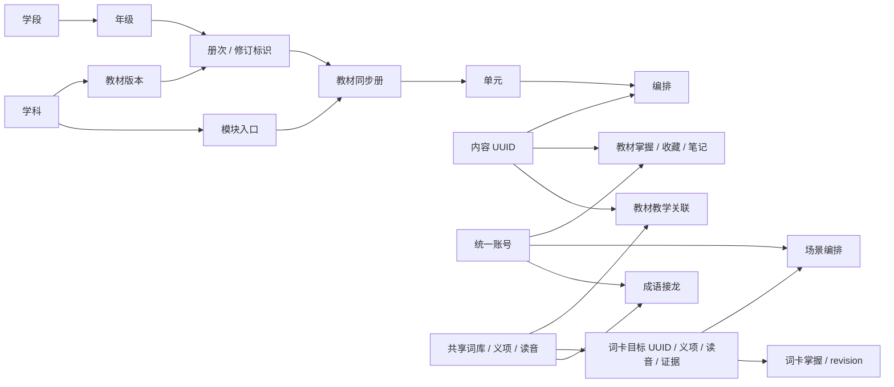

# 乐学堂 · 家庭学习系统

用于辅导孩子学习的 Django 单体项目。`primary-system/` 是主项目，其他目录保留为资料、原型或研究。

设计基线见 [系统设计与开发基线](docs/system-design.md)。当前明确区分两条管线：**教材按册次、单元和内容编排；学科功能拥有独立页面、数据模型和学习流程。** 旧专题学习册已退出，科学、地理、历史等后续按学科逐个开发，不放回通用专题阅读器。

`references/` 新资料的 [基础数据与中文教学规划](docs/foundation-data-plan.md) 已完成，另有 [文件与内容核验](docs/reference-audit-2026-11-02.md)。当前保留七包中的七类资料，南非教材及算术事实已按用户要求删除，提供中文界面、可靠短名称和字段对照及独立浏览入口；长篇英文释义仍保留原文并标明中文待补。字词资料已整合到[查字查词](http://127.0.0.1:8012/dictionary/)，见[统一展示实施](docs/dictionary-unification-implementation.md)；历史[全量资料库实施](docs/reference-library-implementation.md)与[独立验收](docs/reference-library-acceptance.md)。当前退役范围和维护流程见[退役报告](docs/reference-library-removal-implementation.md)。

## 当前功能

- 教材目录：语文、数学、英语三个模块（英语模块即「教材同步」，含单词与课文），4 本教材同步册、444 条内容（英语每单元 3 段课文对话，按教材动画逐帧转录）。英语单元页提供「单词 / 课文」两个视图，课文气泡卡支持逐句点读与整段连读；按年级、学科、教材筛选。
- 统一账号、个人年级偏好；教材内容的掌握、收藏、私人笔记及并发修改冲突提示。
- 学习总览：首页与「我的学习」分领域汇总学了多少——教材掌握、场景单词、成语接龙、作文坊、成语挑战、飞花令、多音字、挑战题库各一张卡，各领域只展示自己含义明确的数字与本周新增，不合成分比；「我的学习」另有「最近学了什么」动态流，把各领域的学习行按时间合并。
- 教材阅读支持纯文本、类型化图示块、互动图示、点读、连读及打印；浏览器语音按朗读结束推进，实际发音依赖设备。
- 共享词库：字词、义项、读音、原始证据、人工修订、版本化导入、审核、启用与回退；统一查字查词页面。
- 成语接龙：游客／登录账号隔离、服务端计分、提示、陪练、终局；单人模式对小龙陪练，双人「家长对决」同屏轮流——每局选先手（孩子/家长），提示双方都能用、每次 −5 分从轮到的一方扣，谁接不上对方赢。词池来自当前生效词库，后台可禁用词条。
- 场景成语：6 类、24 个场景，192 个成语通过 200 个场景词位复用现有成语词典；支持全量词典搜索、出处与场景例句对照。场景固定词条、义项和来源证据，词义修订后暂停关联并提示复核；只读浏览，不生成学习记录。维护见 [场景清单说明](idioms/data/README.md)。
- 成语典故馆：挑有人物故事的 30 个成语按典籍分组做故事卡（负荆请罪、三顾茅庐、望梅止渴……），每卡含出处原句、孩子能懂的故事复述、含义与人物 chips；25 位人物档案提供「人物线索」（蔺相如 → 完璧归赵/负荆请罪），`?figure=` 展开线索视图。成语读音、释义、出处、例句实时取自词库 chinese-xinhua-idioms 生效记录，逐条 matches_pin 校验、漂移即降级待核对；只读浏览，不写学习记录。维护见 [典故馆数据说明](idioms/data/stories-README.md)。
- 看释义猜成语：释义补字小游戏——给出释义，把成语缺的字从候选键盘点选补上；难度就是亮出的提示字数（提示 3 字只剩一个空，无提示即挑战），提示位任意分布，`?seed=` 可复现同一题。题库两档：常用（场景课程成语逐条过钉词校验）与大全（全词库四字成语按释义质量过滤）；判分、提示与连对计数都在前端，每题首次检查后上报服务端记一条学习记录（对错都记，按题池校验）。
- 成语表情猜猜看：看 emoji 四选一猜成语（🐍➕🦶 = 画蛇添足）——296 个画面感强的成语配 AI 辅助生成、人工核对的 emoji 映射，一轮 8 题随机出题；判定、计分在服务端签名状态里（正确答案不留前端），答错即亮正确答案并给词典释义与跳转。页面临时练习，刷新重开，一局猜满由服务端记入学习足迹；映射维护见 [表情题库说明](idioms/data/emoji-README.md)。
- 成语配对：连线配对玩法——左栏找一个成语，右栏配它的近义或反义（画蛇添足 ↔ 多此一举，雪中送炭 ↔ 雪上加霜）。49 对配对（近义 11 / 反义 38）全部钉词校验，同局词头不相交；配对成功亮关系徽标与两侧释义，判定在服务端。页面临时练习，刷新重开，一局配满由服务端记入学习足迹；维护见 [配对题库说明](idioms/data/pairs-README.md)。
- 多音字：`hanzi` 应用新专题——从 CC-CEDICT 全量词语按字位音节对齐推导出 1,010 个多音字（2,227 种读音），字卡网格按读音筛选，点字看每个读音的组词（整词声调拼音、目标字高亮、轻声标「轻」），练一练「给词选读音」前端判分，每题上报服务端按读音表复核后记一条练习记录（对错都记）。数据口径与重建见 [多音字数据说明](hanzi/polyphone_data/README.md)。
- 不规则复数：独立 `plurals` 应用——70 对英语不规则复数手工整理分六组（元音变化、-en 词尾、f 变 ves、单复同形、其他要记的、外来词），27 个小学必会词进「给单数选复数」练习池（干扰项含 childs、foots 这类规则误推形态），每题上报服务端按确定性选项集复核后记一条练习记录（对错都记）；拓展词只浏览标「拓展」徽章。支持搜索与分组筛选；数据手工维护，口径见 [复数数据说明](plurals/plural_data/README.md)。
- 日常用语：独立 `phrases` 应用——教材词卡的 597 条常用短语与短句（en/zh 原文转换自 `primary/english-data.js` ENGLISH_PHRASES），一份两个视图：按句式 18 组（Let's… / Can… / There be / 日常套语……组头带中文口诀）与按话题 11 组（组头挂「去场景单词学词」互链）；141 个句子形态进「看中文选英文」练习池，干扰项取同句式/同话题易混句，每题上报服务端按确定性选项集复核后记一条练习记录（对错都记），搭配类只浏览。支持搜索与筛选；内容以教材语料为单一数据源，转换管线见 [日常用语数据说明](phrases/data/README.md)。
- 挑战题库：独立 `questionbank` 应用，跨学科统一存题——数学（课本例题自评 + 易错诊所判断题）、语文（课文多音字给词选读音）、英语（教材同步词义四选一）首批 150 题，按学科筛选、每组 5/10/20 题逐题作答；判分全部在服务端（不信任前端结论），每题落一条作答记录（对错都记），答错的题进错题本、重练答对自动退出；题型注册表可扩展（后续填空、数值、连线题只注册新题型），批次 JSON 经 `import_questions` 导入（全有或全无、只新增、回执防重）。数据来自 `primary/` 同源数据的规则转换，维护与数据源调研见 [题库数据说明](questionbank/data/README.md)。
- 奥数挑战：题库的奥数轨独立入口（同库 `track` 字段分轨）——首批 30 道四年级奥数入门题人工撰写并逐题核对（速算巧算、等差数列、鸡兔同笼、盈亏问题、还原问题、行程初步、图形计数、逻辑推理八主题），四选一带思路解析，按主题筛选；判分、错题本与挑战题库共用（错题本标注轨别、按轨重练），奥数错题只从奥数轨抽题。首页上奥数挑战以数学向专题卡上网格，挑战题库整体入口仍在专题区标题右侧，进题库后数学、语文、英语、奥数四张领域卡同级。希望杯真题转录留作后续批次。
- 场景单词：独立 `words` 应用，46 个生活场景、577 个词位；稳定词卡目标固定义项、读音和版本证据，可在多个场景复用。教学标注留在词位上，支持点读、连读和词卡掌握。
- 英语音标：独立 `phonetics` 应用，44 个音素按单元音、双元音、清浊成对辅音等五组编排；每组发音要领、常见拼读与例词点读、连读。例词运行时回查词库已核对读音（primary-words／primary-english），解析不到显示「拓展词」；音素原声为预生成资产（espeak-ng 合成，运行时不依赖）；只读浏览，不生成学习记录。维护见 [音标数据说明](phonetics/data/README.md)。
- 英语语法：独立 `grammar` 应用，8 章 31 个语法点（词法基础、名词、冠词、代词、be 动词与 there be、时态初步、形容词与副词、句型变换），每点含讲解、必须掌握要点、对比表、句型公式、例题折叠、易错辨析与三选一巩固题（页内即时判分、进度存本机）；同题已作为 `primary-grammar` 批次进挑战题库，练习记录与错题本统一在题库侧。语法页只读浏览、不生成学习记录；内容源头是 primary/grammar/ 静态版，转换管线与修订流程见 [语法数据说明](grammar/data/README.md)。
- 作文坊：独立 `writing` 应用，**不进教材编排**（不用 ContentItem／单元／Placement）。7 个题材、47 个题目的写作锦囊（目标、结构锦囊、好词好句点读、范文点评、小练笔）加素材百宝箱与灵感抽签；「我的作文本」保存作文草稿——登录挂账号、游客挂浏览器会话（与场景单词同双轨），revision 乐观并发保护。题目数据转换自原型同源数据，维护见 [作文坊数据说明](writing/data/README.md)。
- 查字查词统一查询：已发布词义、CC-CEDICT汉英参考、CMU美式读音、汉字属性和笔顺在同一页展示；正式词条详情也显示同形补充资料，来源和版本分别保留。
- 资料探索：查字查词、古诗文、国家地区、元素及HYG星表五个入口，不自动生成学习记录。
- 飞花令：桌面优先的单字令五句练习，从已入库唐诗、宋词、诗经、楚辞和千家诗检索。预置 29 个令字（花月春山水风雪云雨江日天秋酒夜柳桥马竹红白青海河梅灯舟松荷），也支持自定义任意单个汉字开令（语料不足五句如实拒绝）。输入分句后展示所在完整句，提示学习与独立作答分开统计，可跳转原诗。本页临时状态，刷新重新开始；完成一局由服务端记入学习足迹（每局一条）。来源范围、版本采用与派生索引维护见 [诗句库说明](poetry/data/README.md)。
- 诗词地图：一座城一首诗——背过的诗按地点摆上中国地图（离线 SVG 底图，39 个地点）。点地点或搜城市看当地诗：代表诗、其余诗、点读与跳转原诗；诗篇运行时定位 simplified 层语料，定位不到如实降级。只读浏览，不写学习记录；地点编排与地图来源见 [诗词地图说明](poetry/map_data/README.md)。
- 诗词四季：按春夏秋冬、按情感与题材两条路径浏览诗词——四季（春 715 / 夏 135 / 秋 456 / 冬 477 句）走新增的关键词分类规则，思乡、送别、边塞、咏物等情感题材复用原题材分类；四季大卡 + 情感分组入口页，诗单沿用题材详情页。关键词自动归档不等于逐句审校；只读浏览，不写学习记录。
- 古文经典：hanzhaodeng/chinese-ancient-text 62 册简体古籍（三字经、声律启蒙、论语、史记、资治通鉴等）入库古诗文浏览——九个 collection（蒙学读物/儒家经典/史书典籍/诸子百家/兵法谋略/笔记杂谈/科技博物/医学典籍/佛典经文）、5258 篇正文约 1225 万字，与既有诗词语料同页检索但独立来源版本（`ancient-classics` 数据集），正文简体原生不做繁简切换。飞花令、题材分类与诗词地图不收古文经典；只读浏览，不写学习记录。来源与管线见 [古文经典实施](docs/ancient-classics-implementation.md)。
- 词以类聚：用 WordNet 上下位关系把场景单词挂成树（动物/食物/交通工具等 10 条枝干、263 节点、285 词，OEWN 2025 离线生成）。折叠树浏览，点词出卡（场景中文、音标、点读），一键跳 /words/?word= 深链学词或查词典；中文枝干标注按 synset id 人工维护。只读浏览，不写学习记录；树生成与标注约定见 [词树说明](words/tree_data/README.md)。
- Nova 后台分组管理课程、词库、玩法、学习记录与账号；普通学习账号不具有管理权限。

以上内容规模是当前资料范围，不表示所有内容均已完成教学审校。场景词已支持多场景／多义项引用；新的学科教学玩法尚待实现，见设计基线的后续顺序。

## 本地运行

Python 3.12+；依赖版本固定于 `requirements.txt`。初始化与运行都不需要 Node、兄弟目录 `primary/` 或历史 `output/`。完整基础内容及固定来源载荷随仓库保存，内容恢复不联网；首次安装 Python 依赖可能需要网络。

```sh
cd primary-system
python3.12 bootstrap.py
PRIMARY_DEBUG=1 .venv/bin/python manage.py runserver 127.0.0.1:8012
```

也可以用 `make`：`make install` 初始化、`make run` 启动、`make test` 全量测试；直接运行 `make` 查看全部命令（迁移、seed、数据修复、作文坊与音标数据再生成等）。

已有数据库默认只校验，不重置内容、用户或学习记录。旧初始化只导入部分教材／暂存词库时，先停止目标服务，再运行 `python3.12 bootstrap.py --refresh-data`：脚本在迁移前建立 SQLite backup 恢复点；需替换且含个人记录或人工修订时拒绝，并给出独立 `--database` 路径。迁移待应用且有个人记录时，在迁移前直接拒绝。详见 [本地开发与数据准备](docs/local-development.md)。

- [学习广场](http://127.0.0.1:8012/)
- [查字查词](http://127.0.0.1:8012/dictionary/)
- [资料探索](http://127.0.0.1:8012/references/)
- [场景单词](http://127.0.0.1:8012/words/)
- [词以类聚](http://127.0.0.1:8012/words/tree/)
- [诗词四季](http://127.0.0.1:8012/poetry/seasons/)
- [成语接龙](http://127.0.0.1:8012/chain/)
- [场景成语](http://127.0.0.1:8012/idioms/)
- [成语典故馆](http://127.0.0.1:8012/idioms/stories/)
- [看释义猜成语](http://127.0.0.1:8012/idioms/quiz/)
- [多音字](http://127.0.0.1:8012/hanzi/polyphones/)
- [不规则复数](http://127.0.0.1:8012/plurals/)
- [日常用语](http://127.0.0.1:8012/phrases/)
- [挑战题库](http://127.0.0.1:8012/questionbank/)
- [奥数挑战](http://127.0.0.1:8012/questionbank/olympiad/)
- [英语音标](http://127.0.0.1:8012/phonetics/)
- [英语语法](http://127.0.0.1:8012/grammar/)
- [作文坊](http://127.0.0.1:8012/writing/)
- [飞花令](http://127.0.0.1:8012/poetry/feihualing/)
- [诗词地图](http://127.0.0.1:8012/poetry/map/)
- [管理后台](http://127.0.0.1:8012/admin/)

首次初始化从 `data/baseline/` 恢复当前教材编排、固定内容／词义 UUID、已选中文版本、词库生效与公开状态、接龙词池及九个资料数据集，并从当前七个 ZIP 恢复 361 个资料文件。它不重跑旧领域导入，不创建默认账号，也不需要手工启用词库。

默认数据库为 `db.sqlite3`，用 `PRIMARY_SQLITE_PATH` 可指定独立文件。会话和 CSRF Cookie 使用 `primary_` 前缀；本地随机密钥在权限 0600 的 `.local-secret`。日常数据库、密钥、虚拟环境、备份和解压缓存不进 Git；可复现的基础数据包及三个固定词典来源文件进 Git。

## 数据模型与扩展



教材内容使用稳定 UUID。复用同一内容时共享其学习状态；需要不同教材或年份各自记录时，应创建不同内容。学科专属数据、实验步骤、游戏回合等放在各自领域模型，不能堆进教材 `sections`。

`sections` 支持 v1 纯文本和 v2 `text/figure` 块，原始领域字段保留于只读 `source_payload`。目录跨学科／跨模块约束由模型及表单校验，直接 ORM 写入须调用 `full_clean()`；批量更新会绕过模型校验。

## 内容与词库维护

日常通过当前后台及维护命令更新；需要把核对后的当前内容带到另一台电脑时，重新导出基础包，见 [基础包维护](docs/local-development.md#基础包维护)。下列 Node 导出仅是可选的旧教材维护入口，限定语文／数学／英语三个教材模块，不参与初始化，也不能代替当前数据库编排与完整基础包。

```sh
node scripts/export_primary.cjs
.venv/bin/python manage.py import_primary data/primary.json --dry-run
.venv/bin/python manage.py import_primary data/primary.json --publish
```

导出器只运行仓库固定的受信任静态数据模块；导入器仅接收教材模块，其他部分记录为跳过。导入在事务内执行，支持预演、重复运行和人工修改保护，不删除缺失记录、不覆盖受保护内容、不清空教材进度。`--publish` 只决定新增记录的发布状态。

词库按来源版本维护，教材通过稳定 UUID 与来源快照关联：词库原文、人工修订、教学简释分开保存；同形词不能只凭拼写合并；版本变化不能静默改绑教材词义。内部来源启用与词典页面展示审核是不同状态。

- [词库模型与分期设计](docs/lexicon-foundation.md)
- [词库导入、启用、回退与维护](docs/lexicon-operations.md)
- [首批词典来源与缺失范围](docs/public-dictionaries.md)

图示副本已在本项目内；它们目前与研究目录存在差异，不能无审查覆盖同步。`speech.js` 由本项目独立维护。

## 接口与记录

| 接口 | 用途 |
|---|---|
| `GET /api/v1/catalog/` | 目录与已发布教材册 |
| `GET /api/v1/items/` | 教材内容摘要，支持 `collection/grade/subject/edition/q` |
| `GET /api/v1/items/<uuid>/` | 已发布教材内容 |
| `GET /api/v1/lexicon/` | 可展示词条，支持词形／拼音查询及语言／类型筛选 |
| `GET /api/v1/lexicon/<uuid>/` | 独立义项、读音、来源与版本 |
| `GET /api/v1/items/<uuid>/lexicon/` | 教材的教学词义关联 |
| `GET/POST /api/v1/me/progress/<uuid>/` | 当前账号教材学习记录 |
| `/words/api/state/`、`/words/api/learn/` | schema v3：场景编排、显式中文呈现与目标词卡掌握 |
| `/chain/api/state/`、`play/`、`hint/`、`restart/` | 接龙状态与动作 |
| `POST /idioms/quiz/api/report/` | 看释义猜成语逐题上报学习记录（对错都记，按题池校验） |
| `POST /hanzi/polyphones/api/report/` | 多音字练习逐题上报（服务端按读音表复核并重算对错） |
| `POST /poetry/feihualing/api/action/` | 飞花令开局、作答、提示与揭晓；CSRF 保护，短期签名局内状态，完成一局写入完成记录 |

教材进度 POST 使用完整 JSON：

```json
{"revision": 0, "status": "learning", "bookmarked": true, "note": "今天的新理解"}
```

状态为 `new/learning/mastered`，笔记最多 4,000 字。进度必须归属当前登录用户，写入要求 CSRF；过期 revision 返回 409，需要重新读取后由用户决定保存。个人页面禁止缓存。

场景单词写入使用目标 UUID，布局词位 ID 不作为学习身份：

```json
{"schema_version": 3, "target_id": "目标UUID", "revision": 0, "learned": true, "chinese_version_id": null, "presentation_revision": 0}
```

同目标跨场景共享词卡掌握，不扩张为同拼写所有义项或其他能力。过期 revision 和旧 word_id 请求返回 409，必须刷新；游客和账号不自动合并。变义、删词、来源停用或人工修订变化时保留目标与进度，暂停显示对应释义，不自动换义。详细约束、导入选择和备份见 [场景学习对象](docs/scenario-learning.md)。

中文翻译／教学解释独立版本化，目标及教材关联显式选版；同义升级保留学习身份，改义须新身份且不转移旧进度。来源或中文失效会暂停正文与依赖标注。当前首批39个固定绑定（26场景目标＋13教材关联）已复用来源中文并经AI核对采用，剩余844引用仍是未经本批核对的legacy呈现；不代表全库或所有memo质量通过。见[覆盖清点](docs/chinese-coverage-inventory.md)及[批次报告](docs/chinese-batch-01-implementation.md)。

教材有关联词义时，保存须携带GET返回的presentation及update_learning；仅改收藏／笔记不重写学习依据。旧mastered依据未知时保留原值并显示待确认，不计入当前已确认掌握。维护命令、版本链规则、迁移保护和实测见 [中文义项实施报告](docs/chinese-sense-implementation.md)。

## 验证与数据库配置

```sh
.venv/bin/python -m unittest config.test_base_data
.venv/bin/python manage.py test --noinput
.venv/bin/python manage.py check
.venv/bin/python manage.py makemigrations --check --dry-run
node --test scripts/test_frontend.cjs
```

最新实测见 [VALIDATION.md](VALIDATION.md)，较早章节只代表当时状态。

PostgreSQL 使用 `requirements-postgres.txt`，设置 `PRIMARY_DB_ENGINE=postgres` 及 `PRIMARY_DB_NAME/USER/HOST/PORT/PASSWORD`；切换配置不会自动搬运 SQLite 数据。本机默认 SQLite；`bootstrap.py --database` 只支持 SQLite 初始化。

本次范围为本地开发。生产配置需启用 `PRIMARY_PRODUCTION=1`、关闭 DEBUG，并设置独立密钥、主机与 CSRF 域名，使用正式应用服务和 HTTPS 代理。开发服务器仅监听回环地址。
