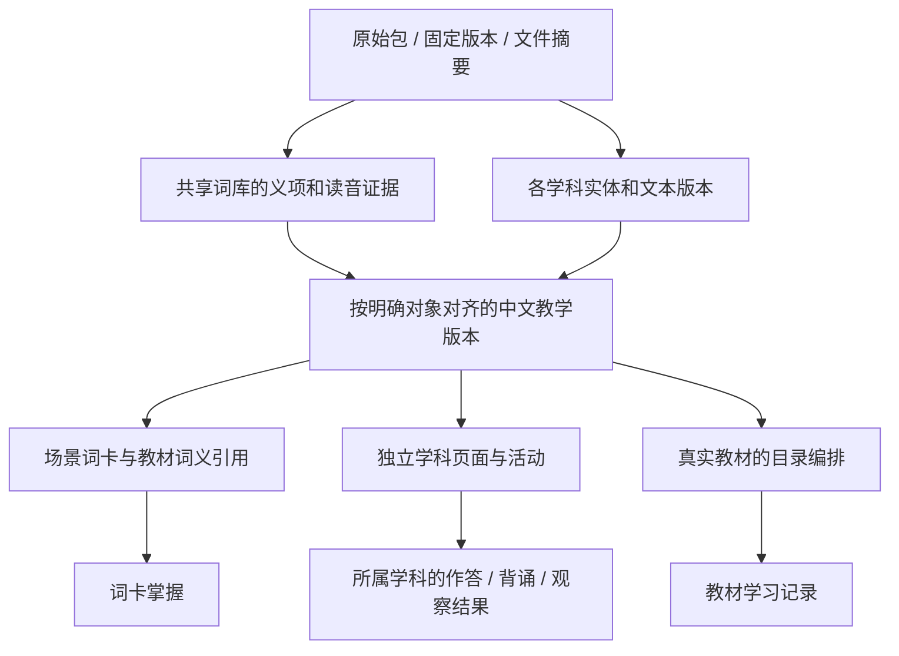

# 基础资料接入与中文教学层规划

**语言资料展示更新：** 新旧词库已统一到“查字查词”，同一次查询展示词义、读音与汉字笔顺／属性；来源和正式义项身份继续分别保留。资料探索收敛为五个入口，数据范围不扩大。见[统一设计](dictionary-unification.md)和[验收](dictionary-unification-acceptance.md)。

**2026-11-02最新范围变更：** 用户明确删除南非CAPS教材和算术事实及其数据。这两项退出当前产品、运行数据库和后续导入范围；元素与其他资料保留。下文涉及两项的首批规划及全量交付统计属于历史记录，不再作为待实施任务。具体删除及保护结果见[退役验收](reference-library-removal-acceptance.md)。未来如开展数学或科学教学，应从新的实际需求出发，不自动恢复这两份资料。

日期：2026-11-02。状态：**设计基线；中文义项版本、学习记录衔接、教材修订保护及首批39条中文采用已完成。九包全量入库与学科基础展示已完成本地验收。** 依据为本地 `references/` 九个 ZIP 的文件核验、结构解析与内容抽样，详见 [资料核验记录](reference-audit-2026-11-02.md) 和 [包级清单](reference-manifest-2026-11-02.json)。文件校验通过不代表教学内容已审校；中文机制的交付范围与证据见 [实施记录](chinese-sense-implementation.md) 和 [主控验收](chinese-sense-acceptance.md)。

**最新范围决定：** 用户要求全部资料入库并提供基础展示，确认本轮完成中文界面、名称与字段对照，长篇释义和教材全文分批翻译。因此下文原有“精选后入库”“先一章”“全星表仅后台”等分阶段建议不再限制资料层的导入和基础查询；教学练习、学习记录、课程映射及中文全文审校仍按后续闭环逐批开展。当前实施范围和验收口径以 [全量资料主控验收](reference-library-acceptance.md) 为准。

## 1. 产品决策

项目服务中国孩子，**中文是理解知识、操作页面和获得反馈的主要语言**。英语学习保留英文词形、句子与发音，但选定义项必须有中文对照；科学等非语言学科默认中文，英文原文可展开查看。来源正文、中文翻译、教学改写、事实纠错分别保存。

资料按用途进入现有词库或独立学科领域，不恢复专题阅读器，不照搬资源包建议的通用 `ContentItem(kind=...)` 模型。教材目录仍由 `catalog` 管理，学科数据、活动和结果由所属应用管理。共享来源追溯规则与账号，不共享一张含义模糊的“全学科掌握表”。

本轮保留所有原始包；科学三分包经摘要核验合成完整原件，保存到项目私有资产目录。全部结构化资料已进入所属领域数据库并提供基础查询；随机题库、学习任务和教材映射仍按明确范围另行启用。

## 2. 数据归属与中文工作

下表中的新应用／模型名称是职责建议，不表示全部立即建表。应先交付一个实际流程，再确定最小模型。

| 资料 | 进入哪里、用于什么 | 必须补齐或保留的中文能力 | 接入次序 |
|---|---|---|---|
| CC-CEDICT：125,346 条 | `lexicon` 独立来源；中文词头的简繁、拼音和英文参考释义 | 中文教学简释、选定义项和适用范围；不能反转成英汉儿童词典 | 随词库中文对照一起试点 |
| Make Me a Hanzi：9,574 字 | 汉字领域的字形／笔顺资产，关联共享汉字身份；不把路径塞入释义 | 笔顺与字形核对、中文结构说明、多音字补充；英文字源提示不是已审教材说明 | 汉字学习首批 |
| Unihan 17：102,998 字 | 已于 2026-11-06 升级：全量 18.0.0 属性以 unihan18 数据集生效（102,999 字），01c 归档退役 | 18 同版扩展属性已落地，保留多值读音、简繁和地区差异；另建中文解释 | 词库 IICore Unihan 18 不受影响 |
| 古诗文 | 独立古诗文领域：作品、文本版本、选篇、分行正文、背诵活动 | 指定版本原文、可追溯简体展示、现代中文解释、读音／注音；教材对应另审 | 先选篇，再扩语料 |
| CMUdict：135,166 读音 | `lexicon` 发音证据与候选匹配；词义和读音分开确认 | 所选英文义项的中文解释；明确美式 ARPAbet，不能标成 IPA 或音频 | 与词卡试点联动 |
| 数学：543 条事实 | 算术领域的运算事实、练习模板、作答记录 | 中文题意、操作说明、讲解和反馈；事实表本身没有这些 | 最小独立学科候选 |
| 国家与地区：250 条 | 地理实体、名称、类型及关系；地图资产另行准备 | 规范中文名称、首都／区域说明和教学口径；不是“250个国家” | 中文名称与分类核对后 |
| 元素：1–118 号 | 科学领域的元素实体、性质和条件；按原子序数识别 | 中文元素名、分类、物态、解释；数值单位、预测／未知标记 | 科学常见元素精选 |
| HYG：119,626 行、499 具名行 | 天文目录、交叉编号、多星关系和观察资料 | 中文星名／星座名及概念解释；区分现代星座与传统星官 | 精选天体，完整目录留后台 |
| 科学 EPUB 三分包 | 一本南非 CAPS Grade 4 教材的来源版本；科学课文、活动与教材编排分开 | 段落、术语、题目、反馈、图注、图中文字说明及家长指导的中文对照 | 先修目录，再做一章样例 |

优先复用项目已经选定的词义和中文教学材料。原料中的英文解释不能覆盖现有中文教学简释；新的中文内容也不能冒充原始来源自带字段。

## 3. 四层边界与稳定身份

### 原始来源与文件

首阶段用受版本管理的清单登记 `source_code`、上游版本／commit、获取日期、包与文件 SHA256、语言、来源定位、署名、加工说明和解析器版本；原件与派生件分离。`references/` 是输入位置，不是运行时服务目录。部署后的读取必须来自项目管理的数据库与资产存储，不能依赖仓库旁边的 ZIP。

九包均保留独立目录／命名空间，不能平铺解压后互相覆盖 `manifest.json`。相同文件可按摘要复用，保留其在多个包中的来源关系。科学二进制分片按清单顺序合并并核验整书摘要。

现有 `LexiconSource → SourceRelease → SourceRecord` 继续拥有词库版本与生效状态；新文件清单不再维护第二个词库“当前版本”。其他领域首用时采用各自的固定来源版本与证据引用。两个领域确有重复的资产管理需求后，再抽取小型共享资产模块；本阶段不迁移整套词库、不建设通用数据平台。

### 领域对象与证据

- 词形不是词义身份。英文词卡沿用 `Sense`／`Pronunciation`／证据绑定；CMU 读音先作为词形候选，不为容纳发音数据制造空白义项。
- 字形资产按完整 Unicode 字符／字形变体及版本定位，保存笔画、中线、坐标系和适用字形；词库提供字音、字义。字形不能代表所有语境下的读音。
- 古诗文区分作品身份与来源文本版本；同一作品在多个选集出现只是多处编排。异文不自动去重，背诵和默写绑定所选文本版本。
- 地理使用内部稳定身份及带命名空间的来源代码；元素使用原子序数；恒星保留来源编号和多套交叉编号；算术事实使用运算码及有序操作数。中文显示名均不作主键。
- EPUB 定位保留版本摘要、文档路径、锚点；无锚点段落以解析位置＋内容摘要定位当前版本。位置和数组下标不宣称跨版本稳定。

### 中文教学版本

采用共同的字段约定，在所属领域中以明确外键关联对象，不先建一张依赖任意 `object_type/object_id` 的通用内容表。词义中文对照首先落在 `lexicon` 的独立翻译／教学释义模型；科学段落译文以后由科学领域拥有。至少记录：

| 字段组 | 约定 |
|---|---|
| 对齐对象 | 所属对象、来源版本／证据、具体字段或段落、原文摘要；词义关联必须明确到 Sense |
| 语言与种类 | 目标 `zh-Hans-CN`；忠实翻译、教学解释、术语名称、事实纠错分开标记 |
| 正文 | 原文保留；中文名称、解释、例句等使用显式字段，不能只留一段无法对齐的混合文本 |
| 生成与核对 | 来源自带／人工／AI 草稿，生成工具与版本、修订者、复核者、时间、使用的术语表版本 |
| 状态 | 草稿、待复核、已确认、原文变化待复核；来源就绪和中文确认是两种状态 |
| 版本关系 | 固定中文版本、上版、变更原因、是否改变知识含义，以及对应的学习对象 |

可以用 AI 分批产生译文和解释草稿，但处理所选范围、保留证据，并核对义项、术语、数字、单位和答案。不得在孩子打开页面时临时机翻并直接保存为权威解释。无需为每个改字增加繁重流程；家庭维护者可在后台逐条或批量核对明确的差异。

术语表按领域维护“英文／中文／定义范围／别名／例句”。例如 `root` 在植物与数学中分别选用不同概念；英语 `light` 的光、轻的等义项不能合成一句中文。元素符号、目录编号、公式和坐标不能按自然语言翻译。

### 页面与学习记录

中文优先不等于隐藏英语学习目标：英语词卡保留大字英文和正确发音，中文简释／词性／场景例句辅助理解；科学阅读默认中文并可查看对应英文；古诗保留选定正文，现代解释另列。移动端用切换／展开而非挤成两栏，朗读随当前语言选择对应声线。

儿童公开范围按课、词卡或活动逐个启用。所选范围的中文必需字段应完整；缺中文的原料保留在维护／资料层，不能静默降级成全英文学习任务。已有中文字段先登记其来源与核对状态，不能把历史存在等同本轮审核通过。

学习记录归属规则沿用现有账号／游客隔离。词卡、识字、书写、背诵、计算、实验观察分别表达各自结果；不把同词卡“已掌握”复制为拼写或听辨，也不把读完科学课当作实验完成。以后学习总览只通过领域摘要接口汇总含义明确的指标。

## 4. 与场景词目标的衔接

当前已实现的 [场景词学习对象](scenario-learning.md) 是硬约束：同一 `LearningTarget` 可编排到多个场景，不同义项必须使用不同目标，现有目标的义项、读音、证据及人工修订快照不可改写。

中文工作首先针对当前 **577 个场景词位和 306 条教材词库关联**展开。这是编排／关联数量，不能直接相加称为唯一单词数；先按现有目标及证据清点。现有中文教学释义能够保留的先保留，缺失的才补齐。

特别禁止批量把中文塞进英文 Sense 的 `editorial_definition`：这既可能使 `gloss_language` 与内容不符，也会触发相关场景词目标的人工修订变更保护。新增中文对照独立保存，不重写原始英文义项或既有目标快照。

规划初始审计发现，教材的306条 `ContentEntryLink` 虽固定来源证据，却缺少人工修订快照，读取可能采用当前人工释义。现已补齐固定修订快照、选择历史、显式中文采用与失效规则；迁移时冻结现状，不反推过去学习时的释义。场景与教材共享中文义项版本，保留各自编排与学习语义。

现已通过显式采用关系落实“目标采用哪版中文呈现”，后续接入继续遵守以下规则：

1. 新中文呈现必须与目标固定的来源证据、义项及修订快照一致；待复核、失效来源或不同证据的译文不得借此重新显示。
2. 只改排版或经核对的同义表达，可在明确记录“不改变学习含义”后选用新的呈现版本，目标与旧进度保留；不得通过忽略 revision 自动替换。
3. 纠正词义、改变所教概念、改用不同读音或来源证据，遵守现有规则新建目标，原进度不复制。翻译纠错是否改变学习含义必须显式记录；不确定时先待复核。
4. 来源升级先生成差异和受影响范围。新的翻译标为待复核；没有完成复核的来源／中文组合不得启用。已在使用的组合保持固定；停用或实质变化仍由当前保护逻辑暂停，不能借旧译文绕过。
5. 词卡状态写入继续使用目标 UUID 与 revision；中文层上线后，写入同时校验并保存本次采用的中文呈现版本，防止页面持旧译文却记成新版。旧记录没有此信息时明确为空，不反推补写。当前进度表只保存最近一次状态，因此只承诺追溯最近一次写入所用的中文版本；完整学习历史需以后独立设计，不为此先建通用事件平台。

本阶段已实现 `ChineseSenseVersion`、确认／撤回记录、场景和教材的显式采用历史以及学习记录的所见版本。教材仅修改收藏／笔记不会更新掌握依据，明确确认学习状态才记录当前呈现；详情、个人页与首页使用一致的有效掌握规则。教材改义须新建 `ContentItem`，原内容的私人记录保留。未知的历史呈现仍为空，版本机制不能还原过去未记录的语义。

机制阶段只完成结构升级与306条原关联的初始选择记录，代表样例留在隔离库。随后对全部577场景词位和306教材关联完成只读清点：883个唯一固定绑定均有既有中文，缺口主要是逐条核对及显式采用，而非883条待翻译原文。两域固定绑定交集为0，不能按同拼写直接共用版本。

首批 `cn-foundation-20261102-01` 已在日常库采用39个中文版本，覆盖26场景目标和13教材关联；中文逐字复用来源并经AI逐条核对，不冒称真人审校。剩余551场景词位和293教材关联仍是legacy呈现、未经本批审核。完整清点、批准清单和保护证据见 [覆盖清点](chinese-coverage-inventory.md)、[候选及审核记录](chinese-batch-01-candidates.md) 与 [首批主控验收](chinese-batch-01-acceptance.md)。

## 5. 各资料的接入门槛

### 汉字、词典与古诗

CC-CEDICT 保留大小写、读音、原文行和释义结构；同字形不同读音／专名不能自动合并，每个英文释义片段也不一定是独立义项。新来源默认暂存，按明确匹配关系启用，不改变其他来源优先级。

Unihan 17 与当前18在相同 IICore 范围内确有属性差异。需要更多汉字属性时优先解析本地已有18同版原件，单独登记适配器和派生版本；旧17供对照。`kGradeLevel` 等来源字段不是中国教材年级。

笔顺需正确处理来源坐标变换和字形区域差异。笔画可播放不等于已符合所选教材书写标准；所选教学字先核对。汉字识读和描红过程结果分开。

古诗文先建精选及文本版本清单，再补现代中文解释、注音、出处及教材证据。《静夜思》的不同正文、《春晓》的来源题名等必须人工选定；选集中出现的年级标签不直接映射中国教材。

### 地理、元素、星表与数学

地理保留国家／地区类型及从属关系，中文名称和教学口径单独维护。来源中的首都、边界、面积和成员资格要有字段级核对依据；不能把250条都当主权国家，也不能把所有 `cca3` 当正式 ISO 代码。无地图边界数据时不承诺地图定位功能。

元素保存数值、单位、测量条件和预测／未知标记；气体密度的原始单位与归一化单位不同，熔点字段还可能实际是三相点。中文显示不得把 `atomic_mass` 译成“质量数”，不得把未知当零。

HYG 明确 J2000.0、赤经小时／赤纬度、距离 pc；异常距离哨兵转成可解释的未知状态。499具名行不是499个唯一恒星，星名不做唯一键。本目录不提供实时星空、行星历表或中国传统星官完整映射。

数学543条事实计算正确，但没有题干与教学梯度。题型、操作提示和讲解由算术应用生成；运算结果服务端校验，交换操作数是否同一训练由规则明确，学习记录绑定练习目标及规则版本。

### 英文科学教材

03a／03b／03c 合成**一本**南非 CAPS Grade 4 科学与技术教材，内容元数据为2013年。不得直接标成“中国四年级同步”。来源年级、建议适用阶段、中国课标／教材映射分别记录；映射需要具体依据，未核对先空置。国内课标候选依据从[教育部课程方案与标准通知](https://www.moe.gov.cn/srcsite/A26/s8001/202204/t20220420_619921.html)及实际使用教材确认，本轮没有完成逐课对照。

随包47行目录有错，已依据 EPUB3 nav 重建120节点（前言1、章18、节42、小节59）。正确目录和来源锚点核对通过后再编排；不把章、节和小节都平铺为同一层 Unit。

科学领域拥有课程、活动、题目、图注、译文和观察记录；真实教材目录可引用这些对象。现有 `catalog` 尚无通用学科对象引用或外国课程年级映射接口，首次先以科学独立页面交付，不为发布查询伪造中国教材。后续接教材编排时加明确的引用与去重规则，避免复制两套课文／答案。

327个题干／327个答案节点和288个教师说明只是结构计数；35个答案节点无文字，不能把开放观察题当空答案客观题。服务端分离学生、作答后反馈和成人指导；学生接口、搜索、打印中不能包含仅靠 CSS 隐藏的答案。英文展开也使用已分离的对齐段落，完整原件下载只放维护端；不能通过“查看原文”绕过分离。练习后查看答案是明确流程，原始教师层不直接下发。

当前账号体系没有家长绑定。首阶段成人指导由维护者的显式服务端权限控制，不能将所有登录用户视为成人；前端切换按钮不是授权。家庭角色确有需要时另建关系。

翻译前建立术语表，按段落／题目／图注对齐。首章样例选“生物与非生物”；再扩“植物结构”“材料分类”。图片保留原件与图源，补中文说明和替代文本；图内英文优先通过中文图例对照，改图时另存派生版本。

已发现胡萝卜被图注称为“茎”的事实错误，教学版本应纠正为根，并保留原文与纠错依据；[RHS 胡萝卜资料](https://www.rhs.org.uk/vegetables/carrots/grow-your-own)可供核对。书中“下一闰年2016”等过时语境也不能照译后直接教学。涉及加热／火柴等实际活动时，整理具体成人操作条件和替代材料；先交付观察类活动。隔离教师层时，将其中必要的操作限制改编到已审学生活动说明及成人准备条件中，不能随隐藏答案一起删掉。外链视频不在资源包内，不作为完成学习的隐性依赖。

## 6. 实施顺序与交付边界

本会话负责设计与验收。具体实现继续使用用户指定的 GPT-6.1 SOL 实施会话；以下是可逐阶段下发的范围，不代表同时启动所有学科。

| 阶段 | 具体交付 | 完成条件 |
|---|---|---|
| A：接入规则与中文词义试点 | 固定来源清单、按包核验／预演入口、词义中文对照模型及目标呈现关联；先覆盖同义复用／同形异义／多读音的代表样本 | 来源不被覆盖；中文必需字段完整；来源变动、翻译改义和旧进度保持规则可验证 |
| B：现有英语内容与汉字基础 | 清点577词位、306教材关联后逐批补缺；CC-CEDICT／CMU候选适配；按当前教材选取常用汉字笔顺与中文说明 | 匹配歧义不猜选；不出现英文释义冒充中文、ARPAbet冒充IPA、旧目标重绑；手机可读可听 |
| C：首个独立学科闭环 | 后续按实际需求另选学习流程；原543条算术事实方案已取消 | 题目—作答—反馈—记录完整；不复用词卡掌握；账号／游客及过期写入正确 |
| D：科学双语样例（已取消） | 南非CAPS教材及相关数据按用户要求删除，不再继续其翻译／练习路线 | 不自动恢复旧来源；新的科学教学需求另行设计 |
| E：按学科扩充 | 古诗精选、地理规范名称／关系、常见元素、精选星表；逐个页面交付 | 各自版本、中文、课程映射与学习含义成立后，再扩大范围 |

上述顺序继续用于教学闭环；资料层已按用户扩大范围完成全量入库和基础展示。暂不做整部古诗库自动出题、全书无人复核机翻、全星表实时星空、全科统一知识图谱或自动难度推荐。完整导入和中文教学就绪分别验收。

## 7. 验收约定

1. 所选范围原始文件校验与来源定位100%可追溯；同一输入重跑不增重复对象、不覆盖人工修订；预演不写入。变更报告包括新增、冲突、缺失中文和失效依赖。
2. **孩子端启用范围的必需中文字段100%齐备且已核对。** 以明确清单为分母，不拿全语料规模制造虚假完成率。中文图注、题意、操作和反馈同样计入。
3. 每个译文能定位原义项／原段落；术语、多读音、否定词、数字、单位与答案经核对。来源变化会使对应中文进入待复核，不能静默混用版本。
4. 学习对象稳定；跨场景同目标共享，异义不共享；删编排不删结果，纠错变义不自动继承。保护旧账号、游客、目标、true/false 和时间，不猜测历史掌握范围。
5. 学科服务端拥有题目规则、结果与归属；学生HTML／接口／搜索／打印／英文切换／下载都遵守答案分离；普通登录账号不能读取成人指导。开放题与客观题采用不同结果语义。涉及实际操作的样例覆盖“教师层剥离后必要操作条件仍可见”。
6. 使用数据库或资产副本验证新导入，再决定是否启用；涉及模型变更覆盖空库、旧库升级、SQLite及相关PostgreSQL并发行为。内容／文档变更不要求无意义的全量回归。
7. 桌面与390px手机完成一次实际学习闭环；无原始技术字段挤入儿童流程；已有教材、词卡、接龙和进度不受影响。

## 8. 本轮已完成与未完成

已完成九包整体摘要、CRC、清单、文件摘要和同路径冲突检查；合成科学 EPUB 审计副本，修正其目录，核对各资料数量和关键字段；将归属、中文对照、版本与学习记录约束写入本设计。

阶段A中的中文义项版本与学习记录衔接、教材修订保护已完成本地实现和升级；验收覆盖真实副本、非空历史记录升级样例、SQLite／PostgreSQL、并发冲突及桌面／390px浏览器。日常库原32张业务表313,132行的原字段逐行比对未变。按包导入／预演适配器和实际中文内容补齐仍需按选定资料后续实施，阶段A整体不因此视为全部完成。

现有英语中文覆盖已完成全量清点，首批39条来源中文已核对、导入并显式采用。批次支持批准摘要、固定身份校验、整批事务、预演、持久回执及严格幂等；主控逐行白名单核对原36张业务表313,438行，仅批准对象采用字段变化。独立副本另验证既有私人学习记录不变。`light`的不同绑定、`maths book`读音与`orange`的词性／义项边界留待单独核查，不随本批改变旧身份。

九包资料现已完整写入日常数据库的10个数据集，来源文件和图片等资产保存在项目管理的私有目录。独立学科基础页面已发布到本机8012：词典／读音、汉字笔顺、古诗文、地理、元素、算术、天文、科学教材均可查询；中文目录、名称和字段对照已提供，少量无可靠中文专名的条目标明待补。长篇英文释义、教材正文与图中文字仍分批翻译。

主控验收覆盖空库和真实业务副本、日常导入与重跑、来源漂移、角色权限、38次桌面／390px入口和详情浏览；日常原37表313,557行原字段全部不变。数量、性能、恢复点与证据见[全量资料验收](reference-library-acceptance.md)。本轮不增加练习／学习记录，不自动绑定词义，不将来源浏览视为教学审校通过。原始资源包未修改，代码未提交、推送或部署。
