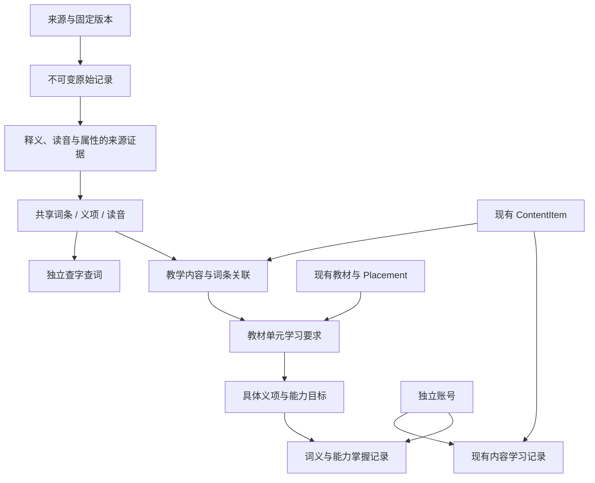

# 基础字典与词典建设规划 V1

日期：2026-10-30。状态：P0、P1 已完成；P2 已完成首批汉字／英英来源及统一查词页，其他词典覆盖和 P3 仍为后续规划。当前范围见 [首批公开词库](public-dictionaries.md)，维护流程见 [词库维护手册](lexicon-operations.md)，验证证据见 [VALIDATION.md](../VALIDATION.md)。

用户已确认：以独立账号学习，预留向其他家庭公开使用的能力，基础词库必须可追溯、可替换。此处的公开能力是设计要求，不代表已经部署或开放数据下载。

## 1. 建设目标与当前差距

在现有账号、教材和内容基座下新增 `lexicon` 应用，承载共享的汉字、汉语词语、成语、英文单词与短语。它服务于查词、教材词表、成语学习、接龙和后续练习；不隶属于某一年级、某一套教材或某个学习模块。

2026-10-30 核对当前仓库：

| 现有数据 | 实测情况 | 对设计的影响 |
|---|---|---|
| `primary/english-data.js` | 306 张教材词卡，按去首尾空白并转小写得到 303 个检索词形 | 出现次数不能当作词条数量；同词可在多册出现 |
| `primary/words-data.js` | 305 张场景词卡，同口径 305 个检索词形 | 场景分类应引用共享词库 |
| 两套英语数据交集 | 75 个相同检索词形，合计 533 个不同检索词形 | 产生对齐候选，不能仅按拼写自动认定词义相同 |
| `primary/idioms-data.js` | 257 张教学成语卡 | 简释、故事、逐字理解属于教学加工，需保留自身来源 |
| `idiom-chain/data/chinese-xinhua/idiom.json` | 固定快照 30,895 条、30,895 个不同词形 | 作为来源数据评估，不直接复制成 30,895 张教材学习卡 |
| 当前 `ContentItem` / `Progress` | 内容受模块与学习册编排约束；进度按账号与内容 UUID 隔离 | 适合教学内容，不足以承担跨模块基础词典与词义级掌握记录 |

以上计数是本地文件实测，不是对来源词库规模或完整性的长期承诺。英语检索归一化仅用于统计匹配候选，不用作词条身份唯一键。

## 2. 四层结构

| 层 | 管理什么 | 例子 |
|---|---|---|
| 基础词库 | 词形、读音、词性、义项、词形变化、来源证据 | `bank` 的不同义项；“行”的不同读音 |
| 教学内容 | 年龄适宜的讲解、记忆方法、练习、插图与故事 | 小学生版解释、拆分记忆卡、成语故事 |
| 教材编排 | 哪个版本、年级、册次、单元学习哪个义项和能力 | 某单元学习一个词的指定义项，要求会认或会拼写 |
| 个人学习 | 本人学过什么、掌握哪项能力、收藏与笔记 | 学完一张卡；掌握某个义项；某次拼写答错 |

同一个基础词条可关联多个义项；同一个义项可有多种教学讲解；不同教材可选择不同讲解和学习要求。词典数据更新不应改写教材当时选定的义项，更不能自动改写用户掌握状态。



基础字典不能沿用“必须编入已发布学习册才能查阅”的规则。它有独立的审查、发布与来源准入规则；教材卡片继续沿用现有发布规则。

## 3. 字典类型与字段范围

| 类型 | 基础字段 | 后续增强与边界 |
|---|---|---|
| 汉字 | 原字形、Unicode 字符序列、读音、义项；可追溯的部首与笔画属性 | 多音字、简繁／异体关系、组词；笔顺动画与字形图片另管来源 |
| 汉语词语 | 词形、读音、词性、义项、用法 | 例句、近反义词按具体义项关联，不按字面强行匹配 |
| 成语 | 词形、读音、释义、出处及可用的来源例句 | 儿童故事、逐字释义、教学简释单列；可查阅和可用于接龙分别判定 |
| 英文 | 词头、词性、义项、音标、词形变化；按来源可提供英英／英汉释义 | 英美读音不齐时明确缺失；短语、专名与同形异义需区分 |

“成语”可作为词汇条目的分类，而非与汉语词库互不相通的重复表。接龙对四字、首尾字、读音和禁用状态的要求放在玩法规则中，不改变词典是否收录该条目。

基础字段有值不等于教学可用：格式检查、语言正确性审查、儿童适宜性审查是不同状态。词频和考试标签不能直接推导为小学年级。

## 4. 模型设计方向

以下保留总体逻辑模型；首期已实现来源版本、稳定身份、义项、读音、字段证据与教学关联，其余扩展按阶段增加。

| 模型 | 主要职责与约束 |
|---|---|
| `LexiconSource` | 来源项目、网址、归属方、数据许可说明、使用范围及审查依据；代码许可证和数据内容依据分别记录 |
| `SourceRelease` | 固定版本、文件摘要、导入时间、解析器版本、变更报告、启用状态；可追溯到原始文件 |
| `SourceRecord` | 每个版本的原始记录；原文只读，保留无法解析的字段；不直接作为前台可展示对象 |
| `LexicalEntry` | 稳定 UUID、语言、展示词头、条目类别和审查状态；不绑定年级、教材、模块 |
| `EntryForm` | 正字形、检索形、别名、词形变化及关系；一个检索形允许匹配多个条目 |
| `Pronunciation` | 音系／地区、音标或拼音原值、检索用规范化值、审查状态及来源 |
| `Sense` | 稳定义项 UUID、词性、释义语言、释义及证据；一个条目有多个义项，读音可与义项关联 |
| `EntryRelation` | 简繁、异体、词形派生、相关词、近反义等关系；语义关系尽量限定义项，方向明确 |
| `ContentEntryLink` | 现有内容关联词条及可选的义项／读音；一个内容可关联多个词条，不移动现有内容 UUID |
| `CurriculumRequirement` | 关联现有 `Placement` 和词条，选择义项、读音及会认／会读／会写／会用目标；年级和版本由教材归属确定 |
| `LearningTarget` / `LexicalProgress` | 稳定学习目标和账号掌握记录；教材要求可引用同一目标，避免不同课程重复累计 |

来源证据必须能落实到释义、读音、关系或属性上，而不是只给整个词条贴一个来源名。第一阶段通过各类规范化记录到 `SourceRecord` 的显式外键和原字段路径表达；需要多来源支撑时采用显式关联表。来源原文、人工修订、教学改写的作者和版本分别保存。

一期不建设微服务、图数据库、独立搜索集群或全量自动语义合并。使用现有 Django 单体，正式多人环境以 PostgreSQL 为主；SQLite 保留小规模开发用途。

### 身份、重复项和多义词

1. 不设置全局 `word unique=True`，也不把“语言 + 小写词形”当作万能唯一键。条目、义项、来源记录各有自己的身份。
2. `US` 与 `us`、不同词性的同形词、专名、拼写相同但来源义项不同的记录，允许保留歧义。
3. 原值保留；NFC、大小写折叠、空格与标点处理仅产生版本化检索键。简繁转换和词形还原只生成候选关系，不自动合并原词。
4. 汉字处理覆盖扩展区；有异体选择符的字符序列不能直接截取第一个码点。多音字不拼成一个无法关联义项的读音字符串。
5. 上游有稳定 ID 时优先使用；没有 ID 时制定该来源的复合身份规则。内容变化造成匹配不确定时进入待确认列表，不用行号硬接旧条目。
6. 合并时保留旧 UUID 的重定向与来源映射。拆分义项时保留旧引用并形成待复核项，不自动迁移所有历史掌握状态。

## 5. 与现有系统衔接

`catalog` 继续管理课程、教材和教学内容；`lexicon` 管理共享词库；`learning` 管理用户记录。先增量增加关联，不删除或重建现有 1,219 条内容。

具体迁移策略：

- 从现有教学词卡抽取词形，建立候选匹配列表，再确定对应条目和义项。
- 75 个重合英语词形作为第一批对齐样本；必须核对义项、词性和音标后再复用基础记录。
- 教学简释、拆分记忆、故事和例句保留原内容及来源，不能被外部词典的长释义覆盖。
- 词典查阅不要求先创建教材卡片；教材词表可以根据关联读取词典，但不能随词库切换无声更换教学释义。
- 关联默认不改变现有 `Progress(user, item)`。历史“已掌握一张卡”不自动升级为“掌握此词所有义项与能力”。
- 新的词汇掌握按具体学习目标记录。例如“理解某义项”和“会拼写该词”分别统计；全局词条收藏与教材卡片收藏可分别提供。
- 用户不能修改共享基础词条。以后支持用户纠错时，进入反馈队列，不直接写入共享词库。

## 6. 来源选择：先建准入机制，再决定收录范围

面向公开使用，来源可替换意味着系统不依赖某一个网站的字段结构、数据库 ID 或单一释义。当前候选评估如下，**候选不等于已完成授权与质量审查**。

| 来源 | 合适的用途 | 当前处理 |
|---|---|---|
| 现有 `primary` 教学资料 | 教学内容迁移和词条关联样本 | 保留现有内容；公开前完善各类文字、图片和音频的来源记录，不因在本仓库中就视为外部权利已核验 |
| Unicode Unihan | 汉字编码、读音、变体及部首笔画等属性的来源候选 | 优先评估字形属性基础；不能替代适合儿童的汉语释义。字段范围见 [UAX #38](https://www.unicode.org/reports/tr38/)，复制使用保留相应 [Unicode 许可说明](https://www.unicode.org/license.txt) |
| 已有 `pwxcoo/chinese-xinhua` 固定快照 | 成语导入适配与质量检查；汉字、词语文件另行评估 | 现有来源说明记录了网络收集／抓取背景，公开使用依据仍需核对；不将家庭自用状态继承为公开发布状态。见 [本地来源说明](../../idiom-chain/docs/sources/CHINESE_XINHUA.md) |
| ECDICT | 英汉／英英释义、音标和词形变化候选 | 项目标注 MIT，README 也描述多来源汇集过程；需固定版本并评估内容来源与覆盖质量。其 `audio`、`detail` 在说明中为待补充字段，不能假定已有完整音频／例句。见 [项目说明](https://github.com/skywind3000/ECDICT) |
| CC-CEDICT | 中英对照、拼音与简繁词形补充候选 | 官方下载页标明 CC BY-SA 4.0，按来源记录署名和相应共享要求；不是儿童汉语释义库的直接替代。见 [官方说明](https://www.mdbg.net/chinese/dictionary?page=cc-cedict) |
| 有明确公开展示／再分发许可的专业数据 | 需要可靠中文释义、权威音频等场景 | 作为开放候选不足时的替换路径；尚未选定供应方或购买数据 |

不以“仓库可以下载”“项目无商业目的”或“代码开源”代替对具体内容使用范围的确认。已有成语快照仍仅暂存；后续已核对并下载 Unihan 18.0.0 与 OEWN 2025 固定快照，选取范围后单独准入。其他候选不代表已批准公开。

来源使用范围、内容审查、发布状态分开管理：允许内部评估，不代表允许匿名 API 返回；允许公开查阅，不代表允许提供整库下载。语音、图片、笔顺和例句分别保留来源及可用范围，不能继承文本字段的许可结论。

## 7. 导入、人工维护和更新流程

建议流程：

```text
登记来源与使用范围
  → 固定快照、摘要和解析器版本
  → 暂存原始记录
  → 结构／编码／缺失／重复／异常检查
  → 规范化候选和冲突报告
  → 人工审查来源、适宜性及重点内容
  → 生成待启用的检索与展示版本
  → 原子切换生效版本
```

关键要求：

- 每批报告新增、修改、未变、疑似重复、解析失败、读音待核、来源不明和教学关联受影响数量。
- 格式合法不等于读音正确；“无”、空字符串和占位符统一按缺失处理，同时保留原文。
- AI 如用于讲解改写或匹配建议，标注为生成内容／候选，不写成来源词典原文，不自动发布。
- 不使用一次 `update_or_create` 覆盖所有来源、人工修订和教学简释。人工修订是独立版本；来源更新生成差异，人工决定是否采纳。
- 大词库分批导入暂存区，避免长时间锁住线上表。未完成版本不影响线上查词；小型管理命令和现有静态资料导入器可继续使用现有事务方式。
- 支持 dry-run、同版本重复导入、任务续跑、来源级切换与停用。回退只调整来源有效版本，不回滚之后发生的人工修订或用户进度。
- 上游删除条目时先标记缺失或停用，不级联删除教材引用和历史记录。
- 发布与来源停用必须同时作用于搜索、详情、自动补全、缓存、教学关联的词典展开和批量导出。撤回的来源文本可保留于审计区，但不得因缓存或教材固定版本继续公开输出；受影响内容进入复核队列。
- 来源切换要产出受影响的词条、义项、教材引用报告；未找到替代的部分显示缺失或保留待处理状态，不编造补齐。

第一阶段只实现实际用到的一个适配器和来源版本流程，再用第二个来源验证可替换性，避免只设计出一个名称通用但仍与单库绑定的导入器。

## 8. 后台与前台入口

后台增加：来源与版本、导入任务与报告、汉字／词语／成语／英文条目、义项与读音、冲突审查、教学关联、批量发布与停用、修订历史。

继续使用现有权限组机制，但将“词库编辑”和“来源准入／发布”分开授权。来源原记录只读，编辑修改规范化内容或教学内容；后台应能回答“这个读音或释义从哪里来、谁改过、哪些教材正在引用”。

前台分两个入口：

- **我的教材与学习词表**：按年级、版本、单元展示选定词义和学习任务；不因基础词库有几十万条就全部放入学生首页。
- **字典与词典查询**：按字、词形、拼音等查阅经过准入的内容；有多个读音、义项或候选时明确展示，不能任意选择一个。

首期采用数据库索引完成精确词形、词形变化、前缀和拼音查询；释义搜索可在 PostgreSQL 侧扩展。数据量与查询实测出现瓶颈后再决定是否增加专用搜索服务。读接口分页，不允许浏览器一次拉完整词库。

## 9. 分期实施与验收

| 阶段 | 交付范围 | 完成标准 |
|---|---|---|
| P0：共享词库骨架 | `lexicon`、来源版本、条目／义项／读音、教学关联、Nova 后台、独立查词接口；少量明确来源的测试样本 | 跨教材引用同一条目；一个词的多义和多音不互相覆盖；原学习记录不变 |
| P1：现有资料对齐 | 先关联现有英语词卡和教学成语，再在暂存区验证已有成语快照适配器 | 重复导入不增生条目；人工简释保持；不确定匹配进入列表；原内容 UUID 与进度保持 |
| P2：首批可公开词库 | 逐类完成来源准入，先满足已有教材的常用字／词／成语／英文覆盖，再扩大可查询范围 | 每项发布内容能追溯来源和范围；源切换、停用、缓存失效与回退通过验证；缺失数据明确显示 |
| P3：学习能力与玩法 | 义项／能力目标进度、练习和复习；接龙引用同一词库；有来源的音频／笔顺等增强 | 学习目标不串账；卡片完成不等于所有词义掌握；玩法状态由服务端执行 |

先建设全类型可扩展的模型，再逐类接入来源；不用一次导入最大的词库来证明基座完成。公开词库的具体来源在版本与字段审查完成后确定，不能在规划阶段承诺某个候选会整体公开。

必须覆盖的回归场景：

1. 同词跨教材引用、同拼写不同词义、多音字及大小写歧义。
2. 中文扩展区字符、简繁关系和异常／缺失读音。
3. 幂等导入、中断重试、来源更新冲突、人工修订保护。
4. 下架或撤回来源后，搜索／详情／教学展开／缓存均不泄露被撤回内容。
5. 来源回退后，后续人工修订和用户进度不丢失。
6. 多账号的收藏、笔记和义项／能力掌握记录隔离。
7. 现有内容 UUID、教材编排和已保存学习记录在迁移前后一致。

## 10. 分期交付记录与下一步

P0、P1 首期已落地：11 个词库模型、数据库迁移、Nova 后台、两个权限组、公开准入过滤接口，以及 primary／固定成语快照／通用 JSON 三种导入路径。原始文本和字段路径不可经后台修改，来源更新与人工修订分开；版本切换、来源撤回、回退和显式替换已纳入回归测试。

P0/P1 完成时有 4 个来源、4 个版本、31,763 条来源记录和 31,739 个初始词条。611 张英文词卡与 257 张成语卡建立关联，24 处核心字段完全一致的记录复用义项；299 对同形词保留为人工核对候选，没有按拼写强行合并。现有内容、编排、用户与进度逐行对比迁移前备份一致。

上述三个 primary 来源仅内部启用；30,895 条成语来源仍为完整暂存状态，这四个来源的公开准入保持关闭。其混合长释义暂按一个来源义项包保留，不推断或宣称已经完成细粒度义项拆分。

P2 首批新增 9,810 个 Unihan 汉字、861 个 OEWN 英文词条和 3,700 个英文义项，已提供 `/dictionary/` 统一页面和公开来源说明。Wordnet 使用原有 Sense ID 区分义项，SourceBinding 增加词头组标识；新版本保留导入时来源与许可快照。详见 [当前数据与范围](public-dictionaries.md)。

下一步补足中文释义、多音字、未匹配教材词形和教学审校。关系图谱、义项拆分工具、学习能力目标、音频／笔顺、接龙与生产部署仍属后续工作；扩展不需要替换教学内容 UUID。
