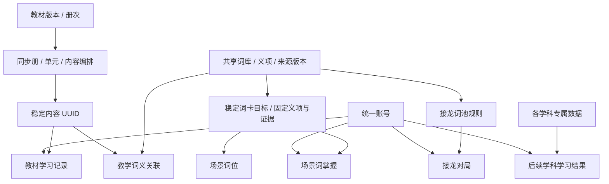

# 系统设计与开发基线

更新：2026-11-02。此文记录当前项目边界、已确定的方向和后续开发顺序；实际运行与验证见 [本地开发](local-development.md) 和 [验证记录](../VALIDATION.md)。

## 1. 项目目标与边界

`primary-system/` 是家庭辅导孩子学习的主项目。仓库其他目录是临时原型、资料来源或研究，不能成为线上运行时依赖。现有导出脚本允许读取受信任的 `primary/` 静态资料，导入后由本项目数据库提供内容；呈现天然富交互的学科（语文、数学教材）改为文件编排——内容源头在静态版、Django 只做零模型只读壳，见 [教材册文件编排](#教材册文件编排数学与语文2026-11-0708)。

采用 Django 单体、服务端模板、少量独立 JavaScript。当前规模下不引入微服务、消息队列、搜索集群或统一的动态页面搭建引擎。SQLite 用于本机；多请求并发与跨数据库正确性用 PostgreSQL 回归验证。

产品优先级是内容准确、孩子容易使用、家长容易维护和后续能持续扩展。外部资源可用于家庭教学；保留来源、快照与人工改写记录，用于核对错误、更新和回退。数据来源追溯不等于已经完成内容准确性或儿童适宜性审校。

项目面向中国孩子，知识解释、操作和反馈以中文为主；英语目标保留英文并提供所选义项的中文对照。`references/` 的接入归属、版本与中文层约定见 [基础资料规划](foundation-data-plan.md)，实际文件核验见 [资料核验记录](reference-audit-2026-11-02.md)。资料已入库，南非教材与算术事实按用户要求退役；原始包不会成为运行时依赖。新旧语言资料通过 [统一查字查词设计](dictionary-unification.md) 一起查询，正式义项与来源记录各保留身份和版本。

## 2. 已确定的领域划分

**教材有固定目录；学科功能有独立页面与数据。** 旧“专题学习册／通用专题阅读”彻底退出，不恢复 `TopicBook`，也不伪造教材承载科学、地理、历史等专题。

| 应用 | 当前责任 | 扩展边界 |
|---|---|---|
| `accounts` | 独立账号、名称、年级偏好、权限 | 账号归属和认证复用；以后需要家庭授权时显式建关系 |
| `catalog` | 学段、年级、学科、教材版本与册次、教材模块、同步册、单元、内容编排 | 仅承担固定教材目录；不收实验状态、探索地图或游戏回合 |
| `learning` | 教材内容的掌握、收藏、笔记及 revision 冲突校验 | 当前记录的对象是内容 UUID，不宣称覆盖所有学科能力 |
| `lexicon` | 字、词、义项、读音、来源版本、人工修订和教学引用 | 供查词、教材与玩法复用；领域应用不能复制另一份基础词典 |
| `chain` | 成语可接龙规则、词池旁表、对局、计分 | 词义来自生效词库；对局规则和历史属于本应用 |
| `words` | 生活场景编排、稳定词卡目标、词卡掌握 | 固定义项／读音／来源证据；不代表其他英语能力 |
| 后续学科应用 | 学科专属模型、页面、操作与学习结果 | 例如实验、时间轴、地图探索各自建模，按真实需求逐个开发 |

一个 Django app 对应有独立规则的数据领域，不要求每个按钮或小游戏都新建 app。新增学科先定义一个可使用的学习流程，再确定模型和页面。首页模块只是入口，不能反过来决定存储模型。

## 3. 数据与服务约定

1. 教材内容 UUID、已有教材单元和编排身份在结构升级中保持稳定。清理旧专题阅读时，仅删除对应专题内容、编排、私人阅读记录和教学关联；保留词库本体、来源证据及独立玩法。
2. 业务写入集中在所属应用的服务层。视图负责输入校验、权限和响应；前端负责交互，不自行判定分数或跨账号归属。
3. 词库读取统一遵守生效来源、当前版本、词条停用／归并状态。内部教学和游戏可消费已启用内部来源；词典页面额外遵守其展示审核状态。
4. 原始来源记录不可覆盖；人工修订另存。教材指定的词义不可在来源升级后悄悄换义。场景词通过稳定目标固定义项、读音与来源证据，来源变义暂停释义，不改绑目标；旧词卡掌握保留原范围，不复制为全学科能力框架。
5. 数据库迁移必须能从已有版本升级，也必须能从空库安装。不得只记录一次手工删表、改迁移历史或重导来代替正式升级步骤。涉及删除的本地升级先用 SQLite backup 保存恢复点。
6. 数据库、密钥、浏览器会话和测试凭据不提交到 Git。后台管理的是本项目数据，其他研究目录不做联动清理。
7. 外部英文原文、中文翻译、教学解释与事实纠错分别版本化；翻译明确对齐义项／原段落，不覆盖源字段。来源就绪不代表中文教学就绪。只启用中文必需字段齐全且核对过的范围；原文变化后复核依赖，不能静默改义或扩大旧掌握含义。

## 4. 目前可保留的基座

- 教材版本、册次和内容身份分离，支持同内容多处编排；学习记录按用户与内容唯一。
- 自定义用户、个人数据归属、CSRF、发布过滤和 revision 冲突已形成可复用规则。
- 词库有独立来源版本、字段证据、义项、读音、人工修订及切换流程，能够支持多个学科。
- 接龙状态与词库分开，场景教学标注与词义分开，方向正确。
- 类型化阅读块可以继续服务教材；不扩充为覆盖所有学科行为的巨型 JSON 字段。

## 5. 下一步先处理的结构问题

### P1：教学内容质量

本地查字目前以 Unihan 属性与英文简释为主，尚不足以承担儿童中文解释。接龙使用的内部成语快照曾有 10 条释义含异常字符 `⊥`（例如“和光同尘”），2026-11-07 已通过人工修订字段清除展示层异常并留存审计，来源原始记录保留未动。成语来源读音已于 2026-11-07 按既有格式门槛批量核对（primary-idioms 257 条、chinese-xinhua-idioms 30,807 条，多音字难点抽查正确），全库 45,510 条读音现已全部核对，接龙对局展示拼音；同日查明 chinese-xinhua 数据集自带 88 条异常并全部处置：37 条词头“两字并一字”损坏按来源拼音与释义修正词形、1 条按归并机制合并、50 条拼音截断/连写写入人工修订字段后重新核对，来源 raw 均保留原样可审计（见 output 审计目录 reading-review 报告）。先建立常用范围与异常审校清单，补充可靠的中文解释和读音；保留原文，修订进入独立人工字段。不要把“成功导入”或“可用于游戏”写成教学质量通过。

新增资料先解决中文义项版本与学习对象的采用关系；不将中文翻译批量写入英文 Sense 的人工修订字段。场景目标与教材 `ContentEntryLink` 均已固定修订选择；中文解释独立版本、显式采用，失效时暂停正文和依赖提示。教材原mastered与当前有效掌握分开，收藏／笔记不重新认证学习依据。具体实现与边界见 [中文义项实施](chinese-sense-implementation.md)。Unihan18全量属性归档作对照（unihan18 数据集，102,999 字），与词库 IICore Unihan 18 同版并行；古诗异文、科学错误目录和单位差异等按 [接入规划](foundation-data-plan.md) 处理。

### 已完成：场景词位与学习对象

`LearningTarget` 使用稳定 UUID 固定词卡能力、Sense、可选 Pronunciation 和版本证据；`ScenarioWord` 按场景＋目标编排，允许同词多场景、同形异义同场景。原词位主键、标注和旧 entry 追溯字段保留，展示不再依赖旧 entry；归并后跟随稳定义项身份。

进度按账号／游客＋目标唯一，旧 true/false 与更新时间无损迁移，词卡掌握不扩大为全词或其他能力。schema v2 与 revision 拒绝旧词位写入及过期修改；删除编排保留目标和进度。来源变义／删词／停用以及人工修订变化时保留固定证据与修订快照，停止显示该释义；来源回退原语义可恢复，人工修订需显式新选目标。导入只新增、保护人工内容，歧义报告后跳过，显式选择新目标不会转移旧进度。

设计、验收矩阵见 [场景学习对象](scenario-learning.md)，实际迁移与验证见 [实施报告](scenario-learning-implementation.md)。待复核旧卡需新建已确认目标，原卡和进度保留；不在后台直接重写学习身份。

### P1：学科入口与学习总览

玩法入口由 `catalog/entry_registry.py` 代码注册：挂在学习模块上的玩法（接龙、场景单词、音标、作文坊）在 `ENTRIES` 登记落地页说明、卡片徽标与摘要口径，不挂模块的专题玩法（飞花令、诗词地图、成语小游戏、多音字等）在 `SPECIAL_ENTRIES` 登记成首页专题卡——首页视图把模块卡与专题卡装配成同形数据，模板一个循环渲染，新增玩法只改注册表、不动模板。关闭模块只控制入口，并非每个独立应用的访问开关。

学习总览由 `catalog/learning_digest.py` 聚合，首页放轻量总览卡、「我的学习」放总览卡加「最近学了什么」动态流。七个领域各出一张卡：教材掌握（`learning.Progress`，与详情页共用 `effective_status` 当前有效状态）、场景单词、成语接龙、作文坊、成语挑战（`idioms.PlayRecord`，看释义猜成语逐题、配对与表情按局）、飞花令（`poetry.FeihualingRound`，服务端判定完成、每局一条）、多音字（`hanzi.PolyphoneAnswer`，每题一条、服务端按读音表复核对错）。数字口径在各自应用的适配函数里（`learning.services.textbook_summary`、`entry_registry` 各摘要、各应用 `records` 模块），汇总只展示各自含义明确的指标与近 7 天新增，不把“读完内容”“会拼写”“玩了一局”合成一个掌握百分比。前端判分的玩法经上报端点落库（quiz/polyphones 的 report），签名回合的玩法在服务端判定完成时落库（pairs/emoji/feihualing 的 action）；页面 GET 保持零写入，游客数据挂会话键并登记进 `accounts.guest_retention` 统一清理。纯代码注册，暂不做动态插件平台。

### P2：学习内容检索与语音

教材搜索当前只查标题、概要和 `body`，不含 JSON `sections` 中的正文；需要补可维护的文本投影和回填测试。语音使用浏览器发音人，设备差异仍需真实设备试听；音频、笔顺或图像资源未来应有独立的资源模型和来源记录。

### P2：运行与长期维护

游客对局和进度采用会话归属，目前没有过期业务记录清理策略；保留期、登录后是否合并游客进度需要按家庭使用方式确定。场景词目标首写与过期写入已覆盖 PostgreSQL 并发验证；接龙游客同时开局等其他领域并发仍需专项验证。当前开发服务仅供本机，部署并非本次范围。

## 6. 后续开发顺序

1. 以当前启动、迁移与核心交互回归作为基线；每次结构修改同时覆盖空库和旧库。
2. 场景单词已完成词义引用与编排分离；后续英语练习按明确能力新建目标，不能沿用词卡掌握冒充会拼写或听辨。
3. [基础资料规划](foundation-data-plan.md)中的资料已完成入库及基础查询，现按退役后的6包、8数据集维护。先统一新旧字词资料的查询与阅读，再继续逐批补中文长文与教学解释、固定呈现版本及显式采用。语言呈现修订和学习语义修订分开，未保存的历史呈现不能反推。
4. 选择一个学科的具体学习流程交付独立页面和数据模型，同时提炼入口与学习摘要适配。用户已取消现有算术事实和南非教材路线，后续流程从新的实际需求确定；不恢复已删除资料。
5. 按实际需要增加学习目标、练习、复习安排；在形成第二个使用场景后再抽取共享能力。

新功能完成标准：数据库可升级、原有用户数据归属正确、核心交互有结果与失败反馈、桌面和手机可用、文档与实际启动方式一致。

## 中文呈现与教材选择基座（2026-11-02）

lexicon拥有不可变中文正文版本及核对历史；words拥有目标采用与最近状态所见呈现；教材关联拥有固定选择历史，教材Progress只存最近一次明确确认的引用依据。三者不合并成全学科事件表。中文同义升级必须显式、逐字段匹配固定证据与快照；变义／改读音／改证据创建新学习身份，旧私人数据不移动。

旧mastered无呈现依据保持未知，不因只改笔记而绑定新版本。详情、个人页、首页共用当前有效状态计算。请求内批量解析来源与中文状态，避免逐词查询；不采用跨请求缓存延迟撤回。首批39个固定绑定已完成来源主释义复用、AI核对与显式采用；其余844引用及memo质量仍需按资料规划逐批核对，见[覆盖清点](chinese-coverage-inventory.md)。

## 全量基础资料与独立学科（2026-11-02）

**最新范围：** 全量交付后，用户明确删除南非教材和算术事实及其数据。科学领域保留元素，去除教材模型／页面；算术仅保留旧数据库升级所需历史迁移，不提供运行入口。当前导入保留6包、8数据集、7类页面，退役来源不会被重复导入恢复。删除与其他资料保护见[退役验收](reference-library-removal-acceptance.md)；以下全量交付段落作为本次变更前的架构沿革。

用户已将资料层范围扩大为九包全量入库和基础展示，英文长文允许分批翻译。`reference_library`仅共享来源包、文件登记、数据集就绪状态和导入回执；`hanzi`、`poetry`、`geography`、`arithmetic`、`astronomy`和`science`拥有各自实体与查询页面。CEDICT和CMU进入lexicon独立候选模型，不覆盖当前义项／读音或重新绑定学习目标。没有恢复TopicBook或新建通用ContentItem巨表。

原件与二进制资产由项目`.reference-assets/`管理，服务不依赖references或审计output。固定来源校验、预演、数据集事务、并发锁和重复导入保护均已实施。科学学生投影保留完整正文结构和表格；答案、教师说明、教师独占图片与完整原件由staff加专用权限控制，普通登录并不获得成人权限。

中文界面、目录及字段对照服务基础阅读，长篇翻译、事实纠错、练习、学习结果和中国教材映射仍按领域推进。本轮没有新增学习进度或扩大旧掌握含义；原37张业务表313,557行保护通过。当前结果与剩余边界见[主控验收](reference-library-acceptance.md)。

## 新旧字词资料统一查询（2026-11-02）

新导入的语言资料与原词库已统一到 `/dictionary/`；正式详情直接展示同形词的参考释义、读音和笔顺，旧资料列表保留重定向。资料探索现为查字查词、古诗文、地理、元素和天文五个入口。前端聚合不等于义项合并，所有来源保留准确版本；学习目标、教材关联和学习记录不改变。设计见[统一查字查词](dictionary-unification.md)，验证及数据保护结果见[验收记录](dictionary-unification-acceptance.md)。

## 场景成语（2026-11-03）

`idioms` 独立提供场景浏览和成语词典检索，不新建一份词典。Git 跟踪的场景清单保存固定词条／义项／读音／来源绑定、核心字段摘要和人工修订快照；场景只拥有编排、写作例句与用法提示，同一个固定词义可出现在多个场景。词典释义、出处与原例句仍从 `lexicon` 当前启用的就绪版本读取，来源停用或引用发生语义变化后停止展示该场景关联，不按文字重新猜选义项。

本专题沿用成语接龙的家庭内部教学来源范围，不更改原有公开词典的发布门槛。场景注释与词典原文分别标示；词典检索覆盖全部当前来源，不局限于场景清单。首版不新增模型、迁移、会话、收藏或掌握记录；以后确有练习需求时再按具体能力设计学习身份，不能把浏览行为推断为已掌握。

## 挑战题库（2026-11-07）

独立 `questionbank` 应用承载跨学科的统一题库：题目按批次导入（Git 跟踪的
`data/questions/` 批次 JSON + `import_questions` 命令），数据库只存题，运行时
不读批次文件。首批题来自 `primary/` 同源数据的规则转换（数学例题自评与易错
判断、语文课文多音字、英语教材同步词义），生成脚本 `scripts/build_questionbank.cjs`
确定性产出、重跑无 diff；外部开放数据集（CMATH 等）已完成调研，引入时单独
建批次走同一管线，见 [题库数据说明](../questionbank/data/README.md)。

关键约定：**题型注册表**（`questionbank/types.py`）登记每种题型的 schema 校验、
服务端判分与答案呈现，加题型只注册不改框架；判分一律在服务端完成，不信任
前端结论，逐题落一条作答记录（对错都记，与多音字同范式）；错题本口径是
「每人每题取最近一次作答，答错的进本」，重练答对自动退出。题目 UUID 由
`source_key/source_ref` 确定性推导保持稳定；导入只新增、同 uuid 内容变更需
人工处理、批次回执防重（对齐中文义项批次的 digest 纪律）。总览第八张领域卡
「挑战题库」只展示答题数、答对数与本周新增，不合成分比；`AnswerRecord` 已
登记 `GUEST_MODELS` 游客保留期清理。题库存题不承担教学审校结论——题目质量
沿用其来源数据（课本例题、易错诊所、多音字读音），后续批次引入时先审后进。

## 英语语法（2026-11-07）

独立 `grammar` 应用承接静态版 `primary/grammar/` 的语法精讲（8 章 31 点）：
零模型只读浏览（照 phonetics 先例，无模型、无迁移、无学习记录），页面按
`?chapter=` 分章展示，知识点卡含讲解、要点、对比表、句型公式、例题、易错
辨析与三选一巩固题——页内判分在前端、进度只存浏览器 localStorage（与静态
版同口径），不入学习总览。

练习记录走另一条路：每点的巩固题由 `scripts/build_grammar.cjs` 同步产出
`primary-grammar` 题库批次（选项确定性轮换修正静态版答案下标偏斜），判分、
记录与错题本统一在 `questionbank` 侧。**内容源头是静态版**——主项目
`grammar/data/grammar.json` 是生成物，改内容去 `primary/grammar/` 改后重跑
脚本，批次有变化时换新 batch_id 导入。总览不出语法卡（与音标同），语法答题
自然计入题库卡；入口经 `seed_platform` 模块行挂英语学科，`ENTRIES` 摘要返回
None。只读边界由测试兜底：GET 不得产生会话。

## 不规则复数（2026-11-07）

独立 `plurals` 应用承接语法专题里装不下的不规则复数词族：70 对词手工整理
分六组（元音变化、-en、f 变 ves、单复同形、其他要记的、外来词），数据为
Git 跟踪的手工维护词表（`plurals/plural_data/plurals.json`）——词库 WordNet
只覆盖 536 词选择范围、man/child 等核心词不在其中，故不从词库推导。

形态完全对齐多音字专题：核心层 27 词进「给单数选复数」练习池，干扰项含
childs、foots 这类规则误推形态且在加载期确定性生成；每题由 report 端点按
同一选项集复核并重算对错后落一条 `PluralAnswer`（对错都记，已登记
`GUEST_MODELS`），总览第九张领域卡「不规则复数」。拓展词只浏览、标徽章。
语法页 gr2-3 卡内挂了去专题的联动链接；两级内容不重复判分——语法页读规则、
专题页管词形与练习。

## 日常用语（2026-11-07）

独立 `phrases` 应用承接教材词卡上的常用短语与短句：`primary/english-data.js`
的 ENGLISH_PHRASES（597 条去重，外研版四上/四下口径）经
`scripts/build_phrases.cjs` 确定性转换为本专题数据，en/zh 文本以教材语料为
单一数据源不改写。一份数据两个视图：按句式（18 组，句首功能正则切组 +
覆盖表校准，组头带中文口诀）与按话题（11 个情景码只取 words 既有 `u-*`
子集，组头互链场景单词）；搭配类短语不进句式视图、只浏览。

练习走多音字式自有记录：141 个句子形态进「看中文选英文」池，干扰项取同
句式/同话题易混句并在加载期确定性生成，每题由 report 端点复核落一条
`PhraseAnswer`（对错都记，已登记 `GUEST_MODELS`），总览第十张领域卡
「日常用语」。教材课文对话仍在教材模块承载，本专题不重复放对话原文。

## 教材册文件编排：数学与语文（2026-11-07/08）

独立 `mathbook`、`chinesebook` 应用承接数学/语文教材的文件编排（照 grammar
先例）：零模型只读浏览，无模型、无迁移、无学习记录；页面套平台导航
（base.html），内容与交互全在前端——分别移植 `primary/math-app.js`（单元切换、
要点/例题/易错标签页、图示互动演示、公式速查、易错诊所、教学视频）与
`primary/knowledge-app.js`（课文卡配作者小传/原文金句/真实百科/重点词语/
多音字/近反义词、必背古诗文、日积月累、字词复习）的渲染层，点读、搜索、
打印保留；「已掌握／已复习」标记存浏览器 localStorage（与语法同口径），
同款练习统一在 `questionbank` 侧，两边口径独立。

页面按册编排：`/mathbook/`、`/chinesebook/` 为册次列表（点教材卡先看到
可选册次，以后加册次同一直入口径），册页 `/mathbook/<册>/`、`/chinesebook/<册>/`，册次码对齐
catalog 教材码后缀（bnu-math-4a-2026 → `4a`、pep-chinese-4a-2026 → `4a`）。
内容源头是 `primary/math-data.js`（11 单元 43 知识点）与
`primary/knowledge-data.js`（8 单元 27 课＋古诗文＋字词复习）：改内容去
静态版改、先过各册声明的静态版测试，再 `make mathbook-data` /
`make chinesebook-data` 重跑 `scripts/build_mathbook.cjs` /
`scripts/build_chinesebook.cjs`——册次注册在脚本的 `BOOKS` 映射（一行一册，
新册 = primary 加数据文件＋测试＋加一行），每册确定性同步规范化数据
`static/<应用>/books/<册>.js`（页面用来源 sha256 前 8 位作 `?v=` 版本）与
结构摘要 `<应用>/data/books/<册>.json`，并同步共享图示库
（`static/figures/figures.js|css`，DB 阅读器图示块同受益）与对应图片目录；
加载期 `<应用>/content.py::load_book()` 对照 manifest 校验（计数以 manifest
为权威、图示/视频引用、图片在位、中文标点——语文正文不允许任何尖括号），
坏数据拒绝上线。渲染层按教材名派生存档键，同科目多册进度互不覆盖。

catalog 的 `primary-math-all`、`primary-knowledge-all` 同步册经数据迁移
0008/0009 下架（可逆），两科 ContentItem 保持 published——学习总览与全局
搜索口径不变，旧阅读器仅剩搜索结果一条深处路径；首页两科模块卡经
`ENTRIES['math']`/`ENTRIES['knowledge']` 直挂教材册页，模块页自动变成落地页。
DB 里的两科内容行暂不删除：待静态教材册有全局检索层后再做最终退役
（TEXTBOOK_ADAPTERS 与 import_primary 管线暂不动，仍可经旧管线重导入，
只是入口隐藏）。

## 激励系统（2026-11-09）

独立 `incentives` 应用承载积分、勋章、连续打卡与兑换奖励，回答的是「孩子
完成学习后有什么回响」。**只服务登录用户**——游客不记积分、不打卡（与
「游客数据永不合并进账号」的既定策略一致，也不进 `GUEST_MODELS`）；学习
动作照旧对游客落各自的记录表，只是激励层静默跳过。

关键约定：

1. **单一账本**：`PointEvent` 正负流水是积分的唯一事实（余额 = 求和，不另存
   余额行）；兑换只追加负数流水，退回追加正数流水，历史永不改写。
2. **规则即数据**：分值、每日上限、称号、28 枚勋章全部在 `incentives/rules.py`
   的 `EVENT_RULES`/`LEVELS`/`BADGES`，改激励口径只动这个文件（测试有
   `validate_rules` 自检）。口径：完成整课/整局给大分、逐题答对给小分、答错
   不扣分；每类动作有每日上限防刷。
3. **学习即打卡**：没有手动签到端点；`record_event` 在发分的同时
   `get_or_create` 当日 `CheckIn`。当天有没有打卡只取决于有没有真实学习。
4. **勋章取源数据计数**：判定直接数各领域记录表（对存量学习记录天然追溯
   补发），只有「全科探索」按积分流水的玩法家族统计；`BadgeAward` 只存
   「谁点亮了哪枚」。
5. **激励绝不阻断学习**：`record_event` 整体 try/except + logger，激励故障只
   记日志；hooks 挂在 11 个服务层写入点尾部（教材掌握、场景单词、成语三
   游戏、接龙终局、飞花令收局、多音字/复数/日常用语/题库答对、作文首存），
   仅在状态真正跃迁时触发（重开接龙局、旧稿重存不发分）。
6. **兑换的家长侧**：`RewardItem` 由家长在 Nova 后台配置（「学习记录」组）；
   孩子在 `/rewards/` 用表单兑换产生待核销 `Redemption`，家长用 admin 动作
   「标记已发放」或「取消并退回积分」处理，退回走服务层保证账实一致。
7. **入口**：导航「我的奖励」（登录可见）、登录态首页激励条
   （`includes/incentive_strip.html` + `home_summary`）、奖励页含打卡日历、
   勋章墙（锁定勋章带进度条）、兑换专区、积分明细与规则表（规则说明直接
   渲染 `EVENT_RULES`，与实际口径同源不过期）。AJAX 端点在响应里带
   `rewards` 字段，各玩法 JS 经共享 `static/incentives/reward-toast.js` 弹小
   庆祝条；教材表单路径走 Django messages。

## 数学公式专题（2026-11-09）

独立 `mathformulas` 应用承接跨学段的公式速查手册（照 grammar 零模型先例）：
无模型、无迁移、无学习记录，页面 GET 零写入零会话；`/mathformulas/` 前端
左右工作区布局（照 phrases/plurals 的 87f4839 统一模式）——左栏 sticky 章节
导航与页内搜索（纯前端渐进增强），右栏公式组卡流，hero 卡上的学段切换走
服务端 `?stage=`（小学/初中/高中，非法参数回退、跨学段 chapter 回退）。

内容全部在 Git 跟踪的 `mathformulas/data/formulas.json`（`content.py::validate`
契约校验：学段归属、文本契约禁英文双引号/裸换行/HTML 标签、规模下限），公式
组沿用 `primary/math-data.js` 公式速查的 `{title, items: [[名称, 公式], …],
note}` 形状。小学按 1-6 年级全覆盖（10 章 42 组 157 条：数的认识、运算、
方程、分数百分数、比与比例、平面/立体图形、常考数量关系、单位换算、统计）；
初中高中先搭 5 章框架 + 打底公式（标「整理中」），后续按需补齐。首页数学
区专题卡经 `SPECIAL_ENTRIES` 注册（route `math-formulas`，新图标 formula.svg）；
不进 base.html 顶部导航，与 phrases/plurals 同口径。纯速查无练习判分——
将来若加「公式回忆练习」，再按 plurals 模式加模型并接 incentives 积分。
